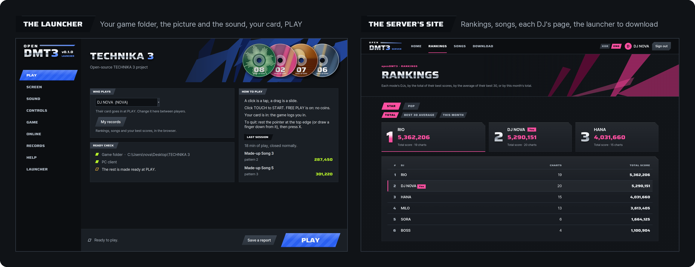
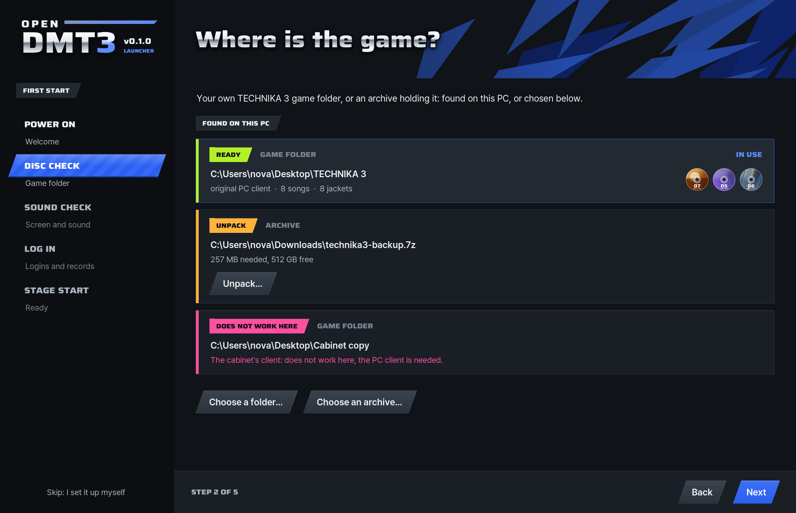

<p align="center">
  <picture>
    <source media="(prefers-color-scheme: dark)" srcset="docs/images/logo-dark.svg">
    
  </picture>
</p>

<p align="center">
  <b>An open-source launcher and server for DJMAX TECHNIKA 3, on your own PC.</b><br>
  It plays your own game folder as it is, with card logins, records, rankings and a site for the players.
</p>

<p align="center">
  <a href="https://github.com/kanggu12/openDMT3/actions/workflows/ci.yml"></a>
  <a href="https://github.com/kanggu12/openDMT3/releases/latest"></a>
  <a href="LICENSE"></a>
  <a href="#what-it-runs-on"></a>
</p>

<p align="center">
  <a href="#quick-start">Quick start</a> &nbsp;|&nbsp;
  <a href="#what-it-does">What it does</a> &nbsp;|&nbsp;
  <a href="#guides">Guides</a> &nbsp;|&nbsp;
  <a href="#open-source">Open source</a>
</p>

<p align="center">
  
</p>

**DJMAX TECHNIKA 3** is an arcade rhythm game of 2011: a cabinet with a touch screen, coins for each play, and an ID
card that logged a player in to the game's online service, which kept their records and rankings. openDMT3 is an
open-source project that plays your own copy of the game on a Windows PC: a mouse or a touch
screen in place of the cabinet's, FREE PLAY in place of coins, a card the launcher puts in for you, and a server of
your own in place of the service.

> [!IMPORTANT]
> **No game files are included.** You need your own copy of the TECHNIKA 3 game folder, with a client that runs on a
> PC. Please use only files you have the right to use. openDMT3 is an unofficial, non-commercial project, not
> affiliated with or endorsed by NEOWIZ.

## Quick start

You need your own TECHNIKA 3 game folder, with a client that runs on a PC: a folder, or an archive to unpack
([what it has to be](docs/game-files.md)). The launcher finds your game folders and archives on this PC, says what
each one is, and only reads them.

<p align="center">
  
</p>

**To play, on Windows 10 or 11**, in Windows PowerShell:

```powershell
cd ~
curl.exe -LO https://github.com/kanggu12/openDMT3/releases/latest/download/openDMT3-win-Setup.exe
.\openDMT3-win-Setup.exe
```

If Windows says it protected your PC, choose **More info**, then **Run anyway**: the installer is not signed. Then
choose **Install**: the launcher opens, and its first-start guide takes five steps to **PLAY**.

**A server with Docker** (Linux, macOS, or Windows in WSL 2):

```sh
git clone https://github.com/kanggu12/openDMT3.git
cd openDMT3
./dmt3 setup
```

A wizard in the terminal asks one question a page, and ends with the site's address and the admin's password.
`./dmt3` alone lists the other commands.

**A server with Python 3.10 or newer** (Linux; on Debian and Ubuntu, with the `python3-venv` package):

```sh
git clone https://github.com/kanggu12/openDMT3.git
cd openDMT3
python3 -m venv .venv
.venv/bin/pip install starlette==0.47.3 jinja2==3.1.6 uvicorn==0.35.0 python-multipart==0.0.20 pillow==11.3.0
.venv/bin/python -m opendmt3.server --data data --host 0.0.0.0
```

The server prints the site's address; opened on that PC, its first page makes the owner's account.

[Playing on your PC](docs/install.md) and [Running a server](docs/server.md) go step by step.

### What it runs on

| | Minimum | Recommended |
| :--- | :--- | :--- |
| **To play** | 64-bit Windows 10 or 11 on an x64 processor (Intel or AMD), a graphics card with Direct3D 9 (NVIDIA, AMD or Intel), a mouse, and your game folder (about 38 GB whole) | Shader model 3.0 on the graphics card for the picture's passes, and a touch screen to play as on the cabinet |
| **The launcher** | About 43 MB to download; installed for your Windows user only, without administrator rights | |
| **A server** | Docker on Linux, on macOS, or on Windows in WSL 2; or Python 3.10 or newer on Linux; ports 4725 (the game) and 4730 (the site) open to the players' PCs | About 100 MB of memory for 64 cabinets |
| **On a server** | The song list alone, about 13 MB: no charts, music or videos | |

Nothing in openDMT3 is written for one maker's graphics card: the picture's passes, AMD's FSR 1 and NVIDIA's NIS
among them, are shaders that any card with shader model 3.0 runs, and a card without it gets Direct3D's own scaling.
Measured on the test PC (Ryzen 9 9950X, RTX 4090) with the card held at its resting 225 MHz: the passes take 0.1 to
0.9 ms of the 16.7 ms a frame has at 1080p and 0.3 to 1.9 ms at 4K, openDMT3's defaults about 0.4 ms at 1080p, and
when frames come late anyway the passes step down by themselves. A server with 64 cabinets and 20 visitors on a history
of 300,000 plays held 91 MB of memory. Tested on that PC under Wine, on its graphics card through WSL's Direct3D 12 and
on Mesa's software renderer; not yet on an AMD or Intel graphics card.

## What it does

- **Plays your game folder as it is.** It only reads the game folder. What the game needs on a PC is made in a folder
  of openDMT3's own: a copy of the client that fills the screen at any Windows scaling and reads the mouse in place,
  FREE PLAY, the patterns the cabinet hid, the server address.
- **A picture and a sound for your PC.** Frame pacing locked to the music, the game's own 5:3 shape kept on any
  screen, upscale filters (AMD FSR 1, NVIDIA NIS) and anti-aliasing with a safety net that keeps 60 frames a second,
  an FPS chip, and the sound device chosen on **Sound**.
- **In the game.** A bar at the top edge with a menu and an X that asks first, the game held still while they are
  open, and a pointer of its own. No key of the keyboard brings them.
- **Logs in by card, without a reader.** The PC client logs players in only by card. openDMT3 gives the game a card
  reader library of its own in place of the cabinet's, which reads a card number the launcher writes, so the game logs
  in the player you picked.
- **Records.** The stages each player clears, on the launcher's **Records** page and on the site: rankings per mode,
  a board per chart, each DJ's page with the last 12 weeks. In the game, the song select shows each player's best
  and the server's first place.
- **The DJ card.** A level from the stages cleared, and an icon, a plate, a plate pattern and a comment each player
  chooses on the site, from the pictures in the game's own files.
- **A site for the players.** Rankings, songs, DJ pages, the launcher's installer set up for that server, admin pages
  with backups, and an API for all of it, in English and Korean.
- **Plays with others.** On someone's server, or on one PC opened to the other PCs on its network.
- **Works without internet.** On this PC, or with a server on a closed network
  ([without internet](docs/server.md#without-internet)).
- **Updates itself.** Only with packages the openDMT3 project signed, and only what changed when a release has a
  delta from the version installed.
- **Says what is wrong**, in English or Korean, with a ready check before PLAY and a report for an issue.

### Where things stand

Works: the launcher with its guide and pages, the installer and its updates, the connection to the game (NET), card
logins with the DJ card, the stages a player clears (song, pattern, score) and the song select's records, the site
with its rankings, song and DJ pages and its admin pages, and the server in Docker. It is checked with the game's own
PC client under Wine, from the installer to a whole song, on one PC and across two machines.

Not yet: the rank and max combo of each stage, missions and crews, and two-finger touch.

## How it fits together

<p align="center">
  <picture>
    <source media="(prefers-color-scheme: dark)" srcset="docs/images/pieces-dark.svg">
    
  </picture>
</p>

There are three ways to play, chosen on the launcher's **Online** page or in its first-start guide:

| Way | Logins and records | What you need |
| :--- | :--- | :--- |
| **On this PC** | A server inside the launcher keeps them in one file on this PC | Nothing else |
| **Another server** | The server someone runs keeps them | Its address, and an ID and password from its owner |
| **Offline** | None: everyone plays with **NO ID CARD** | Nothing else |

The launcher, the server and the card reader library are openDMT3's own code ([architecture](docs/architecture.md)).
Accounts, plays and backups stay in one folder on the PC that runs the server.

## Guides

| Guide | What it covers |
| :--- | :--- |
| [Playing on your PC](docs/install.md) | The installer, the first start, the pages, the picture and the sound, records, updates, the command line |
| [The game's files](docs/game-files.md) | What the game folder has to be, each card's line with the one thing to do, what a server takes |
| [Running a server](docs/server.md) | Docker or Python, players, the site and the admin pages, backups, the internet, without internet |
| [The API](docs/api.md) | Everything the site shows and does, as JSON |
| [Troubleshooting](docs/troubleshooting.md) | When something does not work |
| [License and notice](docs/notice.md) | What the project is, its license, the third-party parts |
| [Architecture](docs/architecture.md), [Protocol](docs/protocol.md), [Testing](docs/testing.md) | How it is built and checked, and what the game and its server say to each other |

## Open source

openDMT3 is MIT licensed and built in the open: its own launcher, game server, site, card reader library and in-game
layer, with every change checked by the tests in this repository.

- **Report a bug or ask for a feature** in [Issues](https://github.com/kanggu12/openDMT3/issues/new/choose).
- **Change the code.** None of the game's files are needed: the tests make stand-ins of their own.
  [CONTRIBUTING.md](CONTRIBUTING.md) has a map of the code and how a change goes in.
- **See what changed** in [CHANGELOG.md](CHANGELOG.md), and report security problems through
  [SECURITY.md](.github/SECURITY.md). The [code of conduct](.github/CODE_OF_CONDUCT.md) applies in the issues and the
  pull requests.

## Credits and license

The launcher and the site follow the look of TECHNIKA 3's own screens, drawn in code, in DMT3 Wide (a cut of Saira)
and Pretendard. The picture's passes are AMD FidelityFX Super Resolution 1, NVIDIA Image Scaling, SMAA and FXAA;
the installer and its updates are Velopack's; archives are opened with 7-Zip.

openDMT3's own code and documentation are under the MIT License ([LICENSE](LICENSE)); the parts it brings with it are
listed in [the notice](docs/notice.md#license). The license does not cover the game or its files, which are not in
this repository. DJMAX and TECHNIKA are trademarks of NEOWIZ. If a rights holder asks through the issues, the
repository will promptly be made private or taken down, in whole or in part ([notice](docs/notice.md)).
