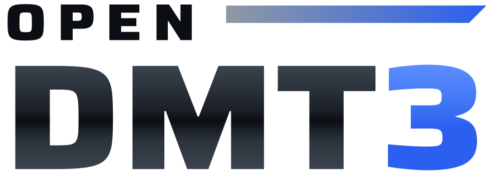
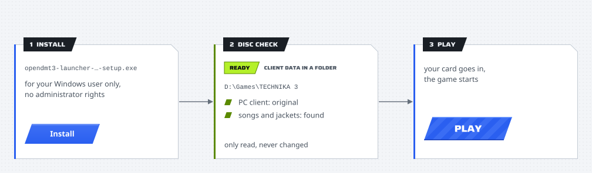
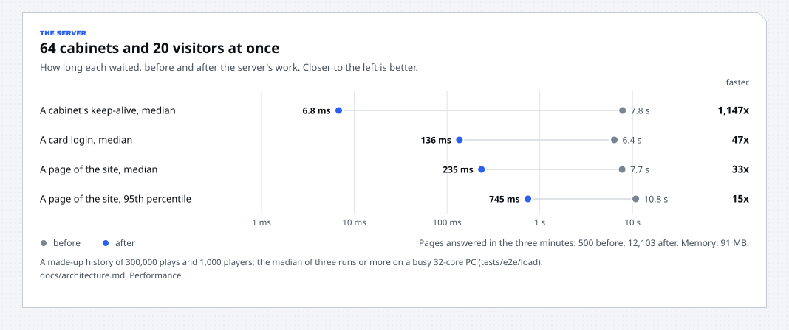
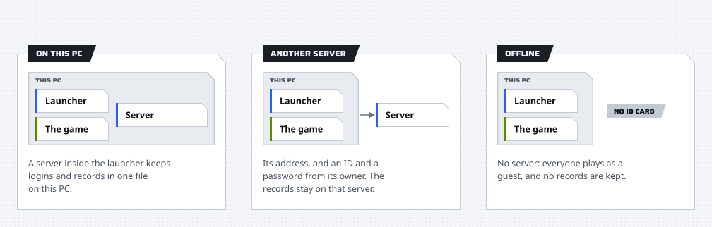

<p align="center">
  <picture>
    <source media="(prefers-color-scheme: dark)" srcset="docs/images/logo-dark.svg">
    
  </picture>
</p>

<p align="center">
  <b>An open-source launcher and server for DJMAX TECHNIKA 3, on your own PC.</b><br>
  It plays the game from your own client data as it is, with an overlay in the game, card logins, records, rankings
  and a site for the players.
</p>

<p align="center">
  <a href="https://github.com/kanggu12/openDMT3/actions/workflows/ci.yml"></a>
  <a href="https://github.com/kanggu12/openDMT3/releases/latest"></a>
  <a href="LICENSE"></a>
  <a href="#what-it-runs-on"></a>
</p>

<p align="center">
  <a href="#quick-start">Quick start</a> &nbsp;|&nbsp;
  <a href="#what-it-does">What it does</a> &nbsp;|&nbsp;
  <a href="#how-it-works">How it works</a> &nbsp;|&nbsp;
  <a href="#guides">Guides</a> &nbsp;|&nbsp;
  <a href="#contributing">Contributing</a>
</p>

<p align="center">
  
</p>

**DJMAX TECHNIKA 3** is a touch-screen arcade rhythm game of 2011. openDMT3 plays your own copy of it on a Windows
PC: a mouse or a touch screen in place of the cabinet's, FREE PLAY in place of coins, a card the launcher puts in for
you, and a server of your own in place of the game's online service.

> [!IMPORTANT]
> **No game files are included.** You need your own copy of the TECHNIKA 3 client data, with a client that runs on a
> PC. Please use only files you have the right to use. openDMT3 is an unofficial, non-commercial project, not
> affiliated with or endorsed by NEOWIZ.

## Quick start

### Play on your PC

On Windows 10 or 11, with your own client data ([which](docs/client-data.md#which-client-data)):

1. Download and run
   **[opendmt3-launcher-0.4.2-windows-x64-installer.exe](https://github.com/kanggu12/openDMT3/releases/download/v0.4.2/opendmt3-launcher-0.4.2-windows-x64-installer.exe)**,
   then choose **Install**. If Windows says it protected your PC: **More info**, then **Run anyway**.
2. The launcher finds your client data. Press **PLAY**.

On Linux the installer runs under Wine ([how](docs/install.md#on-linux-with-wine)). The rest is in
[the player's guide](docs/install.md).

<p align="center">
  <picture>
    <source media="(prefers-color-scheme: dark)" srcset="docs/images/steps-dark.svg">
    
  </picture>
</p>

### Run a server

On a PC of its own, with no Docker or Python, one line installs the server for your user and starts it. On Linux (on a
Mac, the same with `-macos-installer.sh`), it asks for the owner's account first:

```sh
curl -fsSL https://github.com/kanggu12/openDMT3/releases/download/v0.4.2/opendmt3-server-0.4.2-linux-installer.sh | sh
```

On Windows, in PowerShell, the browser opens the page that makes the owner's account:

```powershell
irm https://github.com/kanggu12/openDMT3/releases/download/v0.4.2/opendmt3-server-0.4.2-windows-installer.ps1 | iex
```

With Docker (Compose v2 and Python 3), a wizard sets up the published image:

```sh
git clone https://github.com/kanggu12/openDMT3.git && cd openDMT3
./dmt3 setup
```

On Kubernetes, the release's Helm chart:

```sh
helm install dmt3 https://github.com/kanggu12/openDMT3/releases/download/v0.4.2/opendmt3-server-0.4.2-helm-chart.tgz \
  -n opendmt3 --create-namespace --set admin.enabled=true --set admin.password=CHANGE1234
```

[The server guide](docs/server.md) has the rest: the song list, the players' accounts, the firewall, and the launcher's
own server for the PCs on one network.

## What it does

- **Plays your client data as it is**, only reading it, with the screen filled at any Windows scaling, FREE PLAY and
  the patterns the cabinet hid.
- **Logs in by card without a reader**: openDMT3's own card reader library hands the game the player you picked.
- **Records, rankings and the DJ card** on the launcher and on the site, and each player's best in the song select.
- **A site for the players** with songs, rankings, DJ pages, the launcher's installer and admin pages, and an API for
  all of it, in English and Korean.
- **Plays with others**: on someone's server, on one PC opened to its network, or without internet.
- **Updates itself** with signed packages, and says what is wrong in plain words, with a ready check before PLAY.

### In the game

The overlay bar comes down from the game's top edge or a tap on its handle: the menu (with the sound panel's volumes and
equalizer), minimise, window and an X that asks first. During a song an open panel holds the game still.

<p align="center">
  
</p>

### Frames on time, and on the music

The game runs its logic once a frame, so openDMT3 holds the frames to 60.0 a second and, during a song, to the song's
music. Each frame starts just in time, so a touch reaches the screen sooner (1.7 ms under Wine,
[measured](docs/testing.md#a-song-each-frame-started-just-in-time-before-and-after)), and on a 60 Hz display a song
catches up after a stall.

<p align="center">
  <picture>
    <source media="(prefers-color-scheme: dark)" srcset="docs/images/chart-pacing-dark.svg">
    
  </picture>
</p>

The picture is enlarged with AMD FSR 1, NVIDIA NIS or Anime4K, with FXAA or SMAA if you want them, and steps down by
itself when frames come late. The sound goes in Windows' shortest steps, or through OpenAL Soft on a shorter way
([the picture and the sound](docs/install.md#frame-pacing-the-picture-the-fps-counter-and-the-sound-device)).

### A server for many cabinets

One process answers the cabinets, the site and the API at once, and none of them holds up the others
([many players at once](docs/server.md#many-players-at-once)).

<p align="center">
  <picture>
    <source media="(prefers-color-scheme: dark)" srcset="docs/images/chart-server-dark.svg">
    
  </picture>
</p>

**Not yet:** the rank and max combo of each stage, and missions and crews. Every finger on a touch screen plays, but
no real touch screen has tried it yet. Motion clarity and the flip model are experiments, off by default.

## How it works

The game runs on your PC from your client data, which stays as it is. Logins and records live on a server: the one in
the launcher, someone else's, or none. The launcher talks to the server over HTTP, the game over its own protocol.

<p align="center">
  <picture>
    <source media="(prefers-color-scheme: dark)" srcset="docs/images/system-dark.svg">
    
  </picture>
</p>

Choose how you play on the launcher's **Online** page:

<p align="center">
  <picture>
    <source media="(prefers-color-scheme: dark)" srcset="docs/images/ways-to-play-dark.svg">
    
  </picture>
</p>

## What it runs on

- **To play:** 64-bit Windows 10 or 11 (or Linux with Wine 11), a Direct3D 9 graphics card (NVIDIA, AMD or Intel;
  tested on NVIDIA), a mouse or a touch screen, and your client data (about 38 GB). The launcher is about 43 MB, installed without administrator
  rights.
- **A server:** the launcher, Docker, or Python 3.10 or newer, with ports 4725 (the game) and 4730 (the site) open to
  the players' PCs. It needs only the song list from the client data, about 13 MB. It held about 100 MB of memory
  with 64 cabinets and 20 visitors at once; its site works on two threads, and reading a song list uses up to eight
  cores.

## Guides

- **Players:** [Playing on your PC](docs/install.md), [The client data](docs/client-data.md),
  [Troubleshooting](docs/troubleshooting.md)
- **Server owners:** [Running a server](docs/server.md), [Playing from outside your home](docs/internet.md),
  [A closed network](docs/closed-network.md), [On Kubernetes](docs/kubernetes.md), [The API](docs/api.md)
- **Everyone:** [Questions and answers](docs/faq.md), [License and notice](docs/notice.md)

## Contributing

[CONTRIBUTING.md](CONTRIBUTING.md) has where the code is, how to run it and its tests with no game files, and how a
change goes in. Bug reports and ideas go to [Issues](https://github.com/kanggu12/openDMT3/issues/new/choose); see what
changed in [CHANGELOG.md](CHANGELOG.md), and report security problems as [SECURITY.md](.github/SECURITY.md) says.

## License

MIT ([LICENSE](LICENSE)). The libraries, filters, fonts and programs openDMT3 brings are listed with their licenses in
[THIRD_PARTY_NOTICES.md](docs/THIRD_PARTY_NOTICES.md).

The license does not cover the game or its files. DJMAX and TECHNIKA are trademarks of NEOWIZ.
This repository contains no game data. If the copyright holder requests it, this project may be made private or shut
down. [The notice](docs/notice.md#for-rights-holders) says how to ask.
