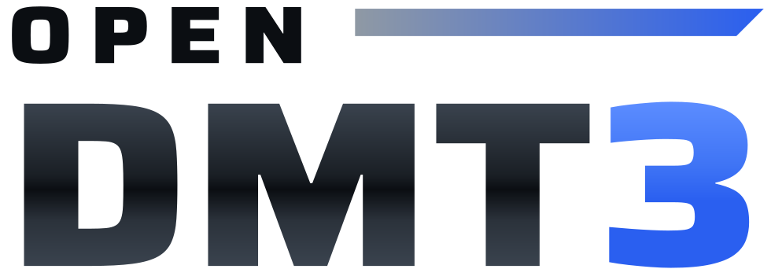
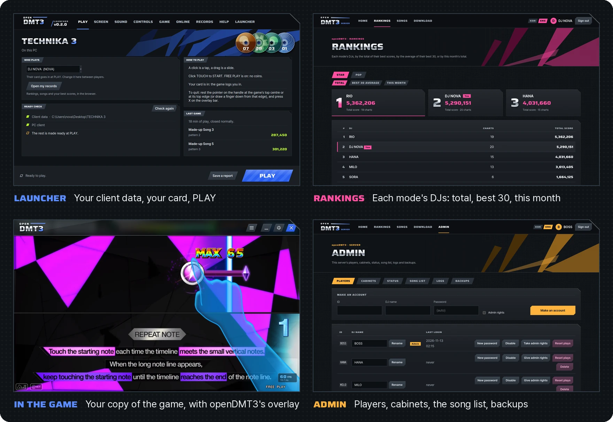
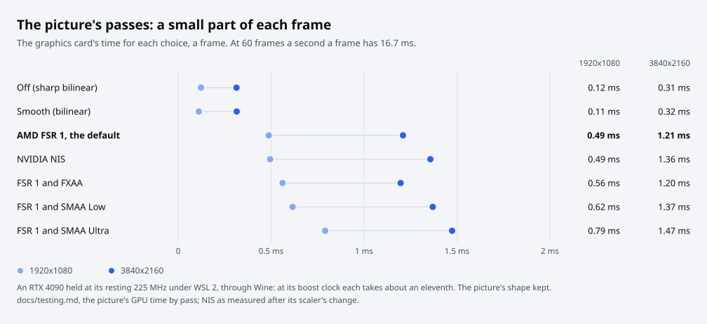

<p align="center">
  <picture>
    <source media="(prefers-color-scheme: dark)" srcset="docs/images/logo-dark.svg">
    
  </picture>
</p>

<p align="center">
  <b>An open-source launcher and server for DJMAX TECHNIKA 3, on your own PC.</b><br>
  It plays the game from your own client data as it is, with card logins, records, rankings and a site for the
  players.
</p>

<p align="center">
  <a href="https://github.com/kanggu12/openDMT3/actions/workflows/ci.yml"></a>
  <a href="https://github.com/kanggu12/openDMT3/releases/latest"></a>
  <a href="LICENSE"></a>
  <a href="#what-it-runs-on"></a>
</p>

<p align="center">
  <a href="#quick-start">Quick start</a> &nbsp;|&nbsp;
  <a href="#what-it-does">What it does</a> &nbsp;|&nbsp;
  <a href="#how-it-works">How it works</a> &nbsp;|&nbsp;
  <a href="#guides">Guides</a> &nbsp;|&nbsp;
  <a href="#contributing">Contributing</a>
</p>

<p align="center">
  
</p>

**DJMAX TECHNIKA 3** is an arcade rhythm game of 2011: a cabinet with a touch screen, coins for each play, and an ID
card that logged a player in to the game's online service, which kept their records and rankings. openDMT3 is an
open-source project that plays your own copy of the game on a Windows PC: a mouse or a touch screen in place of the
cabinet's, FREE PLAY in place of coins, a card the launcher puts in for you, and a server of your own in place of the
service.

> [!IMPORTANT]
> **No game files are included.** You need your own copy of the TECHNIKA 3 client data, with a client that runs on a
> PC. Please use only files you have the right to use. openDMT3 is an unofficial, non-commercial project, not
> affiliated with or endorsed by NEOWIZ.

## Quick start

Two ways to begin, each complete on its own: playing on your PC, and running a server for players on their own PCs.

<table>
<tr>
<th width="50%" align="left">Play on your PC</th>
<th width="50%" align="left">Run a server</th>
</tr>
<tr>
<td valign="top">

On Windows 10 or 11, with your own client data ([which](docs/client-data.md#which-client-data)):

1. Download **[openDMT3-win-Setup.exe](https://github.com/kanggu12/openDMT3/releases/latest/download/openDMT3-win-Setup.exe)**
   and run it.
2. Choose **Install**. The launcher opens on its first-start guide, which finds your client data and takes you to
   **PLAY**.

Downloaded with a browser, the installer may make Windows say it protected your PC: **More info**, then **Run anyway**
(it is not signed). On Linux, the same installer runs under Wine ([how](docs/install.md#on-linux-with-wine)).

**[The player's guide](docs/install.md)**

</td>
<td valign="top">

On Linux, macOS or Windows in WSL 2: Docker with Compose v2, git, Python 3, and your client data for the song list.
In a terminal:

```sh
git clone https://github.com/kanggu12/openDMT3
cd openDMT3
./dmt3 setup
```

A wizard in the terminal asks where your client data is and which installer to hand out (an
`openDMT3-win-Setup.exe` you downloaded), then ends with the site's address and the admin's password. A server also
runs [in the launcher](docs/server.md#in-the-launcher) or [with Python](docs/server.md#with-python).

**[The server guide](docs/server.md)**

</td>
</tr>
</table>

<p align="center">
  <picture>
    <source media="(prefers-color-scheme: dark)" srcset="docs/images/steps-dark.svg">
    
  </picture>
</p>

## What it does

<p align="center">
  
</p>

- **Plays your client data as it is.** It only reads the client data. What the game needs on a PC is made in a
  folder of openDMT3's own: a copy of the client that fills the screen at any Windows scaling and reads the mouse in
  place, FREE PLAY, the patterns the cabinet hid, the server address.
- **In the game.** A bar at the top edge with a menu and an X that asks first, the game held still while they are
  open, a toast when there is something to say, an FPS chip if you want one, and a pointer of its own. They keep to
  the top band and the corners, never where the notes come, and no key of the keyboard brings them.
- **A picture and a sound for your PC.** Frame pacing locked to the music, each frame started just in time so a
  touch shows sooner, the game's own 5:3 shape kept on any screen, the game drawn at its own 1280x768 or at the
  screen's size, upscale filters (AMD FSR 1, NVIDIA NIS, Anime4K) and anti-aliasing (FXAA, SMAA) with a safety net
  that keeps 60 frames a second. On **Sound**, the device, Windows' sound engine in its shortest steps, OpenAL Soft
  as the mixer if you choose it, and an offset for headphones or a TV that play late.
- **Logs in by card, without a reader.** The PC client logs players in only by card. openDMT3 gives the game a card
  reader library of its own in place of the cabinet's, which reads a card number the launcher writes, so the game logs
  in the player you picked.
- **Records.** The stages each player clears, on the launcher's **Records** page and on the site: rankings per mode,
  a board per chart, each DJ's page with the last 12 weeks. In the game, the song select shows each player's best
  and the server's first place.
- **The DJ card.** A level from the stages cleared, and an icon, a plate, a plate pattern and a comment each player
  chooses on the site, from the pictures in the game's own files.
- **A site for the players.** Rankings, songs, DJ pages, the launcher's installer set up for that server, admin pages
  with backups, and an API for all of it, in English and Korean.
- **Plays with others.** On someone's server, or on one PC opened to the other PCs on its network.
- **Works without internet.** On this PC, or with a server on a closed network
  ([without internet](docs/server.md#without-internet)).
- **Updates itself.** Only with packages the openDMT3 project signed, and only what changed when a release has a
  delta from the version installed.
- **Says what is wrong**, in English or Korean, with a ready check before PLAY and a report for an issue.

### Frames on time, and on the music

The game runs its logic once a frame, so a frame late is a game slower than its music. openDMT3 holds the frames to
60.0 a second with a clock of its own, and while a song plays it follows the song's music, so the notes stay on it.
Each frame also starts just in time for its turn rather than right after the frame before, so the touch it carries
is read as late as it can be and reaches the screen sooner: under Wine at 1280x768, 1.7 ms less from the game's read
of a touch to its frame done, with the same pacing
([measured](docs/testing.md#a-song-each-frame-started-just-in-time-before-and-after)).

<p align="center">
  <picture>
    <source media="(prefers-color-scheme: dark)" srcset="docs/images/chart-pacing-dark.svg">
    
  </picture>
</p>

### The picture's passes

The game draws 1280x768. openDMT3 enlarges it to your screen with AMD FSR 1 by default, or NVIDIA NIS, or Anime4K's
small neural network made for drawn art, or bilinear, with FXAA or SMAA before it if you want them; or it has the
game draw at the screen's size, with nothing left to enlarge. Seven of the game's own frames, made smaller and
enlarged back, came closest to themselves with Anime4K, then with FSR 1 ([measured](docs/testing.md#anime4k)).
Nothing is written for one maker's graphics card: the passes are shaders that any card with shader model 3.0 runs,
and when frames come late anyway they step down by themselves.

<p align="center">
  <picture>
    <source media="(prefers-color-scheme: dark)" srcset="docs/images/chart-passes-dark.svg">
    
  </picture>
</p>

### Sound with less delay

While the game runs, Windows mixes its sound device in the shortest steps the device's driver allows: 2.7 ms with
Windows' own audio driver, where 10 ms is usual ([how](docs/architecture.md#the-sound-engines-period)). The game's sounds can also be
mixed by OpenAL Soft through DSOAL, on a shorter way to the device: under Wine, from a sound's start to its sound
out, 12 to 16 ms against DirectSound's 44 ([measured](docs/architecture.md#the-mixer)). For headphones or a TV that
play late, an audio offset holds a song's notes and their judging behind its music.

### A server for many cabinets

One process answers the cabinets, the site's visitors and the API at once, and none of them can hold up the others:
the game's links never wait for a page, the lists made from everyone's plays are kept until the plays change, and
each caller has a fair share ([many players at once](docs/server.md#many-players-at-once)).

<p align="center">
  <picture>
    <source media="(prefers-color-scheme: dark)" srcset="docs/images/chart-server-dark.svg">
    
  </picture>
</p>

### Where things stand

Works: the launcher with its guide and pages, the installer and its updates, the connection to the game (NET), card
logins with the DJ card, the stages a player clears (song, pattern, score) and the song select's records, the site
with its rankings, song and DJ pages and its admin pages, and the server in Docker. It is checked with the game's own
PC client under Wine, from the installer to a whole song, on one PC and across two machines.

Experiments, off by default: motion clarity on a display at 120, 180 or 240 Hz (each frame shown as a CRT's rolling
beam or with black frames between, from the Blur Busters CRT beam simulator), and the flip model (Direct3D 9Ex's flip
swap chain, the way to Windows' independent flip and a variable refresh rate). How they look and what they save is
for real displays to say.

Not yet: the rank and max combo of each stage, missions and crews, and two-finger touch.

## How it works

The launcher plays the game on your PC. Logins and records live on a server: the one inside the launcher, someone
else's, or none at all. Choose on the launcher's **Online** page or in its first-start guide:

<p align="center">
  <picture>
    <source media="(prefers-color-scheme: dark)" srcset="docs/images/ways-to-play-dark.svg">
    
  </picture>
</p>

Run a server when others play from their own PCs. It is the same server each way: the game connects on port 4725,
people and launchers on port 4730, and accounts, plays and backups stay in one folder on the PC that runs it.

<p align="center">
  <picture>
    <source media="(prefers-color-scheme: dark)" srcset="docs/images/ways-to-host-dark.svg">
    
  </picture>
</p>

A server takes one thing from the client data: the song list, which holds the jackets and the DJ cards too
([what a server takes](docs/client-data.md#what-a-server-takes)). [Running a server](docs/server.md) has each way step
by step.

## What it runs on

| | Minimum | Recommended |
| :--- | :--- | :--- |
| **To play** | 64-bit Windows 10 or 11, or Linux with Wine 11 ([how](docs/install.md#on-linux-with-wine)), on an x64 processor (Intel or AMD), a graphics card with Direct3D 9 (NVIDIA, AMD or Intel), a mouse, and your client data (about 38 GB whole) | Shader model 3.0 on the graphics card for the picture's passes, and a touch screen to play as on the cabinet |
| **The launcher** | About 43 MB to download; installed for your Windows user only, without administrator rights | |
| **A server** | The launcher, for the PCs on its network; Docker with Compose v2, git and Python 3 on Linux, on macOS, or on Windows in WSL 2; or Python 3.10 or newer on Linux; ports 4725 (the game) and 4730 (the site) open to the players' PCs | About 100 MB of memory for 64 cabinets |
| **On a server** | The song list alone, about 13 MB: no charts, music or videos | |

A card without shader model 3.0 gets Direct3D's own scaling. Tested under Wine, on an NVIDIA graphics card through
WSL's Direct3D 12 and on Mesa's software renderer; not yet on an AMD or Intel graphics card.

## Guides

### For players

| Guide | What it covers |
| :--- | :--- |
| [Playing on your PC](docs/install.md) | The player's guide: the installer on Windows or with Wine, the first start, the three ways to play, the pages, the picture and the sound, records, updates, the command line |
| [The client data](docs/client-data.md) | Which client data plays, the forms it comes in, each card's line with the one thing to do, what a server takes |
| [Troubleshooting](docs/troubleshooting.md) | When something does not work |

### For server owners

| Guide | What it covers |
| :--- | :--- |
| [Running a server](docs/server.md) | The server owner's guide: in the launcher, with Docker or with Python, the song list, players, the site and the admin pages, backups, updates, the internet, without internet |
| [The API](docs/api.md) | Everything the site shows and does, as JSON |

[License and notice](docs/notice.md) says what the project is, its license and the third-party parts, for everyone.

## Contributing

Bug reports, ideas and pull requests are welcome: [Issues](https://github.com/kanggu12/openDMT3/issues/new/choose).
[CONTRIBUTING.md](CONTRIBUTING.md) is the contributors' guide: where the code is, how to run each part and its
tests with no game files, and how a change goes in. [Architecture](docs/architecture.md),
[Protocol](docs/protocol.md) and [Testing](docs/testing.md) go deeper; [CHANGELOG.md](CHANGELOG.md) says what
changed.

## Credits and license

The launcher and the site follow the look of TECHNIKA 3's own screens, drawn in code, in DMT3 Wide (a cut of Saira)
and Pretendard. The picture's passes are AMD FidelityFX Super Resolution 1, NVIDIA Image Scaling, Anime4K, SMAA and
FXAA, and motion clarity's is the Blur Busters CRT beam simulator; the Sound page's OpenAL Soft mixer is DSOAL and
OpenAL Soft; the installer and its updates are Velopack's; archives are opened with 7-Zip.

openDMT3's own code and documentation are under the MIT License ([LICENSE](LICENSE)); the parts it brings with it are
listed in [the notice](docs/notice.md#license). The license does not cover the game or its files, which are not in
this repository. DJMAX and TECHNIKA are trademarks of NEOWIZ. If a rights holder asks through the issues, the
repository will promptly be made private or taken down, in whole or in part ([notice](docs/notice.md)).
