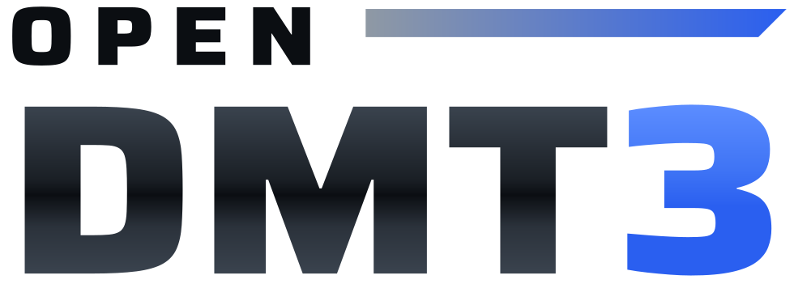

  <picture>
    <source media="(prefers-color-scheme: dark)" srcset="images/logo-dark.svg">
    
  </picture>

# Guides

openDMT3 is a launcher that plays TECHNIKA 3 on a Windows PC and a server that keeps its players' logins and records.
New here? The [README](../README.md#quick-start) has the two ways to begin side by side: playing on your PC, and
running a server for other players' PCs. Each has a guide of its own, and the guides below are grouped by who reads
them.

  <picture>
    <source media="(prefers-color-scheme: dark)" srcset="images/system-dark.svg">
    
  </picture>

## For players

| Guide | For |
| :--- | :--- |
| [Playing on your PC](install.md) | The player's guide: what you need, the installer on Windows or on Linux with Wine, the first start, the three ways to play, the overlay in the game, the pages, frame pacing, the picture's shape and filters, records, the other PCs on your network, the song list for a server, playing without the window, updates, what PLAY makes in openDMT3's own folder, removing it, the command line |
| [The client data](client-data.md) | Which client data plays, where the launcher finds it, the forms it comes in, what each card on DISC CHECK says and the one thing to do, what a server takes, checking from the command line, questions and answers |
| [Troubleshooting](troubleshooting.md) | The installer, finding the game, PLAY, the game closing, the picture, the sound, logins, records, the other PCs, putting everything back |
| [License and notice](notice.md) | What the project is, its license, the third-party parts |

## For server owners

| Guide | For |
| :--- | :--- |
| [Running a server](server.md) | The server owner's guide: what you need, the three ways (in the launcher, with Docker, with Python), the song list, players, the site and the admin pages, DJ cards and the song select, backups, updating the server, handing out updates, a chat webhook, the internet, many players at once, without internet, what to keep private, the command line |
| [What a server takes](client-data.md#what-a-server-takes) | The song list from the client data, and each way it comes in |
| [The API](api.md) | What the site shows and does, as JSON, for scripts and the launcher; named tokens, the OpenAPI document |
| [Troubleshooting a server](troubleshooting.md#the-server) | `./dmt3 doctor`, the owner's first account, the ports and WSL 2, sign-ins held back, the song list |
| [If you run a server](notice.md#if-you-run-a-server) | What a server reads and keeps, and the rights holders' requests |

## For contributors

| Guide | For |
| :--- | :--- |
| [Architecture](architecture.md) | The package and its three parts, the repository and `./dmt3`, the game's files, playing client data that is only read, the in-game overlay, frame pacing, the launcher, the server, the database, performance, security, the build |
| [The game's protocol](protocol.md) | What the game and its server say to each other, as far as it is known |
| [Testing](testing.md) | The suites, the layout checks, the Wine tests on the CPU and on the graphics card, CI, what runs before a release |
| [Test cases](test-cases.md) | Every case, one table per area, with what checks it |
| [Contributing](../CONTRIBUTING.md) | Where the code is, running it and its tests, how a change goes in, releases |
