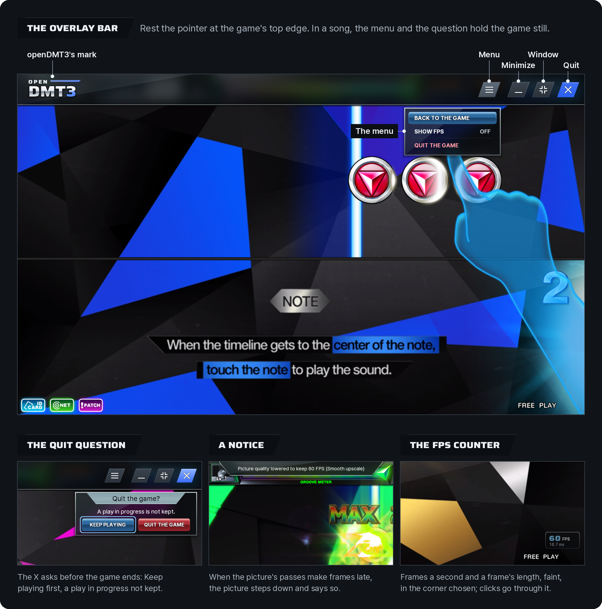
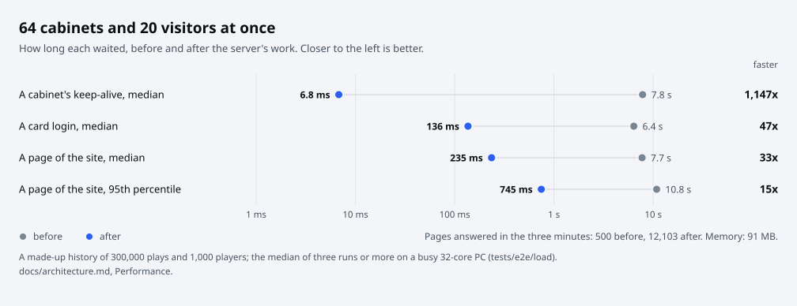

# Architecture

openDMT3 is one Python package, `opendmt3`, in three parts: what every part shares (`core`), the server (`server`,
run in Docker or with Python) and the Windows client (`client`: the launcher and its installer). The command line
for the client data (`python -m opendmt3 check, setup, restore`) is part of `core`.

<p align="center">
  <picture>
    <source media="(prefers-color-scheme: dark)" srcset="images/system-dark.svg">
    
  </picture>
</p>

## The package

```
opendmt3/
  __init__.py        the version, the one place it is written
  __main__.py        python -m opendmt3: the client data's command line (core/cli.py)
  core/              what the server and the client share
  server/            the game server, its services, its database and its site
  client/            the launcher and the installer, for Windows
```

<p align="center">
  <picture>
    <source media="(prefers-color-scheme: dark)" srcset="images/architecture-dark.svg">
    
  </picture>
</p>

The parts depend in one direction: `client` may use `server` and `core`, `server` uses `core`, and `core` uses neither.
`tests/test_architecture.py` reads every module's imports (those inside functions too) and fails when one runs the
other way.

| Part | What it is |
|---|---|
| `core/formats/` | The game's own file formats: the files that hold the others, the settings file, the operator settings, the song lists |
| `core/cabinet/` | What PLAY makes in openDMT3's own folder from the client data it only reads, as steps that each check their part and make it when asked; the display fix of the client; starting the game (through a short path when its folder's cannot be given to it) and following it |
| `core/game.py`, `core/backup.py`, `core/formats/pe.py` | The client data (what its client is, where the files are, each family of the game's files read as the client reads it: the newest of its base and numbered patches that has a file); the originals an earlier openDMT3 kept in it; the libraries a program imports |
| `core/errors.py` | Every error a person reads, with its words in English and Korean |
| `core/signing.py`, `core/preset.py`, `core/safety.py` | The update packages' signature; the server a build is made for; the guard that keeps windows shut under the tests |
| `core/cli.py` | `python -m opendmt3 check, setup, restore` on the client data |
| `server/` (its own modules) | The game server: the connection (handshake, cipher, keep-alive), every message's size, the handlers, and `__main__.py`, which runs it with the site |
| `server/services/` | What the server does without knowing about messages or HTTP: accounts, records, activity, the song list (`catalog.py`, `cards.py`; any form it comes in, `sources.py`; saved into one file and taken in, `songlist.py`; its pictures in one form, `pictures.py`), backups, the chat webhook, a DJ's profile |
| `server/web/` | The site, the admin pages and the API, as one ASGI app beside the game server |
| `server/db/` | One SQLite file, its tables made and upgraded in numbered steps |
| `client/` | The launcher's window and pages (`client/pages/`), and the same jobs without a window (`actions.py`) for the command line |
| `client/installer.py` | The installer's dialogs around Velopack's setup |
| `native/` (repository) | The game's `CRT_R1.dll`, built from C: the card reader and the in-game layer |

The site serves the wide face from the launcher's fonts (`client/assets/fonts/`), which it reads as files; no module of
the server imports the client.

## The repository

| Path | What it is |
|---|---|
| `dmt3` | The front door: the server with Docker Compose (`setup`, `catalog`, `up`, `down`, `restart`, `status`, `logs`, `backup`, `backups`, `restore`, `add-player`, `check`, `doctor`), the Windows build (`build`) and the checks (`test`). Plain Python, nothing to install |
| `compose.yaml` | The server with Docker Compose |
| `opendmt3/` | The package, above |
| `tests/core/`, `tests/server/`, `tests/client/` | Each part's unit tests |
| `tests/e2e/` | The end-to-end suites: `windows/` (the real client under Wine), `ui/` (the launcher's screens), `web/` (the site's screens), `load/`, `upgrade/` |
| `packaging/` | The server's image (`docker/`), the Windows build (`windows/`), the Wine image (`wine/`), the fonts' recipes (`fonts/`), and a release (`release.sh`) |
| `native/` | The game's `CRT_R1.dll` (the card reader and the in-game layer) and its native tests (`test.sh`) |
| `.github/` | CI (`workflows/ci.yml`), a release's checks (`workflows/release.yml`, `release_notes.py`), the issue and pull request forms, the security policy and the code of conduct |

## The game's files

The game keeps its files inside larger files, in families: a base and numbered patches. `core/formats/pak.py` reads
them as the client does. Each one is a header (a seed, then the first entry's offset, the version, the entry count and
a check byte, hidden by the seed's key stream and an XOR chain), then one 0x98-byte descriptor per entry, each
followed by the entry's data in LZO1X chunks. A descriptor holds the entry's seed, the path (hidden by that seed's
key stream) and the two sizes; every fourth byte of it is also XORed with a 256-byte table and with one of 125 key
bytes, picked by a 64-bit field of the descriptor. A family's base and its patches share the key bytes. The first
1,000,000 bytes of each entry are hidden by the entry seed's key stream too.

Nothing of the game is kept in openDMT3:

- **The table** is read from the player's own client, found by its SHA-256 in the client's read-only data.
- **Each key byte** is recovered from the file itself: every path starts with `Resource\`, `pattern\` or `movie`,
  which only the right key byte gives, and the rest of a path is any bytes a Windows file name holds.
- **Korean names.** Some names have Korean letters in the client's code page (cp949: 51 names in 11 of the files of the
  whole client data), and in six files such a name is the first under its key byte; it pins the key byte like any
  other name.
- **Every one of the 92 files** of the whole client data opens with this one scheme. One that no key byte opens is
  another build's: it is left out as not readable (`pak.PakUnreadable`), never called damaged.

The reader is plain Python, so it works in bulk:

- **The key stream.** A word is the float32 bits of a sine or cosine of float32(seed + i); from seed 2^28 on,
  float32 rounds 32 to 512 consecutive values of seed + i alike, so a word is worked out once per run and repeated,
  and below it `array` and `map` work out every word in C loops. The words are added or taken all at once, as 32-bit
  lanes of one big integer. A megabyte took 220 ms one word at a time and takes 5 to 28 ms; every entry of the 92
  files of the whole client data reads the same bytes as before.
- **The key byte search** first tests word 0 of its 256 candidates, whose seeds share three bytes, from one table.
- **A file opened again** takes its listing (the header, the entries, the key bytes) from its first walk while its
  path, size, times and file number are the same.
- **The descriptors** are walked through a window of the file that grows while each read serves several, since on a
  slow drive each read is a round trip (the charts' 56,157 descriptors took 61,683 reads).

Reading also runs on a few threads (`core/parallel.py`) where they wait on the drive:

- **Reading ahead.** A large file's next windows are read ahead on four threads of its own while the walk decodes (a
  drive gives several readers more than one), a family's files are opened together, two threads opening one file wait
  for one walk, and the card's charts check starts with its look and goes on beside the survey.
- **Any thread may read.** `Pak.read` takes an entry's bytes under the file's lock and unpacks them on the caller's
  thread.
- **The song list's pictures** are read on the reading's thread and converted on the server's picture threads
  (`server/services/pictures.py`, `in_order`): reading them on these threads as well came to the same time (2.0 s
  either way as PLAY reads the whole client data, 2.4 s and 2.6 s in the server's image).
- **Threads, not processes**: the Python left is a small part of the work, and a process starts slowly on Windows.
- **Two, not more, for the work that runs Python**: the window's thread waits for Python's lock behind each (the
  PLAY page's header with its discs: 10 ms alone, 24 ms beside two busy threads, 40 ms beside four).

A family is a base (`name.pak`) and numbered patches (`name00.pak`, `name01.pak`, ...). The client opens them in number
order up to the first number missing, and each entry is read from the newest that has it (`core/game.py`, `Layers`).

## Playing client data that is only read

`core/cabinet/steps.py` lists what PLAY makes in openDMT3's own folder (`%AppData%\openDMT3\game`, `steps.Own`) from
the client data, in order: a copy of the client with the libraries it imports from the client data, the card reader
library, the settings file, the operator data with FREE PLAY (taken once: from the client data's `TECHNIKA\` an
earlier openDMT3 kept, else a copy of a cabinet's `drive e\TECHNIKA`, else the client data's `file\`), the hidden
patterns, the server address. Each step checks its part and says whether it is done; the ready check on PLAY is that
list. Then the list `openDMT3-files.txt` beside the card reader library names which of the game's paths are
openDMT3's files.

PLAY starts the client copy from openDMT3's folder with the client data's folder as its current folder. The card reader
library (`native/cardreader/files.c`, `redirect.c`) turns the client's file calls in its import table to its own:
`CreateFileA/W`, `GetFileAttributesA/W`, `CreateDirectoryA/W` and `DeleteFileA` of a path the list names open
openDMT3's file instead, and `GetModuleFileNameA/W` for the client answer a path in the client data's folder. What
was measured under Wine, the client data read only, a whole song each, and what each step does about it:

- The client finds its own folder with `GetModuleFileNameA` and makes it the current folder; answered with the
  client data's folder, its relative paths (`pack\`, `Resource\`, `TECHNIKA\`) stay the client data's.
- Every file of the game goes through the client's own `CreateFileA` (the files that hold the others, opened once and
  kept open), and its crash dumps through `CreateFileW`; nothing of the game's is opened another way.
- Run from another folder, Windows looks in System32 before the current folder: Wine's own D3DX 9 was loaded and the
  game stopped at its first sound. So the client's libraries are copied beside the copy of it.
- Each entry of a family is read from the newest of its files that has it (where the reads landed: of 31 entries in
  more than one file, every one from the newest). A changed entry goes in a copy of that file; a file written as an
  extra patch was not taken by the game.
- Client data at a path outside the ANSI code page (Korean letters on an English Windows) gave the client its own
  path with question marks, and the game stopped reading its settings; one of 280 characters could not be made the
  current folder. The longest path the game opens inside its folder is 64 characters. Such a folder is given to the game
  through its own 8.3 short name when its drive keeps them, else through a junction of openDMT3's
  (`core/cabinet/launch.py`) in a folder of the player's alone (openDMT3's own under `%LocalAppData%`, or one made for
  the PLAY under a random name in a folder every user shares, with access for the player only), checked again right
  before the game starts and taken away when the game ends.
- Without its videos the game plays songs without them; without the file with the tutorial it stops at the tutorial.

Client data an earlier openDMT3 changed (its `backup\` and list) is read through that list: the originals it kept
are what the steps start from, and the list gives them to the game where openDMT3 gives none of its own. **Put back**
restores every one. Removing openDMT3 (`client/leaving.py`) puts every file back the same way, then takes out of
`backup\` the copies the earlier version made itself (marked in its list) and the list. Every way out ends in
Velopack's uninstall, which runs the launcher once as its hook; the hook does that work too, so the app list leaves
the folder as **Help**'s **Uninstall** does.

The same steps run without the launcher, from a copy of this repository, on the client data's folder (or a folder
above it):

| Command | Does |
|---|---|
| `python -m opendmt3 check [CLIENT_DATA] [--to FOLDER]` | Prints the client's build and each step's state |
| `python -m opendmt3 setup [CLIENT_DATA] [--to FOLDER] [--window] [--keep-hidden] [--server HOST:PORT]` | Makes openDMT3's folder for the game in `FOLDER` (default `openDMT3-game`): a framed window, the hidden patterns kept hidden, the server the game connects to; then start `FOLDER\Client (openDMT3).exe` with the client data's folder as the current folder |
| `python -m opendmt3 restore [CLIENT_DATA]` | Puts back every file an earlier openDMT3 changed |

The fixed client is the game's own client with code appended (`core/cabinet/display.py`): a borderless window the size
of the main monitor with the picture stretched, the mouse read in game coordinates, and the program marked large-address
aware. openDMT3's card reader library stands in for the cabinet's in every way of playing: the game asks it for a card,
and it reads the number the launcher wrote in `openDMT3-card.txt` beside it (offline there is none, and the game plays
with NO ID CARD). It is also openDMT3's in-game layer, below.

## The in-game layer

The game loads `CRT_R1.dll` by name before its own code runs, so openDMT3's library (`native/cardreader/`, 32-bit C
built with MinGW) lives inside the game's process. Its `DllMain` reads the launcher's choices from the environment
PLAY starts the game with (`OPENDMT3_LANGUAGE`, `OPENDMT3_CURSOR`, `OPENDMT3_PACING`, `OPENDMT3_FPS`,
`OPENDMT3_FPS_POSITION`, `OPENDMT3_SOUND_DEVICE`, `OPENDMT3_UPSCALE`, `OPENDMT3_SHARPNESS`, `OPENDMT3_ANTIALIASING`,
`OPENDMT3_PICTURE_SHAPE`, `OPENDMT3_PASS_TIMES`, `OPENDMT3_LOW_LATENCY`, from `core/cabinet/values.py`
`layer_environment`) and turns four of
the game's imports to its own: the slots of the game's import table that hold the real functions get ours, which call
the real ones.

<p align="center">
  <picture>
    <source media="(prefers-color-scheme: dark)" srcset="images/inside-game-dark.svg">
    
  </picture>
</p>

| File | What it does |
| :--- | :--- |
| `crt_r1.c` | The card reader's ten exports, and `DllMain`, which starts the rest |
| `files.c`, `redirect.c` | The client's file calls turned to openDMT3's: the list beside the library read once (`redirect.c`, plain C the native tests run), each path the game opens matched against it without letter case, openDMT3's file opened in its place with the wide call; the client told it runs from the client data's folder. `OPENDMT3_FILES_TRACE` (measuring only) writes every call, and every read of one of the game's files with its place, into the in-game log |
| `hooks.c` | The four imports turned to openDMT3's: `DirectSoundCreate8` (and `DirectSoundCreate`), `Direct3DCreate9`, `GetKeyboardState` and `GetCursorPos` ([the four hooks](#the-four-hooks)) |
| `layer.c` | The layer's state and its input: the bar and its chips, the menu and the question, the toast, the mark and the frame rate chip ([the layer's parts and their input](#the-layers-parts-and-their-input)) |
| `text.c` | The layer's words: GDI text in Pretendard Bold and Regular and DMT3 Wide, which the setup puts beside the DLL and the layer loads for the game's process only, kept once drawn so a panel drawn again costs no GDI work |
| `post.c` | The post-process chain over the game's picture, and the layer drawn in it ([the picture's chain](#the-pictures-chain), [the layer in the chain](#the-layer-in-the-chain)) |
| `postmath.c` | The chain's plan and numbers with no Windows calls: which passes a choice runs, FSR 1's EASU and RCAS constants (as `FsrEasuCon` and `FsrRcasCon` work them out), NIS's (as `NVScalerUpdateConfig`), NIS's filter banks, the back buffer's size |
| `passtimes.c` | The picture's GPU time by pass (`OPENDMT3_PASS_TIMES=on`): each step's time a frame, kept over a stretch of frames and said as its median, with no Windows calls |
| `shaders/post.hlsl`, `shaders/smaa.hlsl` | The passes, shader model 3.0: nearest, bilinear, EASU's lengths (once a game texel) and EASU, RCAS, NIS's edge map and its scaler's two passes (the column sums, then across), FXAA, and SMAA's three passes around `third_party/smaa/SMAA.hlsl` |
| `third_party/` | SMAA's shader and its precomputed area and search textures (MIT), and the license texts of AMD FSR 1 and NVIDIA NIS (MIT) and the FXAA 3.11 notice, whose algorithms the shaders follow |
| `engine.c` | Windows' shared sound engine at the shortest period the game's output offers while the game runs ([the sound engine's period](#the-sound-engines-period)) |
| `sound.c` | Which of the game's DirectSound buffers plays and how far, its copies of them too (for the music lock and the hold: the song's music is one buffer of minutes, played once; its key sounds are copies of short buffers), and the hold's fade, stop and start again. With `OPENDMT3_SOUND_WATCH` set (the Wine tests only), also the streams watched: when each plays against the frame count, and underruns, seen as a 20 ms block about to play that holds what it held a lap earlier (the game writes its music through one Lock a buffer, so its writes cannot be counted) |
| `look.c`, `paint.c`, `logic.c` | The pictures (anti-aliased polygons after the game's own panels: its dialogs' title tab and metal frame, its notice's glass, its glossy buttons; the bar's chips in the launcher's leaning button shape) and the decisions (the settings, the frame clock, the keys the game may see, the panels' answers and keys, the layout, when a rest may bring the bar), with no Windows calls |
| `mark.py` | The product's mark for the bar, drawn by the launcher's own code (`opendmt3/client/art.py` logo) when the DLL is built and carried in it as a resource: the bar shows the launcher's picture of the mark, never letters set in its face |
| `trace.c` | With `OPENDMT3_INGAME_TRACE` set, how the game draws (its device, its draws' vertex formats, transforms, render targets, copies), into the log; never set by the launcher |
| `test_native.c`, `test.sh` | The tests of the files with no Windows calls, built with the same compiler and run under Wine |

### The four hooks

- **`DirectSoundCreate8`** (and `DirectSoundCreate`): the chosen output device by its GUID, Windows' default when
  none is chosen or it does not open; once it is open, the sound engine's shortest period is asked for on that device
  ([below](#the-sound-engines-period)).
- **`Direct3DCreate9`**: its `CreateDevice` gives the game's window to the layer, and the device's `Present` does
  the rest.
  - It counts frames: their length, its spread, the slowest 1 %, and openDMT3's own time in them.
  - With even pacing it holds them to 60.0 a second with a sleep and a short spin on the performance counter, in
    place of the client's own limiter (a jump the PC build's patch section put over the first instruction of the
    game's per-frame function, which is put back as it was). Locked to the music
    ([below](#frame-pacing-and-the-music)), that clock follows a song's music while one plays; with VSync on, its
    ticks are kept in the middle of a display refresh. The game's logic runs once a frame, so 60 a second is its
    speed: its timers count frames.
  - It keeps at most one frame queued: an event query after each present, waited for before the next.
  - The post-process chain's safety net reads each frame's length here.
  - While the menu or the question is open during a song, it holds the game still.
- **`GetKeyboardState`**: the game reads every key and the mouse's buttons with it once a frame, so it sees none of
  those that answer the layer, and never Esc (the game's own Esc ends it at once).
- **`GetCursorPos`**: the display fix's helper reads the pointer with it; the point it is handed is turned so that the
  game gets the pixel under the pointer in the picture as placed ([the picture's chain](#the-pictures-chain)), only
  when the fix's call sites are in the client.

### The layer's parts and their input

<p align="center">
  
</p>

- **The bar** comes when the pointer, moved to the game's very top edge or onto the mark at its top centre with no
  button down, rests there 150 ms and the game has had no press or release for 1.5 s, or when a finger is drawn down
  from the top edge after such a quiet. It comes by itself for 3 s when the game's first screen shows and after each
  switch between a window and full screen. No key brings it.
- **How long it stays**: whole 600 ms after the pointer was last on it (looked for ten times a second), 4 s after a
  finger, then it fades over 300 ms; a press on the game takes it away.
- **Its chips**: the menu, minimise, full screen or back to a window, the X.
- **The menu** (Back to the game, Show FPS, Quit the game) and **the question** (Keep playing, Quit the game; its
  line only while a song plays) drop down under their chips.
- **The toast, the mark and the frame rate chip**, which the menu's Show FPS turns on and off for the run.
- **Motion**: the parts' slides and fades are worked out once a frame, in the frame's own time.
- **The game's window** is subclassed for its mouse, its keys while a panel is up, Esc (kept from the game, which
  would end at once), Alt+F4 (nothing), its close request and command (the question) and Windows' menu mode
  (nothing). In a window its title bar's buttons are taken away and its borders size it. A press on the layer never
  reaches the game.
- **The pointer** is a cursor drawn at the display's scaling.
- **Quitting** posts the game's own close; the game's message loop ends the program (after 10 seconds without that,
  the process ends itself, exit code 0).

### The picture's chain

The game draws 1280x768. Drawing it at the display's size is not done: the game's glow pass sizes its full-screen quad
from the surface's real size in one place and from 1280x768 in another, so at a larger back buffer its background
lands in one corner.

The game's frame, measured call by call: it clears the back buffer, draws its sprites into it (every draw a textured
quad, depth never tested), copies it with `StretchRect` into a 1280x768 render-target texture for its glow, draws the
glow composite back over it and its interface on top. Every choice runs the chain (**Smooth** with no anti-aliasing is
its bilinear pass, the picture as Direct3D's own stretch drew it), since the in-game layer is drawn in it:

- **The device** is made with a back buffer of the window's monitor's size (the window's, if larger), copied rather
  than discarded, with no depth surface of Direct3D's own. The game's back buffer is a 1280x768 render target of the
  chain's (`GetBackBuffer`, `GetRenderTarget` and `SetRenderTarget` 0 are turned to it), with a 1280x768 depth surface
  of the format it asked for, so every size the game knows stays as it was and its own texture and glow are untouched.
- **At each present**, the state is saved in a state block; the frame is the game's back buffer itself (a texture's
  surface, with no samples; resolved from a multisampled target when the game asks for samples); the anti-aliasing
  chosen runs on it at 1280x768; the upscale filter draws it into the real back buffer at the picture's place in the
  window's client; the game's target, depth surface and state are put back; the frame is presented one to one through
  a source rectangle of the client's size, so a window that changes size needs no device reset.
- **The picture's place**: its own 5:3 shape kept, centred, with bars of the launcher's darkest neutral on the two
  other sides (logic.c `picture_rect`; the passes that draw there take its origin, constant c8, off their pixel's
  position), or the whole client with **Fill**.
- **The pointer**: the game reads it with `GetCursorPos` through the display fix's helper, which scales from the
  client's size. Its import is turned to one that hands the helper the point whose sums give the game pixel under the
  pointer in the picture as placed (logic.c `pointer_for_game`), only when the fix's call sites are in the client.
  The layer reads the pointer against the same place and lays its parts out in the picture. A reset of the game's
  releases the chain's objects first and makes them again after it.
- **The filters**: **Off** is sharp bilinear (each game pixel a block of the same width on the screen, the screen pixels
  on its edges mixed by how much of them each covers; nearest alone gave half the game's columns 1 pixel and half 2 at
  1920 across), **Smooth** bilinear, **AMD FSR 1** EASU (its two lengths worked out once a game texel, in a pass at
  1280x768) then RCAS (sharpness 0 to 100 is RCAS's 2 to 0 stops,
  FidelityFX's own mapping), **NVIDIA NIS** its edge map at 1280x768, then its 6-tap scaler with its sharpening in two
  passes: down each of the game's columns for each of the window's rows (the game's width by the window's height, one
  32-bit float), then across those sums at the window's size (NVIDIA's compute shader limits it to 2x for its tiles; as
  a pixel shader the same maths runs at 3x).
- **Anti-aliasing**: FXAA 3.11 Quality (preset 39) or SMAA 1x at its four presets, SMAA's luma edges (its edge pass
  reads the picture with the point filter: it reads whole pixels only).
- **Written from their published sources in floats**: shader model 3.0 has no integer or bit operations, so FSR's
  fast reciprocals, bit tricks in its source, are worked out in floats to the same values. Against those sources'
  maths run in numpy on the same game frames at 3840x2160, bilinear within 1 level, FSR 1 at 71.5 to 75.5 dB PSNR and
  NIS at 60.3 to 60.6 dB (99.9 % of pixels within 1 level for both; a few in 100,000 differ more where a comparison in
  the filter lands the other way).
- **The shaders are compiled** when the device is made by `D3DXCompileShader` from the game's own `d3dx9_40.dll` (one
  of its imports, so it is always in its process; no HLSL compiler exists for this DLL's MinGW build). Its 2008
  compiler takes 20 s over NIS's scaler at its optimisation level 3 for the same instructions it gives at its default
  level in 0.15 s, so the default is used. A shader that does not compile leaves the game as Direct3D's own stretch.
- **The defaults**, chosen on the game's own screens at 3840x2160 (title, mode select, tutorial, song select, a song
  over its video, the result): **AMD FSR 1** at 50 with no anti-aliasing. FSR 1 is sharper than bilinear and puts no
  pixel more than 16 levels past the game's own neighbouring values on chrome and lime (NIS does on 0.6 % to 2.4 % of
  pixels, a dark ring round the notes' chrome, even at 0); RCAS at 50 keeps that, above 75 it starts to halo. The
  game's art is smooth in its textures, so anti-aliasing has little to find: FXAA changes 3 % to 12 % of pixels,
  mostly softening text, SMAA 1 % to 8 %.
- **No MSAA**: the game draws textured quads whose edges are see-through, and its hard edges are inside its textures,
  where samples do not reach. Measured with 8 samples against none on the same song, the static interface (score,
  GUIDE ON, the chrome slants, the card plates) is the same to the pixel; only animated parts differ.
- **DLSS, FSR 2 and later, and XeSS do not apply**: they need the game's motion vectors and depth, and it has
  neither.
- **No texture filtering choice**: measured on the game (`trace.c`), every draw is a textured quad sampled with
  linear minification and magnification, and none of its textures has mip levels, so a LOD bias has nothing to choose
  between. Anisotropic 16x in place of its linear filtering, on the same frames, changed the still parts of the song
  select's picture by more than 2 levels on 24 % of their pixels with no sharper art, and put a seam down a panel's
  edge; it stays the game's own.
- **The cost**: the chain's own CPU time a frame and, where the device measures it (two timestamp queries around its
  passes alone), its GPU time go into the counter's log line (never onto the screen: the chip shows a player the
  frames a second and the frame's length).
- **The safety net**: a frame counts against the chain when it took longer than 16.67 ms with 1 ms to spare and would
  not have without the chain's own GPU time (its timestamp queries; the CPU's time where the device has none), so a
  load or a stall of the game's own never counts, nor do the game's first 10 seconds (its loading).
  - Two windows of 60 frames in a row with 30 such frames each step the chain down for the rest of the run, one step
    each time: SMAA to FXAA (compiled with the chain, so a step never waits for the compiler), FXAA to none, then
    FSR 1 or NIS to bilinear.
  - Each step is logged, shown once for six seconds as the layer's toast at the top of the game, and written to
    `openDMT3-picture.txt` beside the DLL, which the launcher puts in its own log when the game ends and then
    removes.

### The layer in the chain

The layer is drawn by the chain after the upscale, into the real back buffer at the window's own pixels, so its edges
and words are sharp at any size and its motion keeps the game's frame timing; no window of its own lies over the game.

- **A part's picture.** Each part (the bar, the bar's chips, the menu or the question, the toast, the mark, the frame
  rate chip) is a picture made on the CPU (`look.c`, with `text.c`'s words) only when it changes, kept as two dynamic
  textures: what is drawn and where the glass is. They are written whole with a DISCARD lock, which never waits for
  the GPU (a managed texture's lock read the texture back first, 2 ms a chip update on Wine's software renderer).
  Every part's textures are made when the layer first draws at a size (the game's loading, a change of the window, a
  reset), as large as the part gets there, filled and drawn once unseen: none is made while the game plays.
- **The glass.** While the bar, a panel or a toast shows, the game's 1280x768 frame is averaged 8x8 into a 160x96
  target, blurred across, then down (a Gaussian of sigma 1.5 texels, 12 of the game's pixels, 9 reads). The three
  passes run when the panel comes, in that frame, then one of the three every sixth frame, each reading what the pass
  before wrote, the finished picture shown while the next is made, so the glass is new every 300 ms. A pass draws
  into its own small target, which on Wine's software renderer costs about 0.3 ms whatever its size, against 0.02 ms
  of its own work; the frames between draw no pass. While the game is held still the three are made once, in one
  frame, for the frame it holds.
- **How a part is drawn.** A part with glass is composed once into a texture of its own: the blurred frame at its
  place, the tint over it (#0a0d10 at 80 %: opaque, never the game's details behind words) and its picture over
  that. It is composed again only when the glass is new, its picture changes or it moves, and every frame draws that
  one texture with the fixed function (reading the blurred frame in every frame cost Wine's software renderer about
  1 ms a part).
- **The chip** has no live blur: its glass reads a blurred frame made whole in one frame when it first shows and
  again after any live blur (reading the last live one cost that renderer about 1 ms a frame for as long as the chip
  showed; one made whole, about 0.2 ms).
  - Its picture is its glass and edge, drawn once for a size, with its words laid over from pieces kept for good
    (`text.c`, TEXT_GLYPHS: each digit in a cell as wide as the widest, so the number does not shift, and each other
    run as one piece, made by GDI the first time at a size), so its two updates a second copy rows and blend about
    ten small pieces, with no GDI drawing.
  - It is drawn at 62 % as a whole, so the game shows through it, lets clicks through, and hides while the game is
    held still and before the game's first screen.
- **The mark and the bar's chips** have no glass of their own (the chips lie on the bar's): their pictures alone are
  drawn with the fixed function, the blurred frame not read (about 1.2 ms a frame on that renderer had the mark read
  the live blur's last frame; drawn so, nothing measurable).
- **Sizes.** A part's size is the game's own: one game pixel is the window's height over 768 output pixels, so the
  panels keep the proportions of the game's own dialogs at every resolution (Windows' scaling sizes the pointer).
- **Places.** Everything stays in the game's top band and its corners: the bar covers the game's own top bar (70 of
  its 768 lines), the menu and the question hang under their chips at the right and end above a quarter of the
  height, the toast hangs from the top edge, the mark (40 by 6 lines, the game's tab shape) hangs from the top edge's
  middle, the chip sits in the corner chosen. Nothing reaches the middle half of the game, where notes come
  (`native/cardreader/test_native.c` checks it at five window shapes).
- **The chip's corner.** Its default is the bottom right, above the game's FREE PLAY label: on the game's screens
  (its warning, the title, the mode and song selects, a song, the results) every corner's very edge holds something
  of the game's own (JOIN THE CREW or a mode's banner at the top left, SKIP or a countdown at the top right, ID CARD
  and NET at the bottom left, FREE PLAY at the bottom right), and the chip's 84 by 40 lines just above FREE PLAY, 41
  over the game's foot, cover none of it.
- **The game's first screen** is found by averaging every 15th frame 8 by 8 and reading it back until one has
  anything on it (the frames while the game loads are black): the bar then comes down by itself for 3 s.
- **Without the glass.** When the glass passes do not compile, or the chain does not run, the parts are drawn with
  Direct3D's fixed function (the tint opaque, no blur), into the chain's back buffer or the game's own.

#### What the layer costs

The layer's cost goes into the log every two seconds, a line for each kind of part drawn (`layer cost fps chip:`,
`bar`, `bar chips`, `panel`, `toast`, `mark`, and `blur`): the frames it was drawn in, its CPU time a frame (its upload
and draw calls), each picture drawn again (its CPU time, the longest, its upload) and, for the chip, the GDI drawings
its updates needed. Its GPU time is measured only when asked, three ways:

- **`OPENDMT3_LAYER_TIMING=on`** adds timestamps around its blur pass and each part, read four frames late with the
  chain's and never waited on. On Wine's software renderer, where work is done in batches, the first part's span
  takes in the end of the chain's: there they mislead.
- **`OPENDMT3_LAYER_TIMING=frame`** (measuring only, for the Wine tests; it stalls the frame) times the chain's and
  the layer's whole work in each frame, the device made idle before and after it: turns with a part shown and without
  it give what the part adds to a frame as it is drawn.
- **`OPENDMT3_LAYER_TIMING=sync`** (measuring only too) makes the device idle around each part, draws it once and,
  every other frame, nine times over (eight copies too faint to change a pixel): what the eight cost is its drawing
  alone, and one draw against an idle round with nothing is what it costs as its own batch (about 1.15 ms for any
  part on that renderer at 1920x1080, the batch rather than the part: a part drawn after the chain's last pass shares
  that pass's batch).

The chain's own GPU time, which the safety net reads, is bracketed around its passes alone, and a frame with the bar,
a panel or a toast on the screen is not judged at all: the panels never make the picture's filters step down (the
chip and the mark, which show for long, are no panels: frames with them are judged).

Measured on Wine's software renderer at 1920x1080 with FSR 1 at 50:

- **Each part's drawing alone** (sync): the chip 1 to 10 us, the bar 105 to 140 us, the bar's chips under 3 us, the
  menu or the question 15 to 40 us, the toast 12 to 22 us, a blur pass 62 to 95 us.
- **What each adds to a frame as it is drawn** (frame, ten turns each, the median turn): the chip -0.03 and +0.04 ms
  in two runs (nothing), the bar +0.37 ms and the question +0.63 ms (their blur's passes, a pass in its own small
  target, among it). One run of the same turns gave +1.0 to +2.0 ms for all three, the chip with its turns right
  after the bar's; its next runs gave none of it. Making the blur's passes at the frame's end instead of before the
  chain measured no cheaper, so they stay first.
- **As a player has it** (no switch): the chip's CPU time 4 to 6 us a frame, an update of it 33 to 43 us drawn and 6
  to 16 us uploaded, no GDI drawing; drawing a panel's picture again when it shows takes 1 to 7 ms of CPU once (the
  bar's chips 1 ms, the toast 2.5 ms, the menu or the question up to 7 ms), at the frame it appears.
- **The timestamps** of `OPENDMT3_LAYER_TIMING=on` changed neither the CPU time a frame (48 to 74 us for the chain
  and the layer, with or without) nor the pacing.

The same parts measured on the PC's own graphics card are in [Testing](testing.md#what-it-measured).

## Frame pacing and the music

The game runs its logic once a frame, so its notes move by frames, and its music plays by the sound card's clock. A
frame late is a game slower than its music. Three pacings:

- **The game's own**: the client's limiter, 17, 17 and 16 ms.
- **Even**: openDMT3's clock at exactly 60.0 a second. A frame more than a frame late (a load) starts the count again
  from it, so a stall's time is lost against the music.
- **Locked to the music** (the default): even, and while a song plays (`sound.c`: a buffer of 10 s or more played
  once, the newest), frame k of the song belongs at k/60 s of its music. At each frame the distance between the
  music's position at the frame's tick and the frame's place is smoothed (a tenth of each reading: the sound card's
  cursor moves in steps), and a twentieth of it moves the next tick: nothing within 1 ms, at most 1 ms a frame for a
  drift, 4 ms a frame (a quarter of a frame) to win back a stall over 50 ms, so no frame is skipped or doubled and a
  correction is spread over many frames. The distance the game itself started the music at is kept, not corrected.

With VSync on, the display's own phase is read at each tick (`GetRasterStatus`) and the next tick moved by at most a
64th of a refresh towards the middle of a refresh, so the present waits for the same refresh every frame: on a 240 Hz
display every fourth. A display that reports no refresh rate, or whose raster position never moves, is left alone.

The sound is left as the game makes it: it asks for priority level and sets the primary buffer to 22050 Hz, 16 bits,
stereo, and its own buffers are 44100 Hz, 16 bits. Under Wine the mix runs at the output device's format whatever the
primary buffer says (recorded at a 48 kHz, 24-bit output, the music keeps its content up to 18 kHz, as at 44.1 kHz),
so a change to the primary buffer's format shows no difference here and is not made.

At most one frame waits for the GPU: after each present an event query is issued, and the next frame waits for it
(at most 100 ms) before its own tick. Work of openDMT3's own that can take milliseconds (a panel's picture drawn again
as it shows, GDI text) is done at a frame's start, inside its wait for its tick, never after the tick.

Measured on the real client under Wine at 1920x1080 over a whole song (123 s, the frame series and the sound card's
own cursor):

- **The game's own pacing**: the music ends 1.2 s ahead of the frames (59.4 frames a second).
- **Even**: the frames hold 16.667 ms, but a stall's time is lost (2.0 s behind after a 10 s stretch of a busy
  machine).
- **Locked to the music**: the song ends within 7 ms of its frames at 60.01 frames a second, frame time spread
  0.2 ms.
- **From a press to its frame done on the GPU**: median 24.8 ms with one frame queued, 26.3 ms as Direct3D queues
  under Wine (whose renderer queues little; a driver's queue of up to three frames is where the limit counts).
- **NVIDIA NIS with SMAA Ultra on Wine's software renderer**: the safety net stepped it to FXAA, to none, then to
  bilinear, and the song after ran at 60.01 frames a second within 7 ms of its music (at 3840x2160 the same three
  steps 46 to 59 s after the start, then 60.01 frames a second, longest frame 19 ms).
- **The defaults** (FSR 1 at 50, locked to the music, a chosen output): 60.01 frames a second, frame time spread
  0.35 ms, the chain's CPU time 36 us and GPU time 7.5 ms a frame. Recorded from the output itself, the sound has no
  gap of 5 ms of silence and no click at the music's starts and stops, and from the device's opening to the game's
  first sound every sample is silence.

<p align="center">
  <picture>
    <source media="(prefers-color-scheme: dark)" srcset="images/chart-pacing-dark.svg">
    
  </picture>
</p>

For measuring under Wine only (never set by the launcher): `OPENDMT3_QUEUE=deep` leaves the queue as Direct3D has it,
`OPENDMT3_LATENCY_WATCH` logs each press's time to its frame done on the GPU, `OPENDMT3_SAFETY=off` keeps the chosen
chain, and `OPENDMT3_REFRESH` gives a refresh rate to a virtual screen that reports none.

While the menu or the question is open during a song (the song's music buffer playing), the game is held still:

- **The picture.** After the frame that opened the panel, the present does not hand control back to the game. It
  presents the game's last frame again through the chain at 60 a second with the layer over it, and pumps the
  thread's messages itself; the layer's window procedure takes the mouse and the keys, and every other message of the
  game's window goes to Windows' default handling instead of the game's, its timers wait.
- **The sound.** The game's DirectSound buffers playing at that moment (the music, and the key sounds over it, which
  the game plays from copies of its buffers made with DuplicateSoundBuffer) are faded out over the hold's first eight
  frames (an eighth of their level less each frame: a cut mid-wave would click) and stopped.
- **Going on.** When the panel closes, each buffer is set back to the place the hold found it, played again and faded
  in over the next eight frames; the sounds the game starts in those frames (a song's first frames back start several
  at once) come in at the same share, and a volume the game sets meanwhile becomes the fade's goal. The game's next
  frame is due a frame after the music starts, so music and notes go on from the moment they stopped together.
- **Quitting** ends the hold before the game's own close is taken.
- **With no chain** (its back buffer is not kept from one present to the next) the game goes on under the panel.

Measured on the real client under Wine (1920x1080, locked to the music, the output recorded):

- **The holds.** Three holds of 5.3, 4.0 and 2.9 s in the tutorial's song and two of 5.3 and 4.1 s in a song (there
  the music and four of its key sounds held each time, and seven or eight sounds started by the game in the fade in's
  frames) each faded out and back in: the first 16.7 ms after each silence at 0.04 to 0.07 RMS, the music's level
  reached over the next eight frames, the jump into and out of each silence 0.0001 at most, and no change between two
  samples within a fade larger than the music's own largest in the 2 s around it.
- **The music against the frames.** The music's place against the frames changed by at most 5.6 ms across a hold (the
  sound card's cursor moves in 10 ms steps; a frame is 16.7 ms), and at the music's stop music and frames agreed
  within 6.7 ms.
- **The layer's cost.** On the title screen at 1920x1080 with FSR 1 at 50, in English and Korean at Windows' scaling
  of 100, 150 and 200 %, on Wine's software renderer, the layer took a median 19 us of CPU a frame (up to 7 ms in a
  frame where a picture is drawn again) and 1.5 to 2 ms of GPU.
- **The frames with a part shown.** Where the game's picture and the chain took about 2.5 ms of GPU a frame, the
  frames held 60 a second with a spread under 0.5 ms in 84 of 100 two-second windows with a part shown (11 of 12 with
  nothing shown); where they took about 8 ms (stretches of the title screen), they held 60 in 9 of 20 windows with
  nothing shown and in none of 42 with a part shown (54 to 58 a second in 37 of them).
- **At 3840x2160** the safety net stepped FSR 1 down to bilinear, the frame was at its limit with nothing shown, and
  the layer's 2 to 2.5 ms of GPU a frame took it to 46 to 53 frames a second while a part showed.

The layer's log (`OPENDMT3_INGAME_LOG`) is for the Wine tests.

## The sound engine's period

Windows 10's audio engine mixes each output device in steps of its period: 10 ms unless a program asks for less with
`IAudioClient3`. While one does, every program in shared mode on that device goes in those steps, DirectSound among
them, and the 10 ms come back when it stops (Microsoft's "Low Latency Audio"). Windows' own HDAudio driver offers 128
to 480 frames at 48 kHz (2.67 to 10 ms); many makers' own drivers offer only their default.

With **Low latency** on (the default, `OPENDMT3_LOW_LATENCY`), `engine.c` takes over once the game's DirectSound
object has opened its device:

- **The device.** Found among Windows' endpoints by the DirectSound GUID each endpoint carries
  (`PKEY_AudioEndpoint_GUID`); for Windows' default output, by the GUID DirectSound's own `GetDeviceID` gives it.
- **The period.** Its periods for the engine's own format (`GetSharedModeEnginePeriod`), and the shortest one asked
  for with a silent stream of openDMT3's own (`InitializeSharedAudioStream`), started and never written to.
- **Held or let go.** When the engine then runs at a period shorter than its default, the stream is held until the
  game's process ends; otherwise it is let go at once.
- **Its own thread.** All of it runs on a thread of its own in COM's multithreaded apartment, with COM's library loaded
  there: the game's own thread joins no apartment, its start never waits for Windows' audio service, and the DLL's
  imports stay as they were.

What came of it is one line of the in-game log (the period asked, the engine's period before and after, the driver's
default, shortest and longest, in frames and milliseconds) and one line of `openDMT3-sound.txt` beside the DLL, which
the launcher reads into its log when the game ends and keeps with the run: the **Sound** page and `--status` say the
period the last game's sound went in, on the device chosen now. The results: `held`; `none-shorter` (the driver's
shortest is its default); `locked` (another program's stream holds the engine at a period of its own); `refused`;
`unchanged` (the stream ran and the engine kept its period); `no-answer` (numbers outside the API's own rules);
`no-client3` (Windows before 10); `no-device`; `off`.

Under Wine, which has no shared engine, the ALSA driver answers a shortest period of 240 frames at 48 kHz and keeps 480
when a stream asks for 240: `unchanged`, and the stream is let go. Its PulseAudio driver answers a shortest of 0 frames:
`no-answer`. In whole songs on the real client under Wine (the game on the GPU at 60 frames a second, its ALSA driver
through PulseAudio, recorded), Low latency on and off played alike: the stream asked for and let go at the game's
start, no underrun, the songs ending within 1.3 and 8.2 ms of their frames, no silent gap of 5 ms or more in either
(a third run with it on: one of 9.5 ms, where the game's frames stalled).

## The launcher

The launcher is `opendmt3/client/`. The window is Tk, drawn by the launcher itself (`theme.py`, `art.py`, `widgets.py`):
no Windows controls, so it looks the same at every scaling. Pages fill the area right of the menu (`client/pages/`);
dialogs are drawn inside the window (`dialogs.py`), over a picture of the window made from its own widgets
(`snapshot.py`).

Slow work runs on worker threads and hands its result back through a queue the window empties every 50 ms, since only
the window's thread may touch Tk. The window draws what changed and no more: a page's header keeps its shards for each
page and size (`art.header_shards`), so the title comes in the same turn as the page; a resize draws the header once
the drag settles, in the guide too; and DISC CHECK's list is drawn once the window's thread is idle, with every change
since in that one drawing, making again only the cards whose path was looked at, became the one in use or got its
jackets. A setting changes the remembered state at once (`state.py`, a JSON file in
`%AppData%\openDMT3`); openDMT3's own folder is made only at PLAY; the client data never changes.

Playing on this PC, `hosting.py` runs the server inside the launcher: the game server and the site on one asyncio loop
in a thread, the site on this PC only unless **Open this PC's server** is on. The launcher signs the player in to its
own site with a one-use link (60 seconds, from this PC only). On another server, `remote.py` speaks the server's API:
sign in once for a token, then the card at every PLAY.

`main.py` starts the window or a job from the command line; `openDMT3-cmd.exe` is the same program built as a console
program, which runs the modules inside `openDMT3.exe` (one copy of them in the folder:
`packaging/windows/console_modules.py`). `remote.py` makes its opener, and loads the system's certificates with it, at
the first call to a server.

Updates go through Velopack (`updates.py`), from the server the launcher plays on when it hands updates out, or from
the address the build was made with, and nothing of a download is in the install folder before its signature is
checked (`core/signing.py`):

1. The feed's names are checked before anything is fetched or deleted: plain file names, the package the one named
   for the version offered, that version newer than the one installed.
2. The launcher fetches the update itself into a folder of its own in the temporary folder: the package with its
   `.sig`; or, when the feed has delta packages from the version installed, each delta with its own `.sig`, checked by
   its bytes before the installed `Update.exe` puts the new package together from them.
3. The package is checked there: by its bytes, or, put together from deltas (it is zipped again, so its bytes are not
   the signed ones), by the files it holds; the version written inside it is the one offered. A package from deltas
   that is not the signed one is dropped and the whole package fetched instead, which `updating.py` says in the
   dialog.
4. Only then it is moved into `packages\`, the installed `Update.exe` is replaced by the one the package carries, and
   Velopack is told to put the package in once the launcher has ended.

Velopack's own download is never used: it writes into `packages\` under the names the feed gives, and puts the
downloaded package's `Update.exe` over the installed one before any check.

## The server

`server/__main__.py` runs both halves in one process and one asyncio loop: the game server on TCP 4725 and uvicorn on
4730. The loop only reads and sends: every query of the game server runs on its own database thread, in the order
asked, and every query, page and answer of the site on Starlette's worker threads (see Performance below). The game
server's protocol is in [protocol.md](protocol.md). In short:

1. The server sends a seed; the client answers; the link is online (the game's NET light turns green).
2. Keep-alives both ways, every 10 to 11 seconds.
3. A card in the reader: the player's details, then the login result.
4. At the end of a session, the stages the player cleared (song, pattern, score), kept with the 47 bytes as they came.

Each message has the size the client registered for it (`messages.py`), and the server answers only with values seen
working on the game's screen. A message of an unknown kind is logged once by name.

The site (`server/web/app.py`) renders Jinja templates in English or Korean, and every page and action has an API twin
([api.md](api.md); `tests/server/test_api.py` checks the guide against the routes). Sign-ins are signed cookies, the
launcher's are signed tokens, both with `data/web.secret`.

## The database

`server/db/__init__.py` holds the steps as SQL; `PRAGMA user_version` counts the steps run. An older database is copied,
then brought up to date, each step under the write lock with the version read again under it (the site's threads may
open the same older file at once); a newer one is refused and left alone. The tables: accounts, cabinets, the change
log, plays, play sessions (a card login to the end of the link or the next login), the API's tokens ended before their
time (each by a hash of it, kept until the token would have expired), and the API's named tokens (each by a hash of
it, with its name, scope and when it was made and last used).

Step 8 indexes what grows with the history: each chart's plays from its best down (`plays_by_chart`: mode, song,
pattern, score descending, time, id), a cabinet's sessions and a session's plays. The site and the game server reach
the file through connections of their own (the game server one for good, the site one a request), in write-ahead log
mode, so readers never wait for a writer. A write waits up to 15 seconds for another connection's (`db.BUSY_SECONDS`).
What reads then writes takes the write lock first (`db.immediate`: a new account after the check that its ID is free,
a new token after the count of the account's tokens, the game server's every write), so two at once never break the
database's own rules or count past a limit.

## Performance

The game server and the site share one process and one event loop, and the loop only reads and sends:

- **The game server's database thread** runs every write of the game server, one at a time in the order asked, and two
  **reading threads** beside it, each on a connection of its own, read a card login's account, records and DJ card (a
  long history's records, 45 ms for the busiest player of 300,000 plays, hold up no other cabinet's results or login);
  the writer then looks at the account again, sends the first places and starts the session, and a login whose account
  changed in between is looked up again on the writer alone. A restore or a reset of plays holds both.
  - Each chart's first place comes from memory (`services/firsts.py`: built from `plays_by_chart` in 30 to 35 ms
    whatever the history's length, followed play by play, built again only when another connection committed).
  - A link's handlers that wait for the database run one after another apart from its reading, so its keep-alives are
    answered meanwhile; past 16 waiting, its reading waits for them.
  - Writes are transactions taken with `BEGIN IMMEDIATE` and tried again while another program holds the database.
- **A login's answer** (on a long history 3,800 messages: the player's records and every chart's first place) is
  encrypted on a worker thread in one pass (`crypto.encrypt_many`: TEA over every block at once, each word in a lane
  of one large integer; 21 ms where one message at a time took 153 to 185 ms on the loop), the result first. It goes
  out before the link's next answer is made: a client that leaves it unread for 15 seconds is dropped at once, what
  was not sent thrown away, so no answers pile up for it.
- **The site's two worker threads** run every page and API answer, one connection to the database a request. Two,
  because the interpreter runs one thread's Python at a time and a query hands it over and back for every row: with
  more, threads mostly wait for one another and for the loop (20 visitors that never paused beside 64 cabinets: logins
  answered in 99 ms at the median with 2 threads, 253 with 3, 1,017 with 4).
  - The lists made from everyone's plays (rankings, months, songs, a song's boards, the totals behind the places,
    Home's newest plays and records, a DJ's page, every player's card) are kept until the plays change
    (`web/cache.py`: under the newest play's number and a count of the changes made to players and plays; a DJ's
    page under that player's own newest play), one per name, made once for every request asking at the same moment,
    at most 5 minutes old.
- **Pictures**: the client data's jackets and DJ card pictures, and a song list's taken in, are decoded, made smaller
  and encoded on up to 8 threads (Pillow does that without the interpreter's lock) while the next ones are read, never
  more than the cores the process may use (those it is allowed on, within a container's processor quota), each handed
  back in its place: the same files byte for byte as one after another.
- **Long work** (a password's check, a song list read or taken, a backup made, put back or checked, a reset of plays,
  the look through the server PC) runs on 3 threads of its own, so the site's two never wait behind it. Backups made,
  kept from an upload, put back or deleted change their folder one at a time, so two in the same second never take
  the same name.
- **Fair shares**: a caller (a sign-in or a token) has one request answered at a time and 30 seconds of processor time
  a minute, an address 8 and 90 ([server.md](server.md#many-players-at-once)); what a request used is counted on its
  threads (`web/work.py`), not the time it waited.

Measured on made-up histories of 300,000 and 1,000,000 plays (1,000 and 2,000 players, the songs by popularity),
before that work and after it, the median of three runs or more on a busy PC (32 cores):

| | 300,000 plays, before | after | 1,000,000 plays, before | after |
|---|---|---|---|---|
| The event loop held by one card login | 820 ms | 14 ms | 2,059 ms | 14 ms |
| 8 cabinets, a keep-alive's answer: p95 (the longest) | 594 ms (1,037) | 0.7 ms (71) | 1,641 ms (2,032) | 0.8 ms (83) |
| 64 cabinets, a keep-alive's answer: p50 / p95 | 466 / 1,238 ms | 1.1 / 3.1 ms |  |  |
| 64 cabinets and 20 visitors that never pause, 3 minutes: a keep-alive p50, a login p50, a page p50 / p95 (pages answered) | 7,802, 6,363, 7,714 / 10,816 ms (500) | 6.8, 136, 235 / 745 ms (12,103) |  |  |
| 20 visitors at once, p95: Home / the rankings / the busiest DJ / the most played song | 1,758 / 1,412 / 6,654 / 1,688 ms | 95 / 70 / 150 / 546 ms |  |  |
| The admin's Cabinets page, one request | 541 ms | 72 ms | 2,027 ms | 229 ms |
| A song list taken (925 pictures) | 2.19 s | 0.57 s |  |  |
| A song list read from the client data (927 files; in the server's image) | 8.75 s (9.67 s) | 7.04 s (7.42 s) |  |  |
| The server image's imports | 286 ms | 230 ms |  |  |

<p align="center">
  <picture>
    <source media="(prefers-color-scheme: dark)" srcset="images/chart-server-dark.svg">
    
  </picture>
</p>

## Security

- **Passwords** are kept as PBKDF2-SHA256 of the MD5 the game sends at its keypad, so the site and the game check the
  same secret. Each check runs on a worker thread, two at a time, so the game's cabinets on the same event loop never
  wait for one. Wrong passwords are slowed down per address (an IPv6 /64 counts as one) and per ID (never for the
  server PC itself), and one address has at most 20 sign-ins a minute; an unknown ID costs a check too. A new
  password has 6 to 16 letters and digits.
- **Card numbers** log a player in by themselves: only their owner sees them, and a new password makes a new one.
  The admin's log keeps no bytes of a login message.
- **Sign-ins** end when the password changes, and on the site's sign-out (that account's, in every browser; the
  launcher's tokens stay). A launcher's sign-out ends its own token and no other. Every form, the sign-in's
  included, carries a token of the site's own. The first owner's page answers only visits from the server PC,
  once. After a sign-in, the site goes only to its own pages.
- **Named API tokens** are kept as their SHA-256 only, end when revoked or with a new password, and stop while their
  account is disabled; a read-only one makes `GET` calls only, none of an admin's.
- **Uploads**: a request body past 64 KB is refused before it is read. An admin's backup upload is the one exception:
  written into `data/backups/` as it comes, up to 256 MB, and checked before it is kept (an SQLite file opened
  read-only with its schema not trusted, its integrity check, this project's tables, a version this server opens).
- **Other players** are named by their account number and DJ name; cabinets' addresses and login IDs are for admins.
- **Behind a proxy**, forwarded headers count only from the addresses given to `--proxy`, and a request carrying one
  is never a visit from the server PC. `--web-host` keeps the site on the server PC while the game's port is open.
- **The game's port**: one address holds at most 16 links and sends at most 64 KB a minute over all of them; a link
  has 10 seconds to answer the handshake, and one that leaves what is sent unread for 15 seconds is dropped with it.
  Results are kept only for the client's own modes, patterns and songs, 8 stages a card login at most. Refusals are
  logged once a minute per address.
- **Fair shares of the site**: a caller (a sign-in or an API token) has 1 request answered at once and 30 seconds of
  the server's processor time a minute, an address 8 and 90; up to 32 more of each wait their turn without holding a
  thread, and past that or past the seconds a request is answered 429 with Retry-After before anything is read for it
  ([server.md](server.md#many-players-at-once) has the whole table).
- **Files**: the database, its backups (and the copy kept before an upgrade) and the secret are made readable by their
  owner only.

## The build

`packaging/windows/build.sh` builds on Linux, in Docker: PyInstaller under Wine for the launcher, the console copy and
the installer, and Velopack's `vpk` for the packages. Each build image carries a hash of its recipe and is made again
when the recipe changes. Both recipes leave out what the launcher never uses (`packaging/windows/launcher_parts.py`:
Pillow's AVIF and WebP codecs and colour management, Tcl's time zones, message catalogs and other systems' character
sets), the folder holds one set of fonts and one archive of the Python modules, and the previous release's whole
package, kept beside the new one, gives a delta package (`packaging/windows/previous.py`). `packaging/docker/` is the
server's image, and `compose.yaml` at the top runs it. Nothing in either comes from the game.