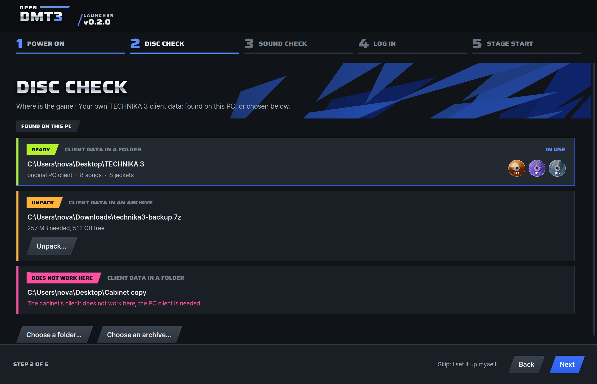

# The client data

openDMT3 ships none of the game's files. To play you need your own TECHNIKA 3 client data: the game's PC client (a
client that runs on a PC) and the game's own files, in a folder or in an archive. A server takes the song list from it
and nothing else. This page says which client data plays, the forms it may come in, what each line on its card means
with the one thing to do, and what a server takes. Please use only files you have the right to use.

| | Needed | What it gives |
| :--- | :---: | :--- |
| [The client data](#which-client-data), with the PC client | To play | The game itself: its program, its songs with their charts, music and videos, its screens |
| [The song list](#what-a-server-takes), read from the client data | For a server | The songs' titles, composers and levels, with the jackets and the DJ cards, for the site and the game's logins |

## Which client data

The game's PC client with the game's files and their last update, about 38 GB whole. The launcher's card says which
you have before PLAY: whole and unchanged, it reads `Client data in a folder, original PC client, 175 songs, 175
jackets: ready` (the server's song list counts 177 songs, every row of the game's list, offered or not).

| What you have | What the card says | Plays |
| :--- | :--- | :--- |
| The PC client as released, the build openDMT3 knows by its fingerprint | **READY**, `original PC client` | Yes, with the screen fit: full screen at any Windows scaling, the mouse at the right place |
| A PC client someone changed, in which the launcher finds what it opens the game's files with | **READY**, `modified PC client`, `Played without the screen fit.` | Yes, in its own window |
| Only the cabinet's client | **DOES NOT WORK HERE**, `The cabinet's client: does not work here, the PC client is needed.` | No: it needs the cabinet's own security keys |
| Another program, or a packed one | **DOES NOT WORK HERE**, `The game's files cannot be opened with this client.` | No |
| The game's files with an earlier update | Fewer songs than 175 | Not checked: the tests play the last update |
| No videos for the songs | `The videos are missing: songs play without them.` | Yes, each song on a black background |
| No previews for the song select | `The previews are missing: the song select shows none.` | Yes |
| No tutorial | `The file with the tutorial is missing: the game stops at the tutorial. ...` | No: the game stops when the tutorial starts |
| No charts | `The file with the charts is missing: the game stops when a song starts. ...` | No: the game stops when a song starts |

Playing on this PC or on another server, PLAY points the game at that server, whatever address its files held.

## Where the launcher finds it

The launcher knows client data by what is in it, whatever its folder is called and wherever it is: the first-start
guide's **DISC CHECK** step shows a card for each one found, with its state, what it holds and its buttons; the
**Game** page shows the one in use, and the others under **Change...**.

<p align="center">
  
</p>

- **Where it looks**: the Desktop, Downloads, Documents and the top of each drive, up to four folders down.
  **Choose a folder...** and **Choose an archive...** take one from anywhere else.
- **It is only read.** PLAY makes what it needs in a folder of openDMT3's own, so the client data may be in Program
  Files, on a drive mounted read only, or on a disc ([what PLAY makes](install.md#your-client-data-stays-as-it-is)).
- **A path the game cannot take** (letters outside this Windows' language, or too long) plays through a short path of
  the launcher's for that run.

### The forms it may come in

| Form | What the launcher does |
| :--- | :--- |
| A folder | Lists it with what it holds; a click chooses it |
| A copy of a cabinet's drives | Finds the client data in it, and takes the cabinet's operator data along, once |
| An archive: `.zip`, `.7z`, `.rar`, a disc image, or whatever else the official 7-Zip opens | Lists it from the list of what is in it, with nothing taken out; **Unpack...** unpacks the client data into a folder |
| A split archive | Reads it through its first part; every part has to be in one folder |
| An archive inside an archive | Opens both, two levels at most |
| An archive with a password | Asks for the password in its own dialog before it unpacks |
| Client data an older openDMT3 changed | Plays it as it is, from the originals it kept; **Put back...** makes it original again |

The search opens an archive only when its name holds `technika`, `djmax` or `dmt3`; one you choose is judged whatever
its name. An archive found by the search is said from its list alone, so its songs are counted once you choose it or
unpack it.

**Unpack...** says the room the client data needs and the room there is, unpacks beside the archive or into a folder
you choose, shows how far it is with the time left, and **Stop** removes what was made. The archive's entries are
judged before anything is unpacked, a password is checked before the work starts, and the folder is made apart and
moved into place whole. The whole client data is about 38 GB.

## What a card says

The chip is the state: **READY** (PLAY can use it), **UNPACK** (an archive: unpack it to play) or **DOES NOT WORK
HERE** (the line under it says why); **CHECKING** while the launcher looks, and **NOT YET** on the **Game** page before
any client data is chosen. Beside the chip, the card says which form it is: **CLIENT DATA IN A FOLDER** or **CLIENT
DATA IN AN ARCHIVE** (**CLIENT DATA** before it is known). The line is one fact and the one thing to do.

| Line | What to do |
| :--- | :--- |
| `The cabinet's client: does not work here, the PC client is needed.` | Choose client data that has the PC client |
| `The game's files cannot be opened with this client.` | The same |
| `The file with the song list is damaged. Copy the client data again, or unpack the archive again.` | As it says |
| `One of the game's files is damaged. Copy the client data again, or unpack the archive again.` | As it says |
| `The file with the jackets is damaged. Copy the client data again, or unpack the archive again.` | As it says; meanwhile the card stays **READY** |
| `The file with the tutorial is missing: the game stops at the tutorial. Copy the client data again, or unpack the archive again.` | As it says |
| `The file with the charts is missing: the game stops when a song starts. Copy the client data again, or unpack the archive again.` | As it says |
| `The first song the game shows has no charts: the game stops when it starts. Copy the client data again, or unpack the archive again.` | As it says |
| `3 songs have no charts and cannot be chosen.` | Nothing: the other songs play |
| `The videos are missing: songs play without them.` | Nothing: the game plays |
| `The previews are missing: the song select shows none.` | Nothing: the game plays |
| `Played without the screen fit.` | Nothing: a modified PC client plays in its own window |
| `The cabinet's operator data comes along.` | Nothing: it is taken once, into openDMT3's own folder |
| `An older openDMT3 changed files here. Put back makes them original again.` | **Put back...**, or play it as it is |
| `This client data is only in OneDrive's cloud. Set its folder to "Always keep on this device".` | In File Explorer, right-click the folder and choose that: read from the cloud, gigabytes would come down while the game waits |
| `This is not there any more.` | Connect the drive it was on again, or choose it where it is now |
| `The launcher cannot read this. Copy it to a folder of your own, such as Downloads.` | As it says |
| `This is part of the client data. Choose the folder that holds all of it.` | Choose the folder around it |
| `This is not a folder or an archive holding client data.` | Choose another path |
| `It holds another archive. Both are opened.` | Nothing: **Unpack...** opens both |
| `Part 3 of this split archive is missing. Put every part in one folder.` | As it says, then look again |
| `This is part 2 of a split archive. Put every part in one folder and choose the first.` | As it says |
| `This archive has a password. Enter it.` | **Unpack...** asks for it |
| `This archive is damaged or not fully downloaded. Download it again.` | As it says |
| `This archive says its size only at its end, where it cannot be checked first. Unpack it with another program, then choose what came out.` | As it says: a `.gz`, `.xz` or `.lz` file |
| `This launcher has no 7-Zip to open archives with. Repair it on the Help page.` | **Help**, **Repair** |
| `An entry in this archive cannot be taken: NAME` | Nothing is taken out of an archive with such an entry (an absolute path, `..`, a device name, a link, or a name that is there twice): choose another copy |
| `Not enough free space: 38 GB needed, 12 GB free. Choose another folder to unpack into.` | **Another folder...** in the Unpack dialog |

## What a server takes

One thing: **the song list** (titles, composers and levels), which holds the jackets and the DJ cards (their tables
and pictures) too. No charts, music or videos: every player has the whole game on their own PC.

| It comes from | How |
| :--- | :--- |
| Client data in a folder on the server PC, at the path given or up to four levels below it | `./dmt3 setup` (the wizard's song list page), `./dmt3 catalog PATH`, or the site's **Admin**, **Song list** |
| Client data in an archive, in any of the forms above | The same; only the files the server needs are taken out, into a folder of the reading's own, and removed after |
| A song list the launcher saved (`openDMT3-song-list.zip`, about 13 MB) | The launcher's **Game**, **Save the song list...**; then the site's **Upload a song list**, or `./dmt3 catalog FILE` |
| The launcher itself, signed in to the server as its admin | **Game**, **Send the song list to this server** |

The jackets and the DJ cards are optional: without the jackets the songs show without them, without the DJ cards every
DJ card keeps the basic icon and plate, and with no song list at all the site shows song numbers. The server keeps
what it read in its data folder, and never the game. [Running a server](server.md#the-song-list) has each way step by
step.

## Check from the command line

`openDMT3-cmd.exe --find` ([where it is](install.md#from-the-command-line)) lists what the search finds, and
`--inspect PATH` says what one path is, each in its card's words; neither changes anything. Here on made-up client
data:

```text
  ready     C:\Users\nova\Desktop\TECHNIKA 3  Client data in a folder, original PC client, 8 songs, 8 jackets: ready
  unpack    C:\Users\nova\Downloads\technika3-backup.7z  Client data in an archive: unpack to play (257 MB needed, 512 GB free)
  no        C:\Users\nova\Desktop\Cabinet copy  The cabinet's client: does not work here, the PC client is needed.
```

`--unpack ARCHIVE [--to FOLDER]` unpacks one, `--folder PATH` uses the client data in a folder (an archive is unpacked
first), and `--put-back` puts back what an older openDMT3 changed. On a server, `./dmt3 catalog PATH` looks at the
path first and says its one line before it imports anything.

## Questions and answers

**Does openDMT3 come with the game?** No. The repository, the installer and a server hold none of the game's files.

**Does PLAY change my client data?** No. It only reads it, and makes what the game needs in
`%AppData%\openDMT3\game`.

**Which client do I need?** A client that runs on a PC. The cabinet's own client needs the cabinet's security keys
and does not work here.

**How much room does it take?** The client data itself, about 38 GB whole. An archive is unpacked beside it or into a
folder you choose, and its card says the room that needs and the room there is.

**Do the players on a server need the game too?** Yes, each their own client data on their own PC. The server takes
only the song list.

**Why does a card count fewer songs than the server's song list has?** The card counts the songs the game offers in
one of its modes, 175 in the whole client data. The song list has a row for every song, 177, and the server keeps them
all for the records' titles and levels.

**Can I give a server the song list without copying the game to it?** Yes: save it in the launcher (**Game**, **Save
the song list...**) and upload the file on the site, or send it from the launcher as the server's admin.

**What if a line says something is missing?** The line says what the game does without it. Videos and previews are
optional; the tutorial and the charts are not.

When something else does not work, see [Troubleshooting](troubleshooting.md).
