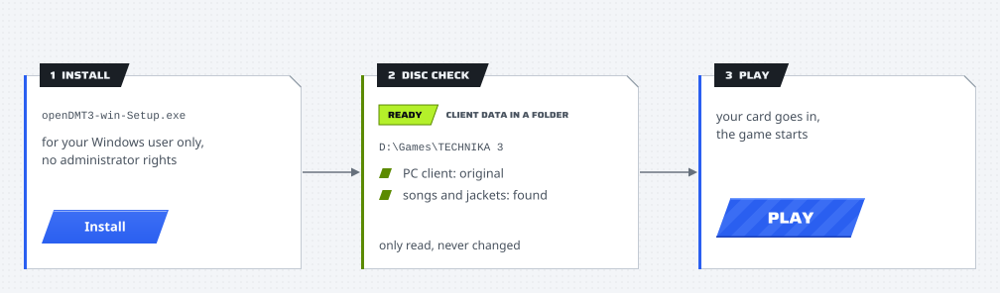
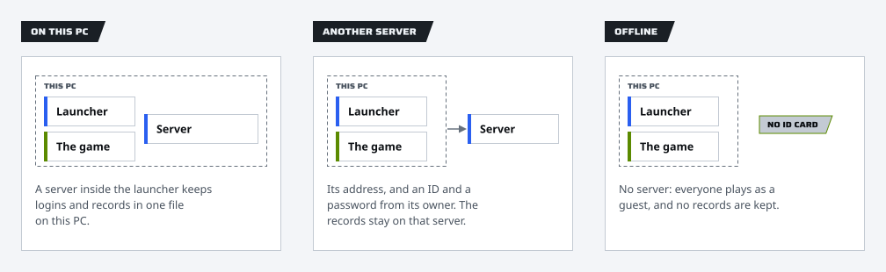

# Playing on your PC

The launcher plays your TECHNIKA 3 game folder on a Windows PC without changing it, remembers how you want the picture
and the sound, puts your card in and starts the game. This guide goes from the installer to everyday play.

<p align="center">
  <picture>
    <source media="(prefers-color-scheme: dark)" srcset="images/steps-dark.svg">
    
  </picture>
</p>

## What you need

- 64-bit Windows 10 or 11 on an x64 processor, a graphics card with Direct3D 9 from any maker (shader model 3.0 for
  the picture's passes), and a mouse or a touch screen ([what it runs on](../README.md#what-it-runs-on)).
- Your own TECHNIKA 3 game folder, with a client that runs on a PC: a folder or an archive
  ([The game's files](game-files.md)). No game files come with openDMT3.
- To play on someone's server: its address, and an ID and password from its owner.

## Install

1. Get `openDMT3-win-Setup.exe` from the [releases](https://github.com/kanggu12/openDMT3/releases/latest), or the
   installer on your server's **Download** page (its name carries the server's address).
2. Run it. If Windows says it protected your PC: **More info**, then **Run anyway** (the installer is not signed).
   Windows 11's Smart App Control, when it is on, blocks unsigned programs, this one among them, and has no **Run
   anyway**.
3. Choose **Install**. It installs for your Windows user only, with a desktop shortcut to the launcher and without
   administrator rights, and opens the launcher. One from a server's **Download** page says which server it is set up
   for, and the launcher opens on that server: its address is filled in on **LOG IN** (and **Online**), so you only
   connect and sign in.

Run again, the installer updates an older openDMT3, offers **Repair** or **Open openDMT3** over the same version, and
asks before going back from a newer one. It closes an open launcher first, and does not go on while a game the
launcher started is running (close the game, then **Try again**).

## The first start

The guide takes five steps, and everything in it can be changed later:

1. **POWER ON**: the language (at first the one Windows is shown in), and what you need.
2. **DISC CHECK**: a card for each game folder and archive found on this PC, with its state (**READY**, **UNPACK**, or
   **DOES NOT WORK HERE** with the one thing to do), what it holds, and its buttons. **Choose a folder...** and
   **Choose an archive...** take one from anywhere, and **Unpack...** makes the game folder from an archive
   ([The game's files](game-files.md) has every form and what each line means).
3. **SOUND CHECK**: full screen or a window, a mouse or a touch screen, the volumes.
4. **LOG IN**: who plays: a player on this PC, a player on another server, or a guest offline (below).
5. **STAGE START**: what PLAY makes in openDMT3's own folder. Your game folder stays as it is.

## Three ways to play

<p align="center">
  <picture>
    <source media="(prefers-color-scheme: dark)" srcset="images/ways-to-play-dark.svg">
    
  </picture>
</p>

| Way | Logins and records | What you need |
| :--- | :--- | :--- |
| **On this PC** | A server inside the launcher keeps them in one file on this PC | Nothing else |
| **Another server** | The server someone runs keeps them | Its address, and an ID and password from its owner |
| **Offline** | None: everyone plays with **NO ID CARD** | Nothing else |

The **Online** page switches between them. On this PC, it also adds and removes players; the **Play** page chooses who
plays next. On another server, you sign in once; the launcher asks the server for your card at every PLAY, and when
that server does not answer, PLAY stops and says so (choose **Offline** to play without it). **Sign out** ends the
sign-in there, on this PC only.

## In the game

Clicking is touching, and holding the button down while moving is sliding. **TOUCH to START** starts; the game is on
FREE PLAY, so it needs no coins. The launcher has already put your card in: the game logs you in on its own.
**NO ID CARD** plays without logging in.

openDMT3 adds a few things of its own over the game, in the look of the game's own panels (its dialogs' title tab
and metal frame, its glossy buttons) on an opaque frosted glass, and in the launcher's language. None of them is in
the middle of the game, where the notes come, and no key of the keyboard brings any of them:

<p align="center">
  
</p>

- **The bar.** Move the pointer to the very top edge of the game, or onto the small tab at its top center, and let it
  rest there with its button up (or draw a finger down from the top edge): a bar comes down over the game's own top
  bar, with openDMT3's mark at its left and, at its right, the menu, then **minimize**, **full screen** (or back to a
  window) and the **X**.
- **When the bar comes and goes.** It comes only when the game has had no click or touch for 1.5 s, so a click or a
  held note at the top of a song never brings it. It also comes down by itself for 3 s when the game's first screen
  shows and after each switch between a window and full screen, so you see where it is. It stays 0.6 s after the
  pointer leaves it, then fades; a click on the game takes it away at once.
- **The X** asks first, under the X at the top right: **Quit the game?**, **KEEP PLAYING** first and **QUIT THE GAME**
  in red; during a song with one line more, **A play in progress is not kept.** (the game sends a play's results when
  the play ends). The window's own close (the taskbar's) asks the same, so a click by mistake ends nothing. **QUIT THE
  GAME** ends the game the way its own close does, and the launcher sees it end. Esc and Alt+F4 do nothing: the
  game's own Esc would end it at once, so the game never sees it.
- **In a window** the game keeps its title bar, to move it, and its borders, to size it, with no buttons on the title
  bar: the bar's chips minimize it, take it to full screen and back, and quit.
- **The menu** drops down under its chip: **BACK TO THE GAME**, **SHOW FPS** (the FPS chip on or off for this run)
  and **QUIT THE GAME**. The arrow keys and Enter choose, Esc closes; a click beside the menu or the question
  closes it too.
- **The game holds still** while the menu or the question is open during a song, or while the game is minimized in
  one: the picture stops on the frame it showed, the music stops on the note it played, and both go on together from
  there when you go back to the game. The game sees none of the keys and clicks that answer them.
- **The FPS chip** (Screen, **Show FPS**; off by default) shows the frames a second and the time of a frame,
  small and faint, in the corner chosen under **Position** (the bottom right by default, above the game's FREE PLAY,
  where it covers none of the game's own labels). Clicks go through it to the game, and it hides while the game holds
  still.
- **A toast** hangs from the top edge for a few seconds when openDMT3 has a line to say: `Picture quality lowered to
  keep 60 FPS`, with the step it took
  ([the safety net](#frame-pacing-the-picture-the-fps-chip-and-the-sound-device)).
- **The pointer** over the game is openDMT3's own: a dart with a chrome edge round a blue core, all blue and a little
  smaller while the button is down, sized for the display's scaling (32 pixels at 100 %). With **Controls** set to a
  touch screen the game hides it as before.

Logged in, the game shows your DJ card (your level, icon, plate, plate pattern and comment), and the song select shows
your best on each chart and the first place on your server. Choose the card's icon, plate, plate pattern and comment
on the site, under **My account**: playing on this PC, **Play**, **My records** opens it.

## The pages

| Page | What it does |
| :--- | :--- |
| **Play** | Who plays, the ready check (what PLAY makes), how to play, the last session's stages |
| **Screen** | Full screen or a window and its size, vertical sync, frame pacing, the picture's shape, the FPS chip and its corner, the upscale filter and its sharpness, anti-aliasing, glow, background videos, loading ahead, measuring the picture's GPU time |
| **Sound** | The volumes of the music and of the keysounds (the sound each note plays when you hit it), and the output device |
| **Controls** | A mouse or a touch screen (the cursor hides on a touch screen), and how each plays |
| **Game** | The game folder and its client, the song list (its songs and jackets; **Save the song list...** and, signed in as a server's admin, **Send the song list to this server**), FREE PLAY, the hidden patterns |
| **Online** | The way to play, the players on this PC, opening this PC's server to the other PCs on your network |
| **Records** | The chosen player's numbers, the last 12 weeks, recent plays and best scores |
| **Help** | The checks, what to do when the game closes by itself, putting the files back, a report for an issue, the launcher's log, Repair, Uninstall |
| **Launcher** | Language (**Same as Windows**, English, Korean), playing without this window, updates, the first-start guide again |

The version installed shows beside the logo. Tab moves between the buttons and switches, and Enter or Space presses one.
A setting takes effect at the next PLAY.

## Frame pacing, the picture, the FPS chip and the sound device

The game runs its logic once a frame and holds 60 frames a second itself, on any display (a faster rate would run the
game faster), so a song's notes move with its frames and its music with the sound card's clock. **Frame pacing**
(**Screen**) chooses whose clock makes the frames:

| Choice | What it does |
| :--- | :--- |
| **Locked to the music** (the default) | Every frame 16.67 ms by openDMT3's clock and, while a song plays, frame k at k/60 s of its music: after a stall the frames catch up a little at a time, so the notes stay on the music |
| **Even** | Every frame 16.67 ms, with no lock to the music |
| **The game's own** | The client's own steps of 17, 17 and 16 ms |

With VSync on, each frame waits for the same number of the display's refreshes (four at 240 Hz). openDMT3 keeps at
most one frame waiting for the graphics card, so a touch is not held behind frames already queued.

- **Picture shape** (**Screen**): **Keep** (the default) shows the game's 1280x768 picture in its own 5:3 shape, the
  largest that fits, centered, with bars of the launcher's darkest gray on the two other sides of a screen or window
  of another shape (16:9, 21:9, 16:10, 5:4); **Fill** stretches it to the whole screen. The pointer and a finger reach
  the game pixel under them either way, and the in-game bar, menu, question, toast and FPS chip lie in the picture.
- **Upscale filter** (**Screen**): how the game's 1280x768 picture is enlarged to the window. **Off** is sharp
  bilinear (each game pixel a block, all of the same width), **Smooth** is bilinear, as the game drew it before,
  **AMD FSR 1** (the default) is AMD FidelityFX Super Resolution 1, **NVIDIA NIS** is NVIDIA Image Scaling.
- **Sharpness** (**Screen**, shown for **AMD FSR 1** and **NVIDIA NIS**): how much those two sharpen, from 0 to 100
  (50 by default).
- **Anti-aliasing** (**Screen**): smooths the game's jagged edges before the picture is enlarged: **Off** (the
  default), **FXAA**, **SMAA Low**, **SMAA Medium**, **SMAA High** or **SMAA Ultra**.
- **Show FPS** (**Screen**, off by default): a small, faint chip over the game with the frames a second, large, and
  the frame's length under it, updated twice a second. **SHOW FPS** in the in-game menu turns it on or off for that
  run; the launcher's choice is how each run starts.
- **Position** (**Screen**, shown while **Show FPS** is on): the chip's corner, **Bottom right** by default (above the
  game's FREE PLAY, where it covers none of the game's own labels); **Top left**, **Top right** or **Bottom left** can
  be chosen instead.
- **Device** (**Sound**): **Windows' default output** (the default), or one of Windows' output devices by name. When
  the chosen device is not connected, the game plays on Windows' default output, and the page says so.

When the upscale filter or the anti-aliasing chosen makes frames late on this PC's graphics card, the game steps it
down one step at a time (SMAA to FXAA to off, then AMD FSR 1 or NVIDIA NIS to Smooth) for the rest of the run, says
so in a toast at the top of the game, and the launcher's log says which step it took.

**Measure the picture's GPU time** (**Screen**, **Advanced**, off by default) times each step of the picture on the
graphics card while the game runs: the game's own frame, the glass behind the in-game panels, the bars, each
anti-aliasing and upscale pass and the in-game parts, each step's median over ten seconds at a time. When the game
closes, the launcher's log gets one line for each ten seconds, such as
`1920x1080 keep, upscale fsr1, sharpness 50, anti-aliasing off: game 412.0 us, ..., easu 180.2 us, rcas 61.4 us, all
260.3 us (600 frames)`, and **Help**, **Report**, **Save** carries them. The game's own frame there is the graphics
card's time from the last frame shown to openDMT3's first pass, so any wait for the game's own work on the processor
is in it.

DLSS, FSR 2 and later, and XeSS do not apply: they need motion vectors and depth, which the game does not give.

All take effect at the next PLAY.

## Your records

Playing on this PC, **Records** shows the chosen player's numbers, and **Play**, **My records** opens the rankings,
the songs and your own page in the browser, signed in as that player. That site is for this PC only and runs while
the launcher does. On another server, the same page reads that server.

The game reports only the stages you clear, at the end of a session: a failed stage is not kept.

## With the other PCs on your network

On the PC that keeps the players, turn on **Online**, **Open this PC's server**. The page lists this PC's addresses on
the network. On each other PC, choose **Another server**, type one of those addresses and sign in with a player made
on the first PC. The server runs while that launcher is open. Windows may ask whether to allow it on private networks:
allow it.

## The song list for a server

A server takes one thing from the game: the song list, which holds the jackets and the DJ cards too
([what a server takes](game-files.md#what-a-server-takes)). **Game**, **Save the song list...** saves it from your
game folder into one file, `openDMT3-song-list.zip` (about 13 MB), in the launcher's own Save dialog (on the desktop
unless you type another path); the server's admin uploads it on the site's **Admin**, **Song list**. Signed in to
another server as its admin (**Online**, **Another server**), **Send the song list to this server** sends it there at
once, asked first. The game folder is only read; the file is checked as a server takes it before it is saved.

## Without this window

**Launcher**, **Play without this window**:

- **Desktop shortcut** makes `TECHNIKA 3 (openDMT3)` on the desktop. It gets the game ready and starts it at once,
  with the player and the settings chosen here.
- **Play when Windows starts** does the same at every sign-in to Windows.

Both point at the installed launcher, so they keep working through updates.

## Updates

**Launcher**, **Check for updates** looks for a newer launcher and installs it; the launcher closes and opens again,
and your settings and records stay. A launcher playing on another server updates from that server when it hands
updates out; otherwise from the address it was built with. Without either, the page says so. When the release has a
delta package from the version installed, only what changed is downloaded; when that does not give the signed
package, the dialog says the whole update is downloading instead. The launcher puts in only a package signed by the
openDMT3 project, and checks it before any of it reaches the folder openDMT3 is installed in. The update waits while
the game is open.

## Your game folder stays as it is

<p align="center">
  <picture>
    <source media="(prefers-color-scheme: dark)" srcset="images/pieces-dark.svg">
    
  </picture>
</p>

PLAY only reads the game folder: openDMT3 keeps what it needs to play it in a folder of its own,
`%AppData%\openDMT3\game`, and gives the game those files in place of its own while it runs. What the game writes
as it runs (its rankings, a crash dump) goes there too. So the game folder may be in Program Files, on a drive mounted
read only, or on a disc.

| What | Why |
| :--- | :--- |
| A copy of the client, with the libraries it loads from the game folder | The copy fills the screen as a borderless window at any Windows scaling, reads the mouse at the right place, and may use 4 GB of memory addresses instead of 2 (a modified PC client gets only the 4 GB, without the screen fit, which is made for the PC client as released); the libraries beside it, so Windows loads the game's own and not another program's of the same name |
| The settings file | No exclusive full screen (it fails on current drivers), your screen and sound choices |
| The operator data (rankings, bookkeeping and the cabinet's settings) | FREE PLAY on: a PC has no coin slot. Taken once from the game: a copy of a cabinet's drives brings the cabinet's own; the rankings the game writes stay here |
| The lists of the songs each stage offers | Shows the patterns the cabinet hid from guests (only with **Show hidden patterns** on) |
| The server address | Points the game at the server you play on (not offline) |
| The card reader library, with the fonts its words use (Pretendard Bold and Regular, DMT3 Wide) and their licenses | Gives the game these files, lets the launcher put your card in, and adds the bar with the menu and the X, the question, the toast, the pointer, frame pacing, the upscale filter and anti-aliasing, the FPS chip and the sound device; offline it holds no card, so the game plays with **NO ID CARD** |
| `openDMT3-card.txt` | The card number the launcher puts in while the game runs (not offline) |

When the game folder's path has letters this Windows' language cannot give the game, or is too long for it, the
launcher gives the game a short path to the same folder for that run: the folder's own short (8.3) name when the drive
keeps one, else a link of the launcher's in a folder only you may use.

An older openDMT3 changed the game folder itself and kept the originals in its `backup\`. Such a folder plays as it
is: the launcher reads the originals from `backup\`. Its card says so, with **Put back...**, and **Help**, **Game
files**, **Put back** puts every original back and removes the files the older openDMT3 added; the game then starts
the way it did before openDMT3. It takes only paths inside the game folder from the list in `backup\`,
so a game folder from someone else cannot make it touch anything outside.

**Help**, **Repair** compares the program's own files with the package the installer left in
`%LocalAppData%\openDMT3\packages\` and puts back any that are missing or changed (a cleaner or an antivirus took one,
a disk fault changed one), with no download. A file of the running launcher is moved aside and replaced; the launcher
then says to open it again. Settings, players, records and the game folder are not touched.

## Removing openDMT3

**Help**, **Uninstall** asks first, with two ways on:

- **Keep data**: settings, players and records stay on this PC, so a later install picks up where you left off;
- **Delete all**: they go too (the question says how much).

Either way it:

- puts back what an older openDMT3 changed in the game folder, as **Help**, **Game files**, **Put back** does, and
  takes its copies and its list out of `backup\`;
- removes the desktop shortcut and playing when Windows starts;
- says so in its last step and closes; the program is gone a few seconds later (the install folder and its line in
  Windows' Settings, Apps), with no window of its own.

Removing openDMT3 in Windows' Settings, Apps does the same, except that it always keeps settings, players and records.
While the game is open its files cannot change: a folder an older openDMT3 changed stays as it left it, and a note in
the game folder's `backup\` (`README-openDMT3.txt`) says which originals to copy back.

Originals that were in `backup\` before openDMT3 first changed the folder stay there, and so do the copies an older
openDMT3 listed there without a mark: nothing can tell them apart from a copy kept by hand, so they are left for you
to delete.

## From the command line

`openDMT3-cmd.exe`, next to the launcher, does the window's jobs and prints what it did; each page's action has its
flag. The launcher's own folder is `%LocalAppData%\openDMT3\current`, so in Windows PowerShell:

```powershell
& "$env:LOCALAPPDATA\openDMT3\current\openDMT3-cmd.exe" --status
```

Several flags in one command run in a fixed order, not the order typed: what it looks at (`--find`, `--inspect`,
`--unpack`, `--sound-devices`), the settings, `--status`, `--report`, the song list, `--open-log`, and last one job
(`--play`, `--check`, `--put-back`, `--update`, `--repair`, `--uninstall`, `--records`, `--serve` or `--shortcut`:
one of these a command), as in `--server URL --sign-in ID --play`. While the launcher's window is open, the flags that
change what it keeps are refused, since the window would write its own copy over them; close it first. A flag it does
not know is said, with the list of the ones it does.

| Command | Does |
| :--- | :--- |
| `--version` | Prints the launcher's version |
| `--status` | Prints the game folder, how this PC plays, the language and the ready check (exit 0 when PLAY can go) |
| `--find` | Lists the game folders and the archives holding one in the usual places, each with what its card says (an archive from the list of what is in it, its songs not counted) |
| `--inspect PATH` | Says what a path is (a game folder, an archive, part of one, or nothing of the game's), as its card does; exit 0 when it can be used |
| `--unpack ARCHIVE [--to FOLDER] [--yes]` | Unpacks the game folder from an archive, beside it unless `--to`, with its progress; the password comes from standard input when it has one |
| `--sound-devices` | Lists Windows' output devices with their GUIDs, the chosen one marked, as **Sound** offers them |
| `--folder PATH` | Uses this game folder (or the one below it); an archive is unpacked first (beside it unless `--to FOLDER`) |
| `--mode this_pc` / `server` / `offline` | Where logins and records are kept, as **Online** chooses |
| `--server URL` | Connects to another server and plays on it from now on |
| `--sign-in ID` | Signs in to that server; the password comes from standard input, or is asked for |
| `--sign-out` | Signs out: the server ends this launcher's sign-in when it answers, and the launcher forgets it |
| `--add-player ID [--dj NAME]` | Makes a player on this PC (the password as for `--sign-in`) |
| `--delete-player ID [--yes]` | Deletes a player on this PC, and their cleared stages (`--remove-player` is the same) |
| `--player ID` / `--player guest` | Who plays on this PC: whose card goes in at PLAY |
| `--language en` / `ko` / `system` | The launcher's language (`system`: the one Windows is shown in) |
| `--guide` | Opens the first-start guide again at the next start of the window |
| `--report [FOLDER]` | Saves a report for an issue (on the desktop when no folder is given) |
| `--save-song-list [FILE]` | Saves the song list for a server, as **Game**, **Save the song list...** does (`openDMT3-song-list.zip` on the desktop when no file is given, in it when a folder is) |
| `--send-song-list` | Sends the song list to the server this launcher is signed in to, as its admin, as **Game**, **Send the song list to this server** does |
| `--open-log` | Shows the launcher's log folder |
| `--play` | Gets the game ready and starts it, as PLAY does |
| `--check` | Prints the ready check |
| `--put-back [--yes]` | Puts back every game file an older openDMT3 changed in the folder in use (`--restore` is the same) |
| `--update [--yes]` | Looks for a newer launcher and installs it (only one signed by the openDMT3 project) |
| `--repair` | Puts back the program's files that are missing or changed, as **Help**, **Repair** does |
| `--uninstall [--delete-data] [--yes]` | Puts the game's files back and uninstalls openDMT3, as **Help**, **Uninstall** does; `--delete-data` deletes settings, players and records too (**Delete all**) |
| `--records [--no-browser]` | Opens the chosen player's records on this PC's site (until Ctrl+C) |
| `--records --text` | Prints the Records page instead |
| `--lan on` / `--lan off` | Opens this PC's server to the other PCs on your network, or not |
| `--serve` | Runs this PC's server without the window, until Ctrl+C |
| `--shortcut` | Makes the desktop shortcut |
| `--autostart on` / `--autostart off` | Plays when Windows starts, or not |
| `--set NAME=VALUE` | Changes a setting (below); several `--set` in one command change several |

The settings `--set` takes, each as its page keeps it:

| Name | Values | The page's choice |
| :--- | :--- | :--- |
| `display_mode` | `fullscreen`, `window` | **Screen**, **Mode** |
| `window_size` | `1280x768`, `1600x960`, `1920x1152`, `2240x1344`, `2560x1536`, `3200x1920`, `3840x2304` | **Screen**, **Window size** |
| `vsync`, `glow`, `videos`, `preload` | `on`, `off` | **Screen**: **VSync**, **Glow**, **Background videos**, **Load ahead** |
| `frame_pacing` | `music`, `even`, `game` | **Screen**, **Frame pacing** |
| `picture_shape` | `keep`, `fill` | **Screen**, **Picture shape** |
| `show_fps` | `on`, `off` | **Screen**, **Show FPS** |
| `fps_position` | `top_left`, `top_right`, `bottom_left`, `bottom_right` | **Screen**, **Position** |
| `upscale` | `off`, `smooth`, `fsr1`, `nis` | **Screen**, **Upscale filter** |
| `sharpness` | 0 to 100 | **Screen**, **Sharpness** |
| `antialiasing` | `off`, `fxaa`, `smaa-low`, `smaa-medium`, `smaa-high`, `smaa-ultra` | **Screen**, **Anti-aliasing** |
| `pass_times` | `on`, `off` | **Screen**, **Measure the picture's GPU time** |
| `music_volume`, `key_volume` | 0 to 100 | **Sound**: the music's and the notes' volumes |
| `sound_device` | `default`, or a GUID from `--sound-devices` | **Sound**, **Device** |
| `cursor` | `on`, `off` | **Controls**: a mouse (`on`) or a touch screen (`off`) |
| `unlock` | `on`, `off` | **Game**, **Show hidden patterns** |

When something does not work, see [Troubleshooting](troubleshooting.md).
