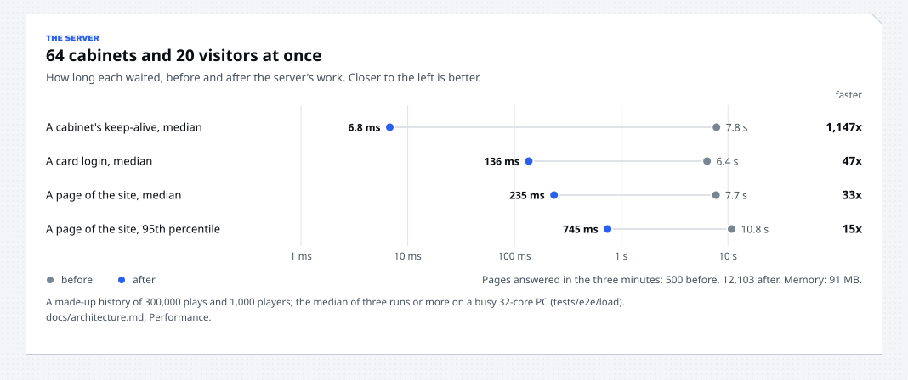

# Running a server

For server owners. A server keeps the players' logins and the stages they clear, for the cabinets that connect to it,
and runs the players' site with the rankings, the songs, each DJ's page and the launcher to download, and the admin
pages, a site of their own for the owner. One process does all of it: the game connects on port 4725, players and
launchers on port 4730, and the admin pages answer on port 4731, on the server PC alone unless you open them
([The admin pages](#the-admin-pages)).

To the server, each game that connects is a cabinet, the arcade's name for the machine: a PC playing through the
launcher is one. The server knows each by the address it connects from, and the site's **Home** page and the admin
pages' **Connected** list them.

You do not need a server to play alone: the launcher has one inside for that ([Playing on your PC](install.md), the
player's guide). Run one when others play from their own PCs, in one of these ways, each the same server:

| Way | Where it runs | For |
| :--- | :--- | :--- |
| [In the launcher](#in-the-launcher) | The launcher's own server on a Windows PC, while the launcher is open | The other PCs on that PC's network |
| [On Windows](#on-windows) | The Windows server package, `opendmt3-server.exe`, or its one-line install: no Docker, Python or launcher needed | A server that stays on, on a Windows PC |
| [On Linux or macOS](#on-linux-or-macos) | The server's package for the machine (x64 or arm64), or its one-line install: no Docker or Python needed | A server that stays on, on a Linux machine or a Mac |
| [With Docker](#with-docker) | Docker Compose with `./dmt3` from a copy of this repository, on Linux, macOS, or Windows in WSL 2, from the published image | A server that stays on, for every player who can reach it |
| [With Python](#with-python) | Python 3.10 or newer, from a copy of this repository | Working on the server, or a machine no package is made for |
| [On Kubernetes](kubernetes.md) | The Helm chart, from the published image | A cluster you run already |

The other guides for server owners: [Playing from outside your home](internet.md) (a name, the router, HTTPS),
[A closed network](closed-network.md) (no internet), [On Kubernetes](kubernetes.md) and
[Questions and answers](faq.md#for-server-owners).

<p align="center">
  <picture>
    <source media="(prefers-color-scheme: dark)" srcset="images/ways-to-host-dark.svg">
    
  </picture>
</p>

## What you need

- A PC that stays on. On Windows, Linux or macOS: the server's package for it, nothing else. With Docker: Docker with
  Compose v2 and Python 3 (`./dmt3` is a Python script), on Linux, on macOS, or on Windows in WSL 2. With Python:
  Python 3.10 or newer. In the launcher: the launcher on a Windows PC, nothing else.
- The server: the release's package for your system and processor, each bringing what the server needs and nothing
  else: `opendmt3-server-0.4.2-windows-x64.zip` on Windows, `opendmt3-server-0.4.2-linux-x64.tar.gz` or
  `opendmt3-server-0.4.2-linux-arm64.tar.gz` on Linux, `opendmt3-server-0.4.2-macos-x64.tar.gz` (Intel) or
  `opendmt3-server-0.4.2-macos-arm64.tar.gz` (Apple silicon) on a Mac; with Docker or Python, a copy of this
  repository (a clone, or the release's source archive).
- Memory and processor: the server held about 100 MB with 64 cabinets and 20 visitors at once
  ([Many players at once](#many-players-at-once)); its site works on two threads, and reading a song list uses up to
  eight cores.
- Your own client data on the server PC, in a folder or an archive, or the song list the launcher saved from it
  ([what a server takes](client-data.md#what-a-server-takes)). The server keeps only the song list.
- The launcher's installer, `opendmt3-launcher-0.4.2-windows-x64-installer.exe`, from the
  [releases](https://github.com/kanggu12/openDMT3/releases/latest), to hand out from the site (every server package
  brings it).

## In the launcher

A PC that plays can be the server for the other PCs on its network, with nothing else to install.

1. On that PC, add the players on the launcher's **Online** page (each an ID, a DJ name and a password), then turn on
   **Open this PC's server**. The page lists this PC's addresses on the network, such as `http://192.168.0.5:4730`.
2. On each other PC, in the launcher's **Online** page (or its first-start guide's **LOG IN**), choose **Another
   server**, type one of those addresses, **Connect**, and sign in with a player made on the first PC.
3. When Windows asks whether openDMT3 may use the network, allow it on private networks.

The server runs while that launcher is open, and keeps its logins and records in
`%AppData%\openDMT3\server\openDMT3.sqlite` on that PC, with a backup a day beside it. Its song list is read from
that PC's own client data when the launcher opens, so the first PLAY does not wait for it. The other players open the
same addresses in a browser for the site.
[Playing on your PC](install.md#with-the-other-pcs-on-your-network) has the player's side.

## On Windows

On a Windows 10 or 11 PC of its own, without Docker, Python or the launcher: the release's
`opendmt3-server-0.4.2-windows-x64.zip`, from the [releases](https://github.com/kanggu12/openDMT3/releases/latest).
It brings its own Python, the official 7-Zip, and the launcher's installer of the same release to hand out. One line
in PowerShell installs it for your Windows user, with no administrator's rights:

```powershell
irm https://github.com/kanggu12/openDMT3/releases/download/v0.4.2/opendmt3-server-0.4.2-windows-installer.ps1 | iex
```

It takes that zip, checked against the release's SHA-256 sums, into `%LOCALAPPDATA%\Programs\opendmt3-server` and puts
that folder on your PATH, so `opendmt3-server` runs by name in that window and in new ones; the data folder is `data`
in it. A first install then starts the server in the background, and while it has no account the browser opens the
admin pages' first-run page on this PC (`http://127.0.0.1:4731/`), where you make the owner's account
(`opendmt3-server setup --admin BOSS` makes it in the terminal instead, its password printed). The same line again,
or a newer release's, starts the new version once, then stops the running server, puts the new version in place with
the data as it was and starts it again; a download or a package that does not start leaves the running server as it
was. `$env:OPENDMT3_SERVER_UNINSTALL = '1'` before the same line stops the server, takes out its firewall rules and
removes the program and its PATH entry, and keeps the data. By hand instead:

1. Unpack the whole zip into a folder of your own (for example `C:\openDMT3-server`), and start
   `opendmt3-server.exe`. The server runs in its window; on the first start your browser opens the admin pages on this
   PC (`http://127.0.0.1:4731/`), where you make the owner's account.
2. Start **Open the firewall.cmd** (Windows asks for an administrator's yes): it opens TCP 4725 and 4730 for private
   networks (`opendmt3-server firewall --public` for public ones too, `--remove` takes the rules out). The admin
   pages' port, 4731, stays closed: they are for this PC, until `opendmt3-server setup --admin-host 0.0.0.0` opens
   them to the network (Windows then asks for their rule the same way).
3. The song list: the admin pages' **Song list** (folders of this PC, an archive, or an upload), or
   `opendmt3-server catalog D:\path\to\client\data` in a terminal in the folder.
4. The admin pages' **Players** makes the players' accounts, and shows the address players open with a QR code.

The data folder is `data` beside the program: the database, its backups, the log (`data\logs`, a new file every 2 MB,
three kept), the settings and the installer the **Download** page hands out. **Start in the background.cmd** and
**Stop the server.cmd** are the program's own `start` and `stop`, and `stop` also stops a server started in its
window. The same commands run on Linux and macOS ([On Linux or macOS](#on-linux-or-macos)):

| Command | Does |
| :--- | :--- |
| `opendmt3-server` or `opendmt3-server run` | Runs the server in this window until it closes (Ctrl+C, or `stop` from another one); `--no-browser` |
| `opendmt3-server start`, `stop`, `restart`, `status`, `logs` | In the background (`--browser`: the owner's first-run page opened too while there is no account, as the Windows one-line install's first start does); stops the running one, however it was started; runs it again where it ran (its window, or the background); whether it runs and answers, with its addresses; the last lines of its log |
| `opendmt3-server setup [--address A] [--game PATH] [--installer FILE] [--admin ID [--password P]] [--game-port N] [--web-port N] [--admin-port N] [--admin-host ADDRESS]` | The players' address, the song list, the installer to hand out, the first account, the ports (`--admin-port 0` turns the admin pages off), who may open the admin pages (`--admin-host 0.0.0.0`: the network too; `127.0.0.1`: this PC again); each only when given, and two parts never on one port. With no account yet and a person at the terminal, it asks for the owner's account and makes it there, each answer it refuses asked again and the password typed twice (a PC with no screen needs no browser) |
| `opendmt3-server invite` | The address players open, with its QR code |
| `opendmt3-server firewall [--remove] [--public] [--print]` | Opens the game's and the site's ports in Windows' firewall as an administrator (the admin pages' port too, only while they are opened to the network); elsewhere prints the commands for ufw and firewalld |
| `opendmt3-server expose NAME [--admin-public]` | The site over HTTPS behind Caddy on this PC; the admin pages too, at `https://NAME:4731/`, only with `--admin-public` ([Playing from outside your home](internet.md#without-docker)) |
| `opendmt3-server catalog PATH [--save FILE]`, `add-player`, `backup`, `backups`, `restore NAME` | The server's own `--catalog`, `--add-player`, `--backup`, `--backups` and `--restore` on this data folder |
| `opendmt3-server repair`, `remove [--delete-data]` | The checks with their fixes; removing the server ([Removing a server](#removing-a-server)) |

`--data FOLDER` before the command uses another data folder (or `OPENDMT3_DATA`).

## On Linux or macOS

On a Linux machine, x64 or arm64, with the GNU C library 2.28 or newer (Debian 10, Ubuntu 20.04, RHEL 8 and newer), or
a Mac, Intel or Apple silicon, without Docker or Python. One line installs the release's package for the machine,
checked against the release's SHA-256 sums, into `~/.local/share/opendmt3-server`, and puts the command
`opendmt3-server` in `~/.local/bin`. A first install then asks for the owner's account in the terminal (its ID, then
its password twice; left empty, one is made and printed) and starts the server:

```sh
curl -fsSL https://github.com/kanggu12/openDMT3/releases/download/v0.4.2/opendmt3-server-0.4.2-linux-installer.sh | sh
```

(on macOS the release's `-macos-installer.sh`). From a script, with no terminal, it makes no account and says the
command that makes one, `opendmt3-server setup --admin BOSS` (its password printed); the server starts all the same,
and the admin pages' first-run page on this PC makes it too. Its commands are the Windows package's
([On Windows](#on-windows)); the data folder is `~/.local/share/opendmt3-server/data`. The same line again, or a newer
release's, starts the new version once, then stops the running server, puts the new version in place and starts it
again, with the data as it was; a download or a package that does not start leaves the running server as it was. It
takes over a server an older release's line installed with Python of its own, the data kept. `sh -s -- --uninstall`
after the pipe's `sh` removes it and keeps the data.

By hand instead: the release's `opendmt3-server-0.4.2-linux-x64.tar.gz`, `opendmt3-server-0.4.2-linux-arm64.tar.gz`,
`opendmt3-server-0.4.2-macos-x64.tar.gz` or `opendmt3-server-0.4.2-macos-arm64.tar.gz`, each one folder that brings
its own Python, the site's libraries, the official 7-Zip and the launcher's installer to hand out:

```sh
curl -fLO https://github.com/kanggu12/openDMT3/releases/download/v0.4.2/opendmt3-server-0.4.2-linux-x64.tar.gz
tar -xzf opendmt3-server-0.4.2-linux-x64.tar.gz
cd opendmt3-server-0.4.2-linux-x64
./opendmt3-server setup --admin BOSS
./opendmt3-server start
```

Its data folder is `data` beside the program. **Downloaded with a browser**, macOS keeps the programs in the folder
from starting until they are let through: `xattr -dr com.apple.quarantine opendmt3-server-0.4.2-macos-arm64`. curl,
as above, leaves no such mark.

## With Docker

On Linux, macOS, or Windows in WSL 2. It needs Docker with Compose v2 and Python 3 (`./dmt3` is a Python script, with
nothing to install), and a copy of this repository: a clone, or the release's source archive (**Source code** on its
page), unpacked. The server itself is the published image of that copy's version:

```sh
git clone https://github.com/kanggu12/openDMT3.git
cd openDMT3
./dmt3 setup
```

Every command below runs in that folder.

A wizard in the terminal, one question a page, each answer's meaning shown as you give it. Esc goes back a page,
Enter on to the next:

1. **Welcome**: what will happen, and what you need: Docker, and your own client data (a folder or an archive), or a
   song list the launcher saved.
2. **Docker and ports**: Docker, Compose and the ports 4725, 4730 and 4731, each problem with its fix (`r` checks
   again).
3. **This server's address**: the addresses this PC has, and the site and game addresses the other PCs use at the one
   you choose.
4. **Who may open the admin pages**: this PC only (the usual), or the other PCs on its network too (a server PC with
   no screen of its own is run from another PC that way).
5. **The first admin account**: its ID (1 to 8 letters or digits). A database that has accounts already makes none.
6. **The admin's password**: typed twice, or left empty and made for you, shown once at the end.
7. **The song list**: type or paste a path (Tab completes; a Windows path such as `C:\Games\...` works under WSL)
   to your client data's folder (or a folder above it), an archive holding it, or a song list the launcher saved, or
   pick one found on the Desktop, in Downloads or Documents (Windows' too, under WSL) with Up and Down. It is looked
   at as you type, and says its one line: `Client data in a folder, original PC client, 177 songs: ready`, then the
   song list, the jackets and the DJ cards. An archive with a password gets a box for it. Links inside the client
   data's folder are followed: the folders they point into are mounted read-only too. Empty: none now.
8. **The installer to hand out**: the one `./dmt3 build` left, a file (an
   `opendmt3-launcher-0.4.2-windows-x64-installer.exe` downloaded from the
   [releases](https://github.com/kanggu12/openDMT3/releases/latest)), or none for now, with its version and size.
9. **Confirm**: every answer on one page; a number goes back to change it.
10. **Setting up**: the image, the data folder, the account, the song list, the jackets, the DJ cards, the installer,
    the server and the check, each on its own line.
11. **Done**: the site's address on this PC and for the other PCs, the admin pages' address, the admin's ID and
    password, and what to do next.

A terminal that cannot draw the pages (`TERM=dumb`, a window smaller than 64 by 20) gets the same pages as numbered
prompts. With options, or from a script, `setup` asks nothing:

```sh
./dmt3 setup --game /path/to/client/data --installer opendmt3-launcher-0.4.2-windows-x64-installer.exe
```

It does these, in order; run again, each one that is done already changes nothing:

- gets the server's image first, before anything runs in a container: the one published for this version
  (`ghcr.io/kanggu12/opendmt3-server`, for amd64 and arm64), pulled; built from this copy when it cannot be pulled,
  or with `--build`, always as `opendmt3-server:local` (`packaging/docker/build.yaml`), never under the published
  name;
- keeps the site's address as the players reach it (`--address ADDRESS`: this PC's address on the network, a name,
  or a whole `https://...` address behind a proxy), so the message to send a player carries it; with `--game-port`
  and `--web-port`, the ports first ([Ports](#ports)); with `--admin-network yes`, the admin pages on the other PCs
  of the network too (`ADMIN_BIND=0.0.0.0` in `.env`; `--admin-network no` keeps them on this PC again);
- makes the data folder;
- makes the first (owner's) account `BOSS` with the admin pages and prints its password (`--admin ID` for another
  ID, `--password` to give one; nothing is made when the database has accounts already): in Docker the admin pages'
  first-run page never sees a visit from the server PC, so the account is made here, and no browser on the server PC
  is needed;
- imports the song list (`--game PATH`: the client data in a folder or an archive, or a song list the launcher
  saved);
- puts the installer on the site's **Download** page (without `--installer`, the one `./dmt3 build` left, when there
  is one);
- starts the server (`--no-start` to leave it stopped).

Run it again with `--game`, `--installer` or `--address` for a new song list, a new installer or another address.
When a step fails, the setup stops there and says which: Docker not answering (`./dmt3 doctor` names what is
missing), the image that cannot be pulled or built, or Compose's own words when it cannot read the data volume (a
broken `.env`, say).

### The song list

A server takes one thing from the client data: the song list (titles, composers and levels), which holds the jackets
and the DJ cards (their tables and pictures) too. Nothing else: no charts, music or videos, since every player has the
whole game on their own PC. The jackets and the DJ cards are optional: without the jackets the songs show without
them, without the DJ cards every DJ card keeps the basic icon and plate, and with no song list at all the site shows
song numbers. Each part is one line when it is read; a part that is missing says what still works, and its details go
to `catalog.log` in the data folder.

It comes from any of these, by what it is, not by its name ([The client data](client-data.md) has the forms and
each line):

| What | How it is read |
| :--- | :--- |
| Your client data in a folder, at the path or up to four levels below it (a copy of a cabinet's drives included) | Where it is, read-only, each file as the game reads it; names in any letter case, as Windows reads them |
| Your client data in an archive (a split one by its first part; one inside another, two levels at most; one with a password) | Its entries listed first; only the files the server needs taken out into a folder of the reading's own, read there and removed |
| A song list the launcher saved (**Game**, **Save the song list...**, or `--save-song-list`), or `./dmt3 catalog PATH --save FILE` made | Checked as an upload from anyone and taken in whole, or not at all |

Whatever came in, the server keeps the same files, so a song list taken in gives byte for byte what reading its
client data gives. What comes in is untrusted:

- **An archive's entries** with an absolute path, a drive letter, `..`, a device name, a stream or a link are
  refused, and so is more than the free space holds. Its password is asked for at the terminal, passed to the
  container by name only, and given to 7-Zip on its standard input, never on a command line.
- **A song list** holds only its own names and kinds, its sizes are capped, its tables' shapes checked, and every
  picture decoded and encoded again; nothing changes until all of it passed.

After a game update, or from another PC's client data:

```sh
./dmt3 catalog /path/to/client/data          # the client data in a folder
./dmt3 catalog ~/Downloads/technika.7z.001   # in an archive, a split one by its first part
./dmt3 catalog opendmt3-song-list.zip        # a song list the launcher saved
./dmt3 catalog /path/to/client/data --save . # save a song list here, for a server elsewhere
```

It looks at the path first, as the wizard does, then imports it into the server's data folder; a running server shows
the new list at once. The path is mounted read-only into a container that goes away, with the folders the client
data's links point into. That container runs as the server's own user, which owns the data folder, whenever that user
can read the path (and write where `--save` writes). It runs as root only when it must (a folder only its owner may
read, such as WSL's Windows drives), and then root only reads: the data folder (or the saved file's folder) is written
by that folder's owner alone, never through a link left in it. The server's image has the official 7-Zip, with its
license.

The admin pages' **Song list** is the page for it:

- what the server takes and whether it has it, part by part;
- **Found on the server PC**: the client data the server sees (the folder kept for it, and outside Docker its user's
  Downloads, Desktop and Documents), each with its one line and **Import**, asked first;
- **Another folder on the server PC**: a path box with its quick folders and a folder browser (in Docker, where the
  server sees only the folder kept for it, the page names `./dmt3 catalog PATH` instead);
- **Upload a song list**, up to 64 MB.

When the server's own user can read the client data's folder, the wizard (or `--keep-game`) keeps it mounted read-only
(`GAME_DIR`, and `GAME_LINKS` for the folder its links point into, in `.env` beside `compose.yaml`), so it is found
there. The admin pages' **Status** has the **Song list** card: when each part was last read, how many there are,
what is missing and why, and where it came from. The API's twins are `GET` and `POST /api/v1/server/song_list` and
`GET /api/v1/server/folders` ([api.md](api.md)).

### Every day

| Command | Does |
| :--- | :--- |
| `./dmt3 up`, `./dmt3 down`, `./dmt3 restart` | Starts the server (getting its image first; `--no-build` to start the image as it is), stops it, restarts it |
| `./dmt3 image [--build \| --published]` | The server's image: the published one of this version, pulled when it is not here; `--build` builds this copy's and keeps using it once it is built, `--published` goes back. An image older than this copy (one kept from before an update) is never run: it says so, with these two |
| `./dmt3 ports [--game N] [--web N] [--admin N]` | The ports ([Ports](#ports)) |
| `./dmt3 invite` | The address players open, with its QR code |
| `./dmt3 expose NAME [--admin-public]` | The site over HTTPS at NAME, with Caddy; the admin pages too, at `https://NAME:4731/`, only with `--admin-public` ([Playing from outside your home](internet.md)) |
| `./dmt3 repair`, `./dmt3 remove [--delete-data]` | The image again and the container afresh, then `doctor`; removing the server, Caddy's volumes with the data ([Removing a server](#removing-a-server)) |
| `./dmt3 status` | The container's state, then `check`, then the site's address and the admin pages' (`./dmt3 up` says both too) |
| `./dmt3 logs [-f] [-n LINES]` | The server's log |
| `./dmt3 backup`, `./dmt3 backups`, `./dmt3 restore NAME` | The server's `--backup`, `--backups` and `--restore NAME` ([Backups](#backups)) |
| `./dmt3 add-player ID [--password P] [--dj NAME] [--admin]` | The server's `--add-player` ([Players](#players)) |
| `./dmt3 check` | The site and the admin pages answer `/health`, and the game's port takes a connection |
| `./dmt3 catalog [PATH] [--save FILE]` | Imports the song list from the client data in a folder or an archive, or from a song list ([The song list](#the-song-list); the folder kept mounted when not given); `--save` saves one instead |
| `./dmt3 doctor` | Docker, the server's image, the ports (each free, and each part's own) and the data folder, each problem with its fix |
| `git pull` (or the new release's source archive), then `./dmt3 up` | Updates the server: the new version's image, and the data stays ([Updating the server](#updating-the-server)) |

The commands that reach the database run the server's own command line ([Command line](#command-line)) in its
container: in the running one, or in a new one that goes away. The same with Docker Compose itself, from the copy of
the repository:

```sh
# the published image of this version, pulled when it is not here (compose.yaml has no recipe of its own):
docker compose up -d
# this copy's own image instead, built as opendmt3-server:local, never under the published name:
docker compose -f compose.yaml -f packaging/docker/build.yaml build
OPENDMT3_IMAGE=opendmt3-server:local docker compose up -d
# the first (owner's) account; its password is printed:
docker compose run --rm server --add-player BOSS --admin
# the song list, imported once from your own client data (a folder or an archive) or a song list:
docker compose run --rm -v /path/to/client/data:/game:ro server --catalog /game --setup-only
# the installer for the site's Download page:
docker compose cp opendmt3-launcher-0.4.2-windows-x64-installer.exe server:/data/downloads/
```

The data lives in a named volume (`opendmt3_data`), and the server runs as its own user, not root.

After an update the **Download** page hands out the installer it had until `./dmt3 setup --installer FILE` puts the new
one there ([Updating the server](#updating-the-server)); [Handing out updates](#handing-out-updates) has the files the
players' launchers update from.

## With Python

From a copy of this repository (a clone, or the release's source archive), with Python 3.10 or newer (on Debian and
Ubuntu, `python3-venv` too): for working on the server, or a machine no package is made for. Nothing installs
`opendmt3` itself. The song list is read once from your client data, before the first start (without it the site
shows song numbers):

```sh
git clone https://github.com/kanggu12/openDMT3.git
cd openDMT3
python3 -m venv .venv
.venv/bin/pip install starlette==0.47.3 jinja2==3.1.6 uvicorn==0.35.0 python-multipart==0.0.20 pillow==11.3.0
.venv/bin/python -m opendmt3.server --data data --catalog /path/to/your/client/data --setup-only
.venv/bin/python -m opendmt3.server --data data --host 0.0.0.0
```

On Debian and Ubuntu, `python3 -m venv` needs the `python3-venv` package. The `--catalog` line takes the client data
in a folder (or a folder above it), an archive holding it, or a song list the launcher saved, says each part in one
line, and exits; run it again for a new song list. To read an archive, the server needs 7-Zip on that PC: the one
`OPENDMT3_7ZIP` names, else the official 7-Zip's `7zz` (the only one that opens RAR5), else a `7z` or `7za` on the
PATH. Client data in a folder, or a song list, needs none.

Then open the admin pages at `http://127.0.0.1:4731/` on the server PC: while the server has no account, their
first-run page makes the first one, the owner's. On a server PC without a browser,
`.venv/bin/python -m opendmt3.server --data data --add-player BOSS --admin` makes it and prints its password (the
server's own program asks for it in the terminal: `opendmt3-server setup`). (In Docker, use `--add-player` as above:
there the admin pages never see a visit from the server PC.) Put
`opendmt3-launcher-0.4.2-windows-x64-installer.exe` in `data/downloads/`, under its own name, to hand it out. The
packages' commands run here too, as `.venv/bin/python -m opendmt3.server.standalone` (its data folder `./data`).

To update, see [Updating the server](#updating-the-server).

## Players

Accounts are made by the owner, on the admin pages' **Players** or with `--add-player ID` (`--password`, `--dj NAME`,
`--admin`). Each account has an ID and a password for the site and the launcher, a DJ name for the game, and a card
number the game logs in with. Send each player the site's address: its **Download** page hands the installer out with
the steps, and the launcher asks for the same address, ID and password.

Players change their own DJ name and password under **My account** (their name in the header), and make **API
tokens** there for programs of their own: each with a name and a scope (read only, or read and write), shown once,
listed with when it was made and last used, and revoked there ([api.md](api.md#named-tokens)).

- **A new password** (6 to 16 letters and digits) also gives the account a new card number and ends its old
  sign-ins; the launcher fetches the new card at the next PLAY, or asks its player to sign in again.
- **Sign out** on either site, the players' or the admin pages, ends the account's sign-ins on both, in every
  browser; the launcher stays signed in.
  The launcher's own **Sign out** ends its sign-in on the server too, and only its own: a launcher signed in on
  another PC stays signed in.
- **A disabled account** cannot log in at the cabinet or on the site, and its plays leave the rankings.

## The players' site

| Page | Shows |
| :--- | :--- |
| **Home** | Your DJ and card, the cabinets and who plays on them, the newest records (plays that beat their player's best on a chart, with the gain), the first five DJs of the first mode, the latest plays (NEW marks a new best) |
| **Rankings** | Per mode, the total of each DJ's best scores on every chart, the average of their best 30, or this month's total (the server's clock) with the first three of each of the 12 months before it |
| **Songs**, a song | The song list, filtered as you type, with each chart's level; a board per chart |
| A DJ | Numbers, their place in each mode's ranking by total, the last 12 weeks, the modes, most played songs, best scores, recent plays |
| **Download** | The installer (its size, when it was put there, its version), named after the server's address, with the address and the steps |
| **Licenses** | openDMT3's license, the parts the server and the launcher it hands out are made with, and the fonts the site serves, with their licenses |

## The admin pages

The admin pages are a site of their own, with their own sign-in (an account with admin rights), on their own port:

- **On the server PC, always**: `http://127.0.0.1:4731/`. Their first-run page, which makes the owner's account,
  answers this PC alone; the players' site sends a visit from this PC there.
- **From the other PCs of the network**, only when you open them: `./dmt3 setup --admin-network yes` (Docker, it keeps
  `ADMIN_BIND=0.0.0.0` in `.env`), `opendmt3-server setup --admin-host 0.0.0.0` (the server's own program; on Windows
  it asks to open their port in the firewall), or `--admin-host 0.0.0.0` on the server's command line. Then
  `http://<server>:4731/`.
- **From the internet**, only with `./dmt3 expose NAME --admin-public` (or `opendmt3-server expose NAME
  --admin-public` for the server's own program): `https://NAME:4731/` through Caddy, over HTTPS
  ([Playing from outside your home](internet.md#the-admin-pages)). Without it nothing of the admin pages is on the
  internet.
- **On Kubernetes**, inside the cluster: `kubectl port-forward` ([On Kubernetes](kubernetes.md#the-admin-pages)), or
  the site's port too with `admin.onPublicPort`.
- **In the launcher**: its own server's admin site, on this PC alone (`http://127.0.0.1:4731/`, or the next free port
  when that one is taken), which **Online**, **Admin pages** opens signed in.

Their port is `ADMIN_PORT` in `.env` (`./dmt3 ports --admin N`), `opendmt3-server setup --admin-port N`, or
`--admin-port` ([Ports](#ports)); `--admin-port 0` turns them off, and `--admin-on-site-port` serves them on the site's
port too, at `/admin/`, for a setup with one port for everything. Their old addresses on the site's port
(`http://<server>:4730/admin/...`) go on to them wherever the admin pages are within reach (from the server PC; from
any PC once they are open to the network, at the address that PC used and the admin port; at their public address
behind `--admin-public`), and are a page that is not there anywhere else. In Docker, where every visit comes from
Docker's gateway, a browser on the server PC is told apart by the name it opens the site by (`127.0.0.1`,
`localhost`): for this way and the footer's link alone, never for a sign-in.

The players' site and the admin pages keep their sign-ins apart: signing in to one never signs in to the other. For a
signed-in admin, the players' site's footer has **Admin pages** wherever they are within that browser's reach. The API
answers on both ports with the same tokens.

Their frame is the server's control room: the pages across the band, and under it on every page the rail with the
game server's state (its port, the cabinets connected, the launchers heard, maintenance, how long it has run, the
players' address). The pages, each in full with what it keeps on disk in [admin.md](admin.md):

| Page | Does |
| :--- | :--- |
| **Status** | What to look at, who is here and the numbers, the machine's resources, what takes the disk, when players play, the song list's card, the notice, maintenance |
| **Players** | Makes an account, with a message to send the player; a new password, the DJ name, admin rights, disable, reset plays, delete; reset every play; every account as CSV |
| **Connected** | Every cabinet seen (named here) and who plays on it now, and every launcher heard since the server started |
| **Song list** | Found on the server PC, another folder, upload a song list |
| **Backups** | Make, upload, download, restore, delete |
| **Logs** | Changes and the game's recent messages; every play, filtered by player, days and title, 50 a page, as CSV; every request the site answered |
| **Server** | The server itself, and a restart, a stop or its removal, asked of what started it (its commands where the pages cannot ask) |

- **Sign-in and language.** Every page of both sites asks for a sign-in, in English or Korean (the visitor picks),
  except the sign-in pages and **Licenses**; the admin pages let in an account with admin rights alone.
- **Long lists** show their first rows and say how many there are: a board or a ranking its first 100, a DJ's best
  scores their first 20.
- **The notice** set on **Status** (one line, up to 200 characters) shows at the top of every page of the players'
  site; it is kept in `data/notice.json`.
- **Start maintenance** on **Status** makes the game server refuse every card login (the game shows a failed
  membership authentication and goes back to its card screen) until **End maintenance**: cabinets online stay
  connected, a game being played keeps its results, every page of the players' site says so beside the notice, and
  the admin pages' rail shows it in pink. It is kept in `data/maintenance.json`.
- **The last enabled admin** keeps the rights and stays enabled: no admin can take them away.
- **Reset plays** on **Players** clears one player's cleared stages, or every player's: the rankings, the songs'
  boards and the DJ pages start again, while accounts, DJ cards and settings stay. It asks first, backs the database
  up before anything goes (a backup of the kind "Before a reset"), and the change log says how many plays went.
- **`/health`** answers 503 with a reason while the database cannot be opened or written, which is what Docker's
  health check reads.
- **The API.** Every page and every action of both sites has its twin in the API ([api.md](api.md)): what they
  show can be read, and what they do can be done, by a program. The owner's first account, made on the server PC's
  own page, has its twin on the command line: `--add-player ID --admin`.

## DJ cards and the song select

When a player logs in at the cabinet, the server sends what the game shows of them:

- **The DJ card**: a level, an icon, a plate with a plate pattern over it, and a comment. Players choose the icon,
  the plate, the plate pattern and the comment under **My account**, **DJ card**, from the pictures in your game
  files (the song list holds them; without them, every DJ card keeps the basic icon and plate). The level comes from
  the stages the player cleared, by the game's own tables.
- **The song select's records**: for the chart under the cursor, the player's own best (MY RECORD) and the
  server's first place with its DJ (BEST RECORD).

Guests (NO ID CARD) see neither. The game shows a new choice from the player's next login.

## The data folder

Everything a server keeps is in its data folder:

| Way | The data folder |
| :--- | :--- |
| In the launcher | `%AppData%\openDMT3\server` on that PC |
| On Windows | `data` beside `opendmt3-server.exe`; after the one-line install, `%LOCALAPPDATA%\Programs\opendmt3-server\data` |
| On Linux or macOS | `data` beside the program; after the one-line install, `~/.local/share/opendmt3-server/data` |
| With Docker | The volume `opendmt3_data` |
| With Python | The folder `--data` names (`data` where the server starts) |
| On Kubernetes | The chart's volume, `dmt3-opendmt3-data` for a release named `dmt3` |

In it: the database, `openDMT3.sqlite`, with its backups in `backups/`; the logs in `logs/`; the song list with its
jackets and DJ cards; the players' pictures; the installer the **Download** page hands out, in `downloads/`, and the
launcher's updates in `updates/` when you hand them out; `web.secret`, which signs the sign-ins; and the notice and
maintenance ([What the pages keep on disk](admin.md#what-the-pages-keep-on-disk)). The server's own program keeps its
settings there too; Docker keeps them in `.env` beside `compose.yaml`.

To move a server to another PC, take its database with it: download a backup on the old server's **Backups**, upload it
on the new one's and restore it ([Backups](#backups)). It holds the accounts with their cards, and the plays. Read the
song list again on the new server; the players' pictures stay in the old data folder.

## Backups

The server backs its database up once a day into `data/backups/` and keeps a week of them. The admin pages'
**Backups** backs up now, downloads a backup, and puts the database back to one; the current database is backed up
first, so a restore can be undone. From the command line: `--backup`, `--backups` and `--restore NAME`.

**Upload a backup** on the same page brings a database file from elsewhere (a backup downloaded from another server,
or the `openDMT3.sqlite` of a server that is stopped), up to 256 MB. It is written into `data/backups/` as it comes and
checked before it is kept: an SQLite file whose integrity check passes, with this project's tables, at a version this
server opens. It then joins the list as **Uploaded**, to restore as any other; a file that is none of these is refused
with the reason, and nothing of it stays. The API takes the file as the body of `POST /api/v1/backups/upload`
([api.md](api.md)). Each kind of backup keeps its newest seven.

## Updating the server

A release changes the server and the launcher together; the data folder stays as it is, and a newer server takes an
older database forward on its first start (a copy of it is kept first).

- **With Docker**: `git pull` in the clone (or unpack the new release's source archive and copy the old folder's
  `.env` into it: the address and the client data kept at setup; the data itself is in Docker's volume, which the new
  folder uses as it is); then `./dmt3 up`: the new version's image is pulled (or built, with `--build`), and the data
  stays. Then
  `./dmt3 setup --installer FILE` with the release's `opendmt3-launcher-0.4.2-windows-x64-installer.exe`, so the
  **Download** page hands out the new launcher.
- **With Python**: stop the server, `git pull` in the copy of the repository (or unpack the new source archive and move
  the `data` folder into it, with a new `.venv` made there by the `venv` line: a virtual environment does not move),
  run the `pip install` line again, and start the server again. Put the new
  `opendmt3-launcher-0.4.2-windows-x64-installer.exe` in `data/downloads/`: of the installers there, the newest
  version is handed out.
- **On Windows, Linux or macOS**: stop the server, unpack the new package into a new folder beside the old one, move
  the `data` folder into it, and start the new `opendmt3-server`. It puts the new launcher's installer beside the old
  one in the data folder's `downloads`, and the **Download** page hands out the newest.
- **The one-line install**: the new release's line; it stops and starts the server itself.
- **In the launcher**: the launcher's own update (**Launcher**, **Check for updates**) updates its server too.

The players' launchers update themselves: from the project's releases, or from this server when it hands the updates
out (below).

## Handing out updates

Put a release's update files, from its page in the [releases](https://github.com/kanggu12/openDMT3/releases), into
`data/updates/`: `releases.win.json`, each `.nupkg` (the whole package, and the delta package from the previous
release when there is one, which is all a launcher of that version downloads) and each `.nupkg.sig` beside it (the
delta package's as well: a launcher checks a delta by its own `.sig` before it uses it). Launchers playing on this
server then update from it (**Launcher**, **Check for updates**), whatever address they were built with.

A launcher puts in only a package whose `.sig` is the openDMT3 project's signature of it, so the server hands out the
project's releases as they are and nothing else. Only those three kinds of file are handed out of the folder: the
feed, the packages and their signatures, by their plain names.

## A line in your chat

`--webhook URL` (or `OPENDMT3_WEBHOOK`) posts a line to a Discord or Slack webhook whenever someone takes a chart's
first place from another player. In Docker, add `OPENDMT3_WEBHOOK: URL` under the service's `environment:` in
`compose.yaml`.

## Ports

The game connects on TCP 4725 and speaks its own protocol there, the server first; the players' site and the
launcher's API share 4730; the admin pages have 4731, on the server PC alone unless you open them. The launcher asks
the site for the game's port, so players type only the site's address. Other ports are set once, and every part uses
them:

- **Docker**: `./dmt3 ports --game 5725 --web 8080 --admin 8731` (or `./dmt3 setup --game-port 5725 --web-port 8080`)
  keeps them in `.env` as `GAME_PORT`, `WEB_PORT` and `ADMIN_PORT`; `compose.yaml` publishes them, each on the same
  number the server listens on inside (the admin pages' on `127.0.0.1` alone, or every address with
  `ADMIN_BIND=0.0.0.0`), and a running server starts again on them. Two parts never share one, Caddy's ports while
  the site is exposed among them. A server set up before the admin pages had a port, with its site's or game's port
  on 4731, gives the admin pages the next free port at its first `./dmt3 up` and says so once; `./dmt3 doctor` names
  any port two parts share.
- **On Windows and with Python**: `opendmt3-server setup --game-port 5725 --web-port 8080 --admin-port 8731`, then a
  restart.
- **On Kubernetes**: `game.service.port` (or `game.service.nodePort`), which the server then listens on too;
  `admin.service.port` for the admin pages' Service.
- **Python by hand**: `--port`, `--web-port` and `--admin-port` (or `OPENDMT3_GAME_PORT`, `OPENDMT3_WEB_PORT` and
  `OPENDMT3_ADMIN_PORT`).

The players' address moves with the site's port: an address setup kept on the old port (`http://192.168.0.5:4730/`)
is kept on the new one, so the invite and its QR code, the start banner, `status`, the message to send a player and
`GET /api/v1/server/invite` all say where the site is now. An address through a proxy (`https://...`) stays as it
was given.

## Over the internet

[Playing from outside your home](internet.md) has the name, the router's forwards and HTTPS: `./dmt3 expose NAME`
puts Caddy in front of the site with a certificate it gets and renews by itself (the admin pages too, at
`https://NAME:4731/`, only with `--admin-public`), and the server's own command line writes the same settings for a
Caddy beside it (`opendmt3-server expose NAME`, with `--admin-public` too). By hand, with Caddy or another reverse
proxy on the server PC: the site behind it on the server PC only (`--web-host 127.0.0.1`), the proxy's forwarded
headers believed from its address alone (`--proxy 127.0.0.1`), the game's port opened as it is.

Cabinets behind one router share its address: the game's port takes up to 16 of them from one address, and 64 in all.

## Many players at once

One server answers its cabinets, its site's visitors and the programs using its API at the same time, and none of
them can take it from the others. These are the limits, per sender (an address; an IPv6 /64 counts as one) or per
caller (a sign-in on the site, or an API token):

| What | Limit | Past it |
| :--- | :--- | :--- |
| Cabinets | 64 links in all, 16 from one address | The link is closed at once |
| A cabinet's link | 10 seconds to answer the handshake; 90 seconds without a message ends it; 15 seconds to read what is sent; 16 logins or results waiting for the database | The link is closed (what it left unread thrown away); past 16, its next messages wait their turn |
| What one address sends the game's port | 64 KB a minute over all its links (a cabinet sends a few hundred bytes a minute) | Its links are closed until the minute ends |
| Results | 8 stages a card login, only modes, patterns and songs the game has | Not kept, one log line a link |
| Sign-ins | 20 a minute from one address; in 10 minutes, 5 wrong passwords for one ID from one address (its other IDs go on), 30 from one address for any IDs, 10 for one ID from anywhere (never for the server PC itself); each site's door counts its own, and the admin door holds back none of the visits only this PC makes; a banned account's right password is no wrong one; 2 password checks at once | 429 with Retry-After |
| Requests at once | 1 per caller, 8 per address; up to 32 more of each wait their turn | 429 with Retry-After |
| The server's work | 30 seconds of processor time a minute per caller, 90 per address (a page takes a few milliseconds; a file of every play on a long history a few seconds) | 429 with Retry-After until enough of the minute has passed |
| A request's body | 64 KB, but the uploads: an admin's backup up to 256 MB and song list up to 64 MB, a player's picture up to 2 MB; beside an upload form's file, 64 KB of fields and boundaries, 8 KB of headers a part; each counted as it comes, a body sent in chunks too | 413, or the form's page says it |

The site's files (its styles, fonts, pictures and the launcher's updates) are not counted. Retry-After says in seconds
when to ask again; the site shows the same in a page of its own.

<p align="center">
  <picture>
    <source media="(prefers-color-scheme: dark)" srcset="images/chart-server-dark.svg">
    
  </picture>
</p>

The cabinets' links never wait for the site's work:

- **Threads.** Every query, page and answer of the site runs on two worker threads, every write of the game server on
  a thread of its own, and its logins' reads on two more beside it.
- **Kept lists.** The lists made from everyone's plays (rankings, songs, a song's boards, a DJ's page) are made once
  and kept until the plays change.
- **A database held by another program.** A write waits up to 15 seconds for it, and the game server's own writes (a
  player's results, a session) are tried again until they go through: a player is never told the database is busy,
  and their link stays while it waits.
- **A restore or a reset of plays** from the admin pages or the API holds the game server's writes and reads
  while it works, so no play is lost between the backup it makes first and the copy (or the deletion). The command
  line's `--restore` cannot hold them, so stop the server first for that one.
- **Pictures.** Reading a song list from the client data converts its pictures on up to 8 of the server's cores at
  once, fewer when the server may use fewer (a container started with `--cpus 2` uses two).

## Without internet

The server needs no internet once it is installed. [A closed network](closed-network.md) has what to bring in from a
PC that has internet (the Windows package, the image as a file, or the libraries), and HTTPS with Caddy's own
authority or yours.

## Removing a server

- **Docker**: `./dmt3 remove` takes the containers (Caddy's too) and the image the server runs away and keeps the
  data volume; `./dmt3 remove --delete-data` deletes the data too, Caddy's volumes with it (its certificates and its
  local authority, even after `expose --off`), after a backup read out into this folder
  (`opendmt3-backup-<time>.sqlite`, readable by its owner alone: it holds the card numbers), and asks first (`--yes`
  does not). It then looks at what Docker still has of the project, and names any volume left instead of saying all
  went. The copy of the repository or the package is then deleted like any folder.
- **On Windows, Linux or macOS, and with Python**: `opendmt3-server remove` stops the server; `--delete-data` deletes
  the data folder too, after a backup kept beside it (its owner's alone). On Windows it then takes out the firewall
  rules `firewall` made, asking Windows for an administrator only when such a rule is there; the data never waits on
  that question, and when it is answered no the rules stay, said as such (`opendmt3-server firewall --remove` takes
  them out later). A package put nothing anywhere but its own folder: deleting that folder removes it. The one-line
  installs' own removal (`--uninstall`, or `OPENDMT3_SERVER_UNINSTALL` on Windows) removes the program and keeps the
  data.
- **On Kubernetes**: `helm uninstall`, then the data volume with `kubectl delete pvc` ([On Kubernetes](kubernetes.md));
  the admin pages' **Server** names both with the release's own names.
- **In the launcher**: the launcher's own removal ([Playing on your PC](install.md)).

`./dmt3 repair` and `opendmt3-server repair` come first when something is broken: the image again and the
container afresh, or the package's files checked against its list (each damaged one named, the fix being the zip or
the `.tar.gz` unpacked again over the folder), the data folder and the ports.

## What to keep private

- A player's card number logs that player in at the cabinet by itself, as a real card would. The site shows it only
  to its owner; the launcher puts it in `openDMT3-card.txt` in openDMT3's own folder while the game runs, readable by
  that PC's user. A new password also makes a new card number.
- The database (`data/openDMT3.sqlite`) and its backups (`data/backups/`) hold the card numbers too, and the
  passwords only as slow hashes.
- `data/web.secret` signs the sign-ins: whoever has it can make one. A new one signs everybody out.

openDMT3 makes these files readable by their owner only (on Linux and macOS).

## Command line

`python -m opendmt3.server` (or the container's command):

| Option | Does |
| :--- | :--- |
| `--data DIR` | The folder for the database and files (`OPENDMT3_DATA`; `data` by default) |
| `--host ADDRESS` | The address to listen on: `0.0.0.0` for other PCs (`127.0.0.1` by default) |
| `--web-host ADDRESS` | The site's address to listen on, when not `--host`'s: `127.0.0.1` behind a proxy on the server PC |
| `--port N`, `--web-port N` | The game's port (4725, `OPENDMT3_GAME_PORT`) and the site's (4730, `OPENDMT3_WEB_PORT`; 0 for no site) |
| `--admin-port N`, `--admin-host ADDRESS` | The admin pages' port (4731, `OPENDMT3_ADMIN_PORT`; 0 for none) and the address they listen on (`127.0.0.1`, this PC alone, `OPENDMT3_ADMIN_HOST`; `0.0.0.0` for the network too) |
| `--admin-on-site-port` | The admin pages on the site's port too, at `/admin/` (one port for both, as behind one Ingress; `OPENDMT3_ADMIN_ON_SITE_PORT`) |
| `--admin-host-bind ADDRESS`, `--admin-host-port N` | In a container, the server PC's side of the admin port, which compose passes (`OPENDMT3_ADMIN_HOST_BIND` from `ADMIN_BIND`, `OPENDMT3_ADMIN_HOST_PORT` from `ADMIN_PORT`): a loopback address keeps the admin pages to this PC (and their door never holds back its visits), any other opens them to the network; the links and redirects to them name that port. Outside a container the listener's own address and port say it |
| `--admin-address URL` | The admin pages' public address behind the proxy, which `./dmt3 expose --admin-public` passes (`OPENDMT3_ADMIN_ADDRESS`, `https://NAME:PORT/`): the links and redirects to them name it as it is |
| `--catalog PATH` | Imports the song list (with its jackets and the DJ cards) from the client data in a folder or in an archive (`OPENDMT3_ARCHIVE_PASSWORD` for its password), or from a song list, each part one line, then starts. Run as root on a data folder someone else owns, root only reads: the data folder is written as its owner |
| `--catalog PATH --save FILE` | Saves the song list from `PATH` into `FILE` (a folder: `opendmt3-song-list.zip` in it) instead, checked as a server takes it, and exits; the server's data is not touched |
| `--game FOLDER` | The folder holding the client data, which the admin pages' **Song list** finds and imports again (`OPENDMT3_GAME`; in Docker, `GAME_DIR`) |
| `--site-address URL` | The site's address as the players reach it, for the message to send a player, the invite and the admin pages' links to the players' site (`OPENDMT3_SITE_ADDRESS`; in Docker, `SITE_ADDRESS`); without it, the host the admin's browser used, on the site's port |
| `--add-player ID [--password P] [--dj NAME] [--admin]` | Makes an account, prints it, and exits |
| `--backup`, `--backups`, `--restore NAME` | Backs up now, lists the backups, puts the database back to one |
| `--proxy ADDRESS` | The reverse proxy in front of the site and the admin pages, by the address its connections come from (several with commas): its forwarded headers are believed from there alone |
| `--webhook URL` | The chat webhook for new first places |
| `--setup-only` | Does `--catalog` and `--add-player`, then exits without serving |
| `--verbose` | Logs every message of the game with its first bytes |

When something does not work, see [Troubleshooting](troubleshooting.md).
