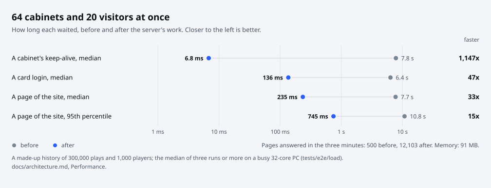

# Running a server

For server owners. A server keeps the players' logins and the stages they clear, for the cabinets that connect to it,
and runs a site with the rankings, the songs, each DJ's page, the launcher to download, and the admin pages. One
process does both: the game connects on port 4725, people and launchers on port 4730.

To the server, each game that connects is a cabinet, the arcade's name for the machine: a PC playing through the
launcher is one. The server knows each by the address it connects from, and the site's **Home** page and the
**Admin**, **Cabinets** tab list them.

You do not need a server to play alone: the launcher has one inside for that ([Playing on your PC](install.md), the
player's guide). Run one when others play from their own PCs, in one of three ways, each the same server:

| Way | Where it runs | For |
| :--- | :--- | :--- |
| [In the launcher](#in-the-launcher) | The launcher's own server on a Windows PC, while the launcher is open | The other PCs on that PC's network |
| [With Docker](#with-docker) | Docker Compose with `./dmt3`, on Linux, macOS, or Windows in WSL 2 | A server that stays on, for every player who can reach it |
| [With Python](#with-python) | Python 3.10 or newer on Linux, from a copy of this repository | The same, without Docker |

<p align="center">
  <picture>
    <source media="(prefers-color-scheme: dark)" srcset="images/ways-to-host-dark.svg">
    
  </picture>
</p>

## What you need

- A PC that stays on. With Docker: Docker with Compose v2, git and Python 3 (`./dmt3` is a Python script), on Linux,
  on macOS, or on Windows in WSL 2. With Python: Python 3.10 or newer and git, on Linux. In the launcher: the launcher
  on a Windows PC, nothing else.
- Your own client data on the server PC, in a folder or an archive, or the song list the launcher saved from it
  ([what a server takes](client-data.md#what-a-server-takes)). The server keeps only the song list.
- The launcher's installer, `openDMT3-win-Setup.exe`, from the
  [releases](https://github.com/kanggu12/openDMT3/releases/latest), to hand out from the site.

## In the launcher

A PC that plays can be the server for the other PCs on its network, with nothing else to install.

1. On that PC, add the players on the launcher's **Online** page (each an ID, a DJ name and a password), then turn on
   **Open this PC's server**. The page lists this PC's addresses on the network, such as `http://192.168.0.5:4730`.
2. On each other PC, in the launcher's **Online** page (or its first-start guide's **LOG IN**), choose **Another
   server**, type one of those addresses, **Connect**, and sign in with a player made on the first PC.
3. When Windows asks whether openDMT3 may use the network, allow it on private networks.

The server runs while that launcher is open, and keeps its logins and records in
`%AppData%\openDMT3\server\openDMT3.sqlite` on that PC, with a backup a day beside it. Its song list is read from
that PC's own client data when the launcher opens, so the first PLAY does not wait for it. The other players open the
same addresses in a browser for the site.
[Playing on your PC](install.md#with-the-other-pcs-on-your-network) has the player's side.

## With Docker

On Linux, macOS, or Windows in WSL 2. It needs Docker with Compose v2, git, and Python 3 (`./dmt3` is a Python script,
with nothing to install):

```sh
git clone https://github.com/kanggu12/openDMT3.git
cd openDMT3
./dmt3 setup
```

A wizard in the terminal, one question a page, each answer's meaning shown as you give it. Esc goes back a page,
Enter on to the next:

1. **Welcome**: what will happen, and what you need: Docker, and your own client data (a folder or an archive), or a
   song list the launcher saved.
2. **Docker and ports**: Docker, Compose and the ports 4725 and 4730, each problem with its fix (`r` checks again).
3. **This server's address**: the addresses this PC has, and the site and game addresses the other PCs use at the one
   you choose.
4. **The first admin account**: its ID (1 to 8 letters or digits). A database that has accounts already makes none.
5. **The admin's password**: typed twice, or left empty and made for you, shown once at the end.
6. **The song list**: type or paste a path (Tab completes; a Windows path such as `C:\Games\...` works under WSL)
   to your client data's folder (or a folder above it), an archive holding it, or a song list the launcher saved, or
   pick one found on the Desktop, in Downloads or Documents (Windows' too, under WSL) with Up and Down. It is looked
   at as you type, and says its one line: `Client data in a folder, original PC client, 177 songs: ready`, then the
   song list, the jackets and the DJ cards. An archive with a password gets a box for it. Links inside the client
   data's folder are followed: the folders they point into are mounted read-only too. Empty: none now.
7. **The installer to hand out**: the one `./dmt3 build` left, a file (an `openDMT3-win-Setup.exe` downloaded from the
   [releases](https://github.com/kanggu12/openDMT3/releases/latest)), or none for now, with its version and size.
8. **Confirm**: every answer on one page; a number goes back to change it.
9. **Setting up**: the image, the data folder, the account, the song list, the jackets, the DJ cards, the installer,
   the server and the check, each on its own line.
10. **Done**: the site's address on this PC and for the other PCs, the admin's ID and password, and what to do next.

A terminal that cannot draw the pages (`TERM=dumb`, a window smaller than 64 by 20) gets the same pages as numbered
prompts. With options, or from a script, `setup` asks nothing:

```sh
./dmt3 setup --game /path/to/client/data --installer openDMT3-win-Setup.exe
```

It does these, in order; run again, each one that is done already changes nothing:

- keeps the site's address as the players reach it (`--address ADDRESS`: this PC's address on the network, a name,
  or a whole `https://...` address behind a proxy), so the message to send a player carries it;
- builds the server's image and makes the data folder;
- makes the first (owner's) account `BOSS` with the admin pages and prints its password (`--admin ID` for another
  ID, `--password` to give one; nothing is made when the database has accounts already);
- imports the song list (`--game PATH`: the client data in a folder or an archive, or a song list the launcher
  saved);
- puts the installer on the site's **Download** page (without `--installer`, the one `./dmt3 build` left, when there
  is one);
- starts the server (`--no-start` to leave it stopped).

Run it again with `--game`, `--installer` or `--address` for a new song list, a new installer or another address.

### The song list

A server takes one thing from the client data: the song list (titles, composers and levels), which holds the jackets
and the DJ cards (their tables and pictures) too. Nothing else: no charts, music or videos, since every player has the
whole game on their own PC. The jackets and the DJ cards are optional: without the jackets the songs show without
them, without the DJ cards every DJ card keeps the basic icon and plate, and with no song list at all the site shows
song numbers. Each part is one line when it is read; a part that is missing says what still works, and its details go
to `catalog.log` in the data folder.

It comes from any of these, by what it is, not by its name ([The client data](client-data.md) has the forms and
each line):

| What | How it is read |
| :--- | :--- |
| Your client data in a folder, at the path or up to four levels below it (a copy of a cabinet's drives included) | Where it is, read-only, each file as the game reads it; names in any letter case, as Windows reads them |
| Your client data in an archive (a split one by its first part; one inside another, two levels at most; one with a password) | Its entries listed first; only the files the server needs taken out into a folder of the reading's own, read there and removed |
| A song list the launcher saved (**Game**, **Save the song list...**, or `--save-song-list`), or `./dmt3 catalog PATH --save FILE` made | Checked as an upload from anyone and taken in whole, or not at all |

Whatever came in, the server keeps the same files, so a song list taken in gives byte for byte what reading its
client data gives. What comes in is untrusted:

- **An archive's entries** with an absolute path, a drive letter, `..`, a device name, a stream or a link are
  refused, and so is more than the free space holds. Its password is asked for at the terminal, passed to the
  container by name only, and given to 7-Zip on its standard input, never on a command line.
- **A song list** holds only its own names and kinds, its sizes are capped, its tables' shapes checked, and every
  picture decoded and encoded again; nothing changes until all of it passed.

After a game update, or from another PC's client data:

```sh
./dmt3 catalog /path/to/client/data          # the client data in a folder
./dmt3 catalog ~/Downloads/technika.7z.001   # in an archive, a split one by its first part
./dmt3 catalog openDMT3-song-list.zip        # a song list the launcher saved
./dmt3 catalog /path/to/client/data --save . # save a song list here, for a server elsewhere
```

It looks at the path first, as the wizard does, then imports it into the server's data folder; a running server shows
the new list at once. The path is mounted read-only into a container that goes away, with the folders the client
data's links point into. That container runs as the server's own user, which owns the data folder, whenever that user
can read the path (and write where `--save` writes). It runs as root only when it must (a folder only its owner may
read, such as WSL's Windows drives), and then root only reads: the data folder (or the saved file's folder) is written
by that folder's owner alone, never through a link left in it. The server's image has the official 7-Zip, with its
license.

**Admin**, **Song list** is the site's page for it:

- what the server takes and whether it has it, part by part;
- **Found on the server PC**: the client data the server sees (the folder kept for it, and outside Docker its user's
  Downloads, Desktop and Documents), each with its one line and **Import**, asked first;
- **Another folder on the server PC**: a path box with its quick folders and a folder browser (in Docker, where the
  server sees only the folder kept for it, the page names `./dmt3 catalog PATH` instead);
- **Upload a song list**, up to 64 MB.

When the server's own user can read the client data's folder, the wizard (or `--keep-game`) keeps it mounted read-only
(`GAME_DIR`, and `GAME_LINKS` for the folder its links point into, in `.env` beside `compose.yaml`), so it is found
there. **Admin**, **Status** has the **Song list** card: when each part was last read, how many there are, what is
missing and why, and where it came from. The API's twins are `GET` and `POST /api/v1/server/song_list` and
`GET /api/v1/server/folders` ([api.md](api.md)).

### Every day

| Command | Does |
| :--- | :--- |
| `./dmt3 up`, `./dmt3 down`, `./dmt3 restart` | Starts the server (building its image first; `--no-build` to start the image as it is), stops it, restarts it |
| `./dmt3 status` | The container's state, then `check`, then the site's address |
| `./dmt3 logs [-f] [-n LINES]` | The server's log |
| `./dmt3 backup`, `./dmt3 backups`, `./dmt3 restore NAME` | The server's `--backup`, `--backups` and `--restore NAME` ([Backups](#backups)) |
| `./dmt3 add-player ID [--password P] [--dj NAME] [--admin]` | The server's `--add-player` ([Players](#players)) |
| `./dmt3 check` | The site answers `/health` and the game's port takes a connection |
| `./dmt3 catalog [PATH] [--save FILE]` | Imports the song list from the client data in a folder or an archive, or from a song list ([The song list](#the-song-list); the folder kept mounted when not given); `--save` saves one instead |
| `./dmt3 doctor` | Docker, the server's image, the two ports and the data folder, each problem with its fix |
| `git pull`, then `./dmt3 up` | Updates the server: its image is built again from the new code, and the data stays ([Updating the server](#updating-the-server)) |

The commands that reach the database run the server's own command line ([Command line](#command-line)) in its
container: in the running one, or in a new one that goes away. The same with Docker Compose itself, from the top of
the repository:

```sh
docker compose up -d --build
# the first (owner's) account; its password is printed:
docker compose run --rm server --add-player BOSS --admin
# the song list, imported once from your own client data (a folder or an archive) or a song list:
docker compose run --rm -v /path/to/client/data:/game:ro server --catalog /game --setup-only
# the installer for the site's Download page:
docker compose cp openDMT3-win-Setup.exe server:/data/downloads/
```

The data lives in a named volume (`opendmt3_data`), and the server runs as its own user, not root.

After an update the **Download** page hands out the installer it had until `./dmt3 setup --installer FILE` puts the new
one there ([Updating the server](#updating-the-server)); [Handing out updates](#handing-out-updates) has the files the
players' launchers update from.

## With Python

On Linux, with Python 3.10 or newer and git. The server runs from a copy of this repository; nothing installs
`opendmt3` itself. The song list is read once from your client data, before the first start (without it the site
shows song numbers):

```sh
git clone https://github.com/kanggu12/openDMT3.git
cd openDMT3
python3 -m venv .venv
.venv/bin/pip install starlette==0.47.3 jinja2==3.1.6 uvicorn==0.35.0 python-multipart==0.0.20 pillow==11.3.0
.venv/bin/python -m opendmt3.server --data data --catalog /path/to/your/client/data --setup-only
.venv/bin/python -m opendmt3.server --data data --host 0.0.0.0
```

On Debian and Ubuntu, `python3 -m venv` needs the `python3-venv` package. The `--catalog` line takes the client data
in a folder (or a folder above it), an archive holding it, or a song list the launcher saved, says each part in one
line, and exits; run it again for a new song list. To read an archive, the server needs 7-Zip on that PC: the one
`OPENDMT3_7ZIP` names, else the official 7-Zip's `7zz` (the only one that opens RAR5), else a `7z` or `7za` on the
PATH. Client data in a folder, or a song list, needs none.

Then open the site at the address the server prints (`site on ...`) on the server PC: while the server has no account,
that page makes the first one, the owner's. On a server PC without a browser,
`.venv/bin/python -m opendmt3.server --data data --add-player BOSS --admin` makes it and prints its password. (In
Docker, use `--add-player` as above: there the site never sees a visit from the server PC.) Put
`openDMT3-win-Setup.exe` in `data/downloads/` to hand it out.

To update, see [Updating the server](#updating-the-server).

## Players

Accounts are made by the owner, on **Admin**, **Players** or with `--add-player ID` (`--password`, `--dj NAME`,
`--admin`). Each account has an ID and a password for the site and the launcher, a DJ name for the game, and a card
number the game logs in with. Send each player the site's address: its **Download** page hands the installer out with
the steps, and the launcher asks for the same address, ID and password.

Players change their own DJ name and password under **My account** (their name in the header), and make **API
tokens** there for programs of their own: each with a name and a scope (read only, or read and write), shown once,
listed with when it was made and last used, and revoked there ([api.md](api.md#named-tokens)).

- **A new password** (6 to 16 letters and digits) also gives the account a new card number and ends its old
  sign-ins; the launcher fetches the new card at the next PLAY, or asks its player to sign in again.
- **Sign out** on the site ends the account's sign-ins on the site, in every browser; the launcher stays signed in.
  The launcher's own **Sign out** ends its sign-in on the server too, and only its own: a launcher signed in on
  another PC stays signed in.
- **A disabled account** cannot log in at the cabinet or on the site, and its plays leave the rankings.

## The site and the admin pages

| Page | Shows |
| :--- | :--- |
| **Home** | Your DJ and card, the cabinets and who plays on them, the newest records (plays that beat their player's best on a chart, with the gain), the first five DJs of the first mode, the latest plays (NEW marks a new best) |
| **Rankings** | Per mode, the total of each DJ's best scores on every chart, the average of their best 30, or this month's total (the server's clock) with the first three of each of the 12 months before it |
| **Songs**, a song | The song list, filtered as you type, with each chart's level; a board per chart |
| A DJ | Numbers, their place in each mode's ranking by total, the last 12 weeks, the modes, most played songs, best scores, recent plays |
| **Download** | The installer (its size, when it was put there, its version), named after the server's address, with the address and the steps |
| **Licenses** | openDMT3's license, the parts the server and the launcher it hands out are made with, and the fonts the site serves, with their licenses |

**Admin** has a tab for each of its jobs:

| Tab | Does |
| :--- | :--- |
| **Players** | Makes an account, with a message to send the player; a new password, the DJ name, admin rights, disable, reset plays, delete; reset every play |
| **Cabinets** | Names each one |
| **Status** | What to look at, the song list's card, cabinets connected, plays and time today, this week and this month, the last backup, the notice, maintenance |
| **Song list** | Found on the server PC, another folder, upload a song list |
| **Logs** | Changes and the game's recent messages; every play, filtered by player, days and title, 50 a page, as CSV |
| **Backups** | Make, upload, download, restore, delete |

- **Sign-in and language.** Every page asks for a sign-in, in English or Korean (the visitor picks), except the
  sign-in page and **Licenses**.
- **Long lists** show their first rows and say how many there are: a board or a ranking its first 100, a DJ's best
  scores their first 20.
- **The notice** set on **Status** (one line, up to 200 characters) shows at the top of every page; it is kept in
  `data/notice.json`.
- **Start maintenance** on **Status** makes the game server refuse every card login (the game shows a failed
  membership authentication and goes back to its card screen) until **End maintenance**: cabinets online stay
  connected, a game being played keeps its results, and every page of the site says so beside the notice. It is kept
  in `data/maintenance.json`.
- **The last enabled admin** keeps the rights and stays enabled: no admin can take them away.
- **Reset plays** on **Players** clears one player's cleared stages, or every player's: the rankings, the songs'
  boards and the DJ pages start again, while accounts, DJ cards and settings stay. It asks first, backs the database
  up before anything goes (a backup of the kind "Before a reset"), and the change log says how many plays went.
- **`/health`** answers 503 with a reason while the database cannot be opened or written, which is what Docker's
  health check reads.
- **The API.** Every page and every action of the site has its twin in the API ([api.md](api.md)): what the site
  shows can be read, and what it does can be done, by a program. The owner's first account, made on the server PC's
  own page, has its twin on the command line: `--add-player ID --admin`.

## DJ cards and the song select

When a player logs in at the cabinet, the server sends what the game shows of them:

- **The DJ card**: a level, an icon, a plate with a plate pattern over it, and a comment. Players choose the icon,
  the plate, the plate pattern and the comment under **My account**, **DJ card**, from the pictures in your game
  files (the song list holds them; without them, every DJ card keeps the basic icon and plate). The level comes from
  the stages the player cleared, by the game's own tables.
- **The song select's records**: for the chart under the cursor, the player's own best (MY RECORD) and the
  server's first place with its DJ (BEST RECORD).

Guests (NO ID CARD) see neither. The game shows a new choice from the player's next login.

## Backups

The server backs its database up once a day into `data/backups/` and keeps a week of them. **Admin**, **Backups** backs
up now, downloads a backup, and puts the database back to one; the current database is backed up first, so a restore
can be undone. From the command line: `--backup`, `--backups` and `--restore NAME`.

**Upload a backup** on the same tab brings a database file from elsewhere (a backup downloaded from another server,
or the `openDMT3.sqlite` of a server that is stopped), up to 256 MB. It is written into `data/backups/` as it comes and
checked before it is kept: an SQLite file whose integrity check passes, with this project's tables, at a version this
server opens. It then joins the list as **Uploaded**, to restore as any other; a file that is none of these is refused
with the reason, and nothing of it stays. The API takes the file as the body of `POST /api/v1/backups/upload`
([api.md](api.md)). Each kind of backup keeps its newest seven.

## Updating the server

A release changes the server and the launcher together; the data folder stays as it is, and a newer server takes an
older database forward on its first start (a copy of it is kept first).

- **With Docker**: `git pull`, then `./dmt3 up`: the image is built again from the new code, and the data stays.
  Then `./dmt3 setup --installer FILE` with the release's `openDMT3-win-Setup.exe`, so the **Download** page hands out
  the new launcher.
- **With Python**: stop the server, `git pull` in the copy of the repository, run the `pip install` line again, and
  start the server again. Put the new `openDMT3-win-Setup.exe` in `data/downloads/`.
- **In the launcher**: the launcher's own update (**Launcher**, **Check for updates**) updates its server too.

The players' launchers update themselves: from the project's releases, or from this server when it hands the updates
out (below).

## Handing out updates

Put a release's update files, from its page in the [releases](https://github.com/kanggu12/openDMT3/releases), into
`data/updates/`: `releases.win.json`, each `.nupkg` (the whole package, and the delta package from the previous
release when there is one, which is all a launcher of that version downloads) and each `.nupkg.sig` beside it (the
delta package's as well: a launcher checks a delta by its own `.sig` before it uses it). Launchers playing on this
server then update from it (**Launcher**, **Check for updates**), whatever address they were built with.

A launcher puts in only a package whose `.sig` is the openDMT3 project's signature of it, so the server hands out the
project's releases as they are and nothing else. Only those three kinds of file are handed out of the folder: the
feed, the packages and their signatures, by their plain names.

## A line in your chat

`--webhook URL` (or `OPENDMT3_WEBHOOK`) posts a line to a Discord or Slack webhook whenever someone takes a chart's
first place from another player. In Docker, add `OPENDMT3_WEBHOOK: URL` under the service's `environment:` in
`compose.yaml`.

## Over the internet

The game's port speaks the game's own protocol, so it is opened as it is (TCP 4725). Sign-ins carry passwords: behind
a reverse proxy that does HTTPS, they travel encrypted. With [Caddy](https://caddyserver.com) on the server PC, for
example:

```
dmt.example.org {
    reverse_proxy 127.0.0.1:4730
}
```

and the server started with `--host 0.0.0.0 --web-host 127.0.0.1 --proxy 127.0.0.1`: the game's port is open to
other PCs, the site listens on the server PC only, where the proxy reaches it, and the server believes forwarded
headers from the proxy's own address only. Visitors are then told apart (a wrong password holds back only its own
address) and HTTPS sign-ins get secure cookies. The proxy passes on the visitor's address in `X-Forwarded-For` and the
site's name in `Host`, as Caddy does by itself. A request that came through the proxy never counts as a visit from the
server PC: the owner's first page and the launcher's one-use links answer only the site opened on the server PC
itself.

In Docker, publish the site on the server PC only (`"127.0.0.1:4730:4730"` in place of `"4730:4730"` under `ports` in
`compose.yaml`); `--proxy` then names the address the container sees the proxy's connections come from: for a proxy on
the server PC, the gateway of the container's network (`docker network inspect opendmt3_default` shows it as `Gateway`).
Add it to the service as `command: ["--proxy", "GATEWAY"]`.

Cabinets behind one router share its address: the game's port takes up to 16 of them from one address, and 64 in all.

## Many players at once

One server answers its cabinets, its site's visitors and the programs using its API at the same time, and none of
them can take it from the others. These are the limits, per sender (an address; an IPv6 /64 counts as one) or per
caller (a sign-in on the site, or an API token):

| What | Limit | Past it |
| :--- | :--- | :--- |
| Cabinets | 64 links in all, 16 from one address | The link is closed at once |
| A cabinet's link | 10 seconds to answer the handshake; 90 seconds without a message ends it; 15 seconds to read what is sent; 16 logins or results waiting for the database | The link is closed (what it left unread thrown away); past 16, its next messages wait their turn |
| What one address sends the game's port | 64 KB a minute over all its links (a cabinet sends a few hundred bytes a minute) | Its links are closed until the minute ends |
| Results | 8 stages a card login, only modes, patterns and songs the game has | Not kept, one log line a link |
| Sign-ins | 20 a minute from one address; 5 wrong passwords in 10 minutes from one address, 10 for one ID (never for the server PC itself); 2 password checks at once | 429 with Retry-After |
| Requests at once | 1 per caller, 8 per address; up to 32 more of each wait their turn | 429 with Retry-After |
| The server's work | 30 seconds of processor time a minute per caller, 90 per address (a page takes a few milliseconds; a file of every play on a long history a few seconds) | 429 with Retry-After until enough of the minute has passed |
| A request's body | 64 KB, but an admin's uploads: a backup up to 256 MB, a song list up to 64 MB | 413 |

The site's files (its styles, fonts, pictures and the launcher's updates) are not counted. Retry-After says in seconds
when to ask again; the site shows the same in a page of its own.

<p align="center">
  <picture>
    <source media="(prefers-color-scheme: dark)" srcset="images/chart-server-dark.svg">
    
  </picture>
</p>

The cabinets' links never wait for the site's work:

- **Threads.** Every query, page and answer of the site runs on two worker threads, every write of the game server on
  a thread of its own, and its logins' reads on two more beside it.
- **Kept lists.** The lists made from everyone's plays (rankings, songs, a song's boards, a DJ's page) are made once
  and kept until the plays change.
- **A database held by another program.** A write waits up to 15 seconds for it, and the game server's own writes (a
  player's results, a session) are tried again until they go through: a player is never told the database is busy,
  and their link stays while it waits.
- **A restore or a reset of plays** from the **Backups** tab or the API holds the game server's writes and reads
  while it works, so no play is lost between the backup it makes first and the copy (or the deletion). The command
  line's `--restore` cannot hold them, so stop the server first for that one.
- **Pictures.** Reading a song list from the client data converts its pictures on up to 8 of the server's cores at
  once, fewer when the server may use fewer (a container started with `--cpus 2` uses two).

## Without internet

The server needs no internet once it is installed: nothing it does reaches outside, and the site's fonts and pictures
come with it. To set one up on a network with no way out, bring it in from a PC that has internet:

- **Docker**: build the image there, then carry it as a file:
  `docker save opendmt3-server:local -o opendmt3-server.tar`, and on the server `docker load -i opendmt3-server.tar`.
  `./dmt3 setup` builds the image first, so on the server take its steps one at a time: `./dmt3 up --no-build` (or
  `docker compose up -d`, without `--build`), then `./dmt3 add-player BOSS --admin` for the first account and
  `./dmt3 catalog PATH` for the song list ([Every day](#every-day) has the installer's step too).
- **Python**: `.venv/bin/pip download -d wheels starlette==0.47.3 jinja2==3.1.6 uvicorn==0.35.0
  python-multipart==0.0.20 pillow==11.3.0` there (on the same system and Python version as the server), and on the
  server, in its copy of the repository, `python3 -m venv .venv` and
  `.venv/bin/pip install --no-index --find-links wheels starlette jinja2 uvicorn python-multipart pillow`.

The webhook is the only thing that reaches outside, and only when you give it one.

## What to keep private

- A player's card number logs that player in at the cabinet by itself, as a real card would. The site shows it only
  to its owner; the launcher puts it in `openDMT3-card.txt` in openDMT3's own folder while the game runs, readable by
  that PC's user. A new password also makes a new card number.
- The database (`data/openDMT3.sqlite`) and its backups (`data/backups/`) hold the card numbers too, and the
  passwords only as slow hashes.
- `data/web.secret` signs the sign-ins: whoever has it can make one. A new one signs everybody out.

openDMT3 makes these files readable by their owner only (on Linux and macOS).

## Command line

`python -m opendmt3.server` (or the container's command):

| Option | Does |
| :--- | :--- |
| `--data DIR` | The folder for the database and files (`OPENDMT3_DATA`; `data` by default) |
| `--host ADDRESS` | The address to listen on: `0.0.0.0` for other PCs (`127.0.0.1` by default) |
| `--web-host ADDRESS` | The site's address to listen on, when not `--host`'s: `127.0.0.1` behind a proxy on the server PC |
| `--port N`, `--web-port N` | The game's port (4725) and the site's (4730; 0 for no site) |
| `--catalog PATH` | Imports the song list (with its jackets and the DJ cards) from the client data in a folder or in an archive (`OPENDMT3_ARCHIVE_PASSWORD` for its password), or from a song list, each part one line, then starts. Run as root on a data folder someone else owns, root only reads: the data folder is written as its owner |
| `--catalog PATH --save FILE` | Saves the song list from `PATH` into `FILE` (a folder: `openDMT3-song-list.zip` in it) instead, checked as a server takes it, and exits; the server's data is not touched |
| `--game FOLDER` | The folder holding the client data, which the admin's **Song list** tab finds and imports again (`OPENDMT3_GAME`; in Docker, `GAME_DIR`) |
| `--site-address URL` | The site's address as the players reach it, for the message to send a player (`OPENDMT3_SITE_ADDRESS`; in Docker, `SITE_ADDRESS`); without it, the address the admin's browser used |
| `--add-player ID [--password P] [--dj NAME] [--admin]` | Makes an account, prints it, and exits |
| `--backup`, `--backups`, `--restore NAME` | Backs up now, lists the backups, puts the database back to one |
| `--proxy ADDRESS` | The reverse proxy in front of the site, by the address its connections come from (several with commas) |
| `--webhook URL` | The chat webhook for new first places |
| `--setup-only` | Does `--catalog` and `--add-player`, then exits without serving |
| `--verbose` | Logs every message of the game with its first bytes |

When something does not work, see [Troubleshooting](troubleshooting.md).
