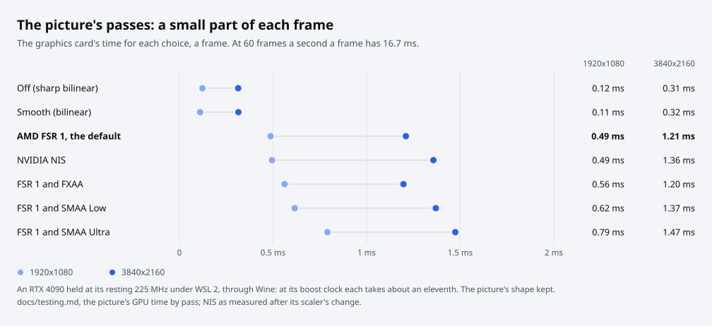

# Testing

The tests need no game files: they make stand-ins of their own (client data with small stand-ins for the game's files,
a client with the bytes the display fix looks for). Only the Wine tests, and a few unit tests when `OPENDMT3_GAME_DIR`
is set (`unit*` in [Test cases](test-cases.md)), use real client data: your own, which never goes in the repository.
Nothing a test runs opens a window on your screen: the window tests run on a virtual screen in a container, and the
launcher refuses to open its window or the game under the unit tests.

[Test cases](test-cases.md) lists every case with what checks it.

## Where the tests are

| Folder | Holds |
|---|---|
| `tests/core/` | The unit tests of `opendmt3/core`: the client data, its formats, the setup steps, the settings values, the error words |
| `tests/server/` | The unit tests of `opendmt3/server`: the game protocol, the services, the database, the site and the API |
| `tests/client/` | The unit tests of `opendmt3/client`: the launcher's jobs, its theme and pictures, its link to a server |
| `tests/` | `test_architecture.py` (the parts' boundary), `test_front_door.py` and `test_setup_wizard.py` (`./dmt3` and its wizard), `test_docs.py` (the guides, CONTRIBUTING.md, CHANGELOG.md and `.github/`), `test_words.py` (the words people read), `test_release_notes.py` (a release's version and notes, the workflows' pins), `test_launcher_licences.py` and `test_windows_build.py` (the Windows build), `test_parallel_runner.py` (the runner below) |
| `tests/e2e/` | The end-to-end suites: `windows/`, `ui/`, `web/`, `load/`, `upgrade/` |
| `native/cardreader/` | `test_native.c`: the in-game layer's settings, frame clock, keys, menu and question, layout and pictures, run by `test.sh` |

`./dmt3 test` runs the unit tests, the boundary test on its own and pyflakes over the package, the tests, `dmt3` and
the scripts that build and release openDMT3 (`packaging/`, `.github/`), all on the Python that runs it or the one
`--python PATH` names (a Python with the site's libraries and pyflakes). [CI](#ci) runs the same on Python 3.10 and
3.12, and the suites below that need no game files.

The unit tests run on several processes at once (`tests/parallel.py`, as many as the cores, at most eight):

- **How they are shared out.** Each process takes the next test class as it finishes one, the longest of the last run
  first, and a class long beside the whole run is cut into pieces of its tests; the results are added up and said as
  one run says them.
- **How long.** The unit tests, run by turns in one process and on eight, on a 32-core PC under a load of 3 to 7: 124
  and 157 s in one process, 37 and 47 s on eight.
- **One process.** `--one-process` runs them one after another, as `python -m unittest discover -s tests -t .` does;
  `--jobs N` sets the number of processes.
- **No test counts on another.** `python -m tests.parallel --shuffle SEED` hands the classes out in another order
  (four seeds on 2, 3, 8 and 16 processes gave the plain run's results).
- **The timed tests run alone.** The nine tests that time what the PC does while they run (how soon a server answers
  beside a misbehaving caller or a held database, an event loop's longest stall, the first places' walk against the
  history's length) run after the rest on a process of their own (`ALONE` in `tests/parallel.py`, each with why).
- **A failure.** A failing piece shows what its tests printed while it ran and how many pieces ran before it on its
  process (each process's order in `build/test-order.json`, to run them again in one process); a process that crashes
  is said as an error of what it ran, with the end of what it printed and Python's report of where it was.
- **The launcher's folder.** Every test process gives the launcher's own folder a temporary one
  (`tests/__init__.py`).

## What runs where

| Suite | Covers | Command | Time |
|---|---|---|---|
| Unit | The game's formats, the setup, the settings values, the game server (framing, cipher, login, results, fuzzing, its first places in memory), accounts, the database and its upgrades, backups, the site and the API (its work off the event loop, its kept lists, its fair shares), cabinets, visitors and threads at once, the launcher's jobs, the theme's contrast and pictures, the error words, the parts' boundary, the front door's commands | `./dmt3 test`, or `python -m tests.parallel` | 45 s on eight processes (2 to 3 min in one) |
| Launcher screens | The first-start guide, every page, the dialogs (keys, clicks, a resize), the start-up error window, the installer's states, the keyboard focus; at 960x640, 1180x760 and 1600x1000, in English and Korean | `tests/e2e/ui/run.sh OUT_DIR` | 6 min |
| Site screens | Every page signed in, at a desktop and a phone width, in English and Korean, the questions asked first, a token shown once, the upload fields by mouse, keyboard and screen reader, both uploads, maintenance off and on | `tests/e2e/web/run.sh OUT_DIR` | 4 min |
| Native | The in-game layer's own parts, built with MinGW and run under Wine, both in containers | `native/cardreader/test.sh` | 1 min |
| Wine | The real client and the built installer on a virtual screen: installer to a card login, the in-game buttons, question, pointer, frame pacing and sound device, a whole song on the real client (the stage failed with no input, so no result is sent), offline as a guest, two real cabinets on one server at once, the link's keep-alive, the link after the server restarts, an installer over an older open launcher, an update (an unsigned one refused), two machines through the site, removing openDMT3, repairing it | `tests/e2e/windows/*.sh` | 5 to 20 min |
| Wine on the GPU | The Wine tests drawn on the PC's own graphics card through WSL 2 instead of Mesa's software renderer: the renderer proved with a known picture, `install_and_play.sh`, `play_a_song.sh` and `ingame.sh` on it, and the game's and openDMT3's frame costs measured on the GPU and the CPU, the picture's GPU time by pass, two builds' pictures of the same frames held against each other ([below](#wine-on-the-gpu)) | `tests/e2e/windows/gpu/check.sh OUT_DIR`, `OPENDMT3_WINE_GPU=1 tests/e2e/windows/ingame.sh ...`, `tests/e2e/windows/gpu/measure.sh ...`, `tests/e2e/windows/gpu/pictures.py A_DIR B_DIR` | 2 min; as on the CPU; 35 min a screen size |
| Windows scaling | The launcher's screens with Windows' own Python and Tk under Wine at 100 %, 125 %, 150 % and 200 % (1920x1080 and 3840x2160), in English and Korean, measured as the Linux run measures them, every guide step and page again at the window's smallest size; the made-up archives made and read with the official 7-Zip for Windows (`packaging/windows/sevenzip.sh`, its downloads kept in `OUT_DIR/cache`) | `tests/e2e/ui/run_wine.sh OUT_DIR` | 30 min |
| Load | One server process on a made-up history of 300,000 plays for 30 minutes: 63 stand-in cabinets and a bad one (garbage, a login it never reads, a message cut half way), 20 visitors on the site and a program asking for every play as a file over and over. Every good cabinet online all the time, 95 % of the keep-alives within 250 ms and every one within 2 s, half the logins within 500 ms, every session kept, each page within 1 s for 95 % of the visitors' asks and none refused, every call of the program answered (one at a time), memory steady after the first third | `python tests/e2e/load/cabinets.py` | 31 min |
| Upgrade | A database the last release's server made (accounts and plays), opened by this tree's server: upgraded with its owner's-only copy kept first, nothing lost, the same players sign in | `tests/e2e/upgrade/run.sh vX.Y.Z OUT_DIR` | 2 min |

The site's tests and the server need `starlette`, `jinja2`, `uvicorn`, `python-multipart` and `pillow` (the versions
in [server.md](server.md#with-python)), and the site's tests `httpx` as well; without them those tests are skipped and
say so. The launcher's window tests need Tk: on a Python without it (a server's) they are skipped too. The archives'
tests need 7-Zip (`OPENDMT3_7ZIP` naming it, or `7zz`, `7z` or `7za` on the PATH; CI's is the official one) and are
skipped without it. The rest pass on Python 3.10, the oldest a server runs on.

## The layout checks

The launcher's check (`tests/e2e/ui/shots.py`) walks every widget of each screen and fails on text cut off, a wrapping
label never told its width, a button squeezed, anything past the window's right edge, or anything hidden under the
bottom bar or past the window's bottom edge with no way to scroll to it; **Play** must show whole at the size the
launcher opens at. The site's check (`tests/e2e/web/shoot.js`, measuring with `measure.js`) fails on anything past a
page's right edge, words cut off inside a box that hides its overflow, a stacked row's cell with no label at the phone
width, a word of the phone menu that does not fit, a button whose words are out of its middle, and a question asked
first that does not fit. Both also count what they looked at, so a page that silently stops being visited fails the
run.

Each check is tested itself: `OPENDMT3_REPO` points it at a copy of the tree, and `tests/e2e/web/selftest.sh OUT_DIR`
plants five faults in a copy (a table that sticks out on a phone, words cut off in a box of a fixed height, a stacked
cell with no label, a button's words out of its middle, the phone menu cut) and passes only when the check catches
each. The launcher's check for hidden content tries itself at every run, at that run's fonts and scale, on a made-up
page taller than the window: it must be said hidden where it cannot scroll (a scroll area with its region cut, a plain
box) and not where it scrolls.

## Wine

`packaging/wine` is the image: Wine, a virtual screen and the tools to click and take screenshots, with no network.
The tests take the built installer from `packaging/windows/build.sh` and a copy of your own client data, mounted read
only (PLAY only reads the client data, so a game played from it proves nothing of it had to be written).

Each script's first lines give its arguments. Those that play take the copy as `GAME_PARENT`, a folder holding it up
to four levels down, when they start from the installer, or as `GAME_DIR`, the folder itself, for `net_green.sh`,
`server_restart.sh` and `two_cabinets.sh`, which make openDMT3's folder for it themselves. `RELEASES_DIR` is a
build's `OUT_DIR/releases` and `BUILD_DIR` its `OUT_DIR`; the screenshots go to `OUT_DIR`. `LINK_SOURCE` is a folder
the copy's files may be links into (mounted read only), and `WINE_DLLS` a folder of the 32-bit system DLLs the game
needs and Wine lacks (`mfc42.dll`, from a Windows PC's `SysWOW64`). `setup_over.sh`, `update.sh`, `update_delta.sh`
and `repair.sh` need no client data.

| Script | Passes when |
|---|---|
| `install_and_play.sh` | The installer, the guide clicked through, PLAY, and the DJ logged in by card on the launcher's server, still playing 15 seconds later |
| `play_a_song.sh` | As `install_and_play.sh`, then a whole song with the game's own timers: still open six minutes after the login, its link kept, no crash dump. `GAME_AT=` puts the game on the Desktop under another name (Korean letters, or folders long enough to pass 260 characters: the launcher's log then says it played through its short path); `MODIFIED=1` for a copy whose client is a modified PC client (no screen fit) |
| `offline_play.sh` | The installer, the guide with Offline, PLAY, and the game as a guest 15 seconds after TOUCH to START, with no card and no server |
| `two_cabinets.sh` | Two real clients on one server at once, each with its own copy of the client data and its own player's card: both online from their own addresses, both players logged in by card, neither link lost before the end |
| `net_green.sh` | The client's link went online once and stayed, keep-alives answered all along |
| `server_restart.sh` | The game came back online by itself after the server was stopped and started again on the same database, and stayed |
| `setup_over.sh` | The installer over an older, open launcher asked, updated it and started the new one, the desktop shortcut and playing when Windows starts kept |
| `update.sh` | An installed launcher refused an update without a signature it takes, and one that carries another `Update.exe`, with nothing of them in the install folder (`packages\` and `Update.exe` as they were); then found a newer one, fetched and checked it, updated itself, started again and knows it is the newest, the desktop shortcut and playing when Windows starts kept. The made-up update is signed with a key pair made for the run |
| `update_delta.sh` | An installed launcher updated itself from a feed with only the next version's delta package: the launcher fetched the delta and checked it by its own signature, the installed `Update.exe` put the package together from the one installed in the launcher's own folder, the launcher found it holds the files that were signed, and the next version started with its changed and added files |
| `remote_play.sh` | A second machine downloaded the launcher from a server's site, installed it, signed in, and its game logged in on that server by card |
| `repair.sh` | `--repair` put back a lost launcher file and a changed updater; with `openDMT3.exe` lost, the console program named the installer's Repair; the installer over the same version offered Repair, which put the file back, kept the settings and started the launcher |
| `ingame.sh` | Every step of [the in-game layer's test](#what-ingamesh-checks), over four plays of the real client: the layer's parts on this PC, then offline with the picture defaults, with FSR 1 at 80 and SMAA High, and with NVIDIA NIS and SMAA Ultra |
| `render.sh` | [The game drawn at the screen's size](architecture.md#the-game-drawn-at-the-screens-size), without the game (a minute): a 32-bit Direct3D 9 program (`ingame/render_probe.c`) loads the built `CRT_R1.dll` as the game does and asks for a 1280x768 back buffer in a window over a 1920x1080 screen with `OPENDMT3_RENDER=display`. It is answered 1280x768 everywhere the game reads a size (its back buffer, a render-target texture's level and surface, the viewport, a viewport of its own set and read back, a screenshot of its own read into a 1280x768 surface), and the frame it drew, dumped by the chain at 1800x1080, has each of its parts where the game's would land (`ingame/render_probe.py`: through its projection, through a copy into its texture and back, and in screen-space vertices as the game's videos are drawn), all of it again after a device reset. It reads only `D3DX9_40.dll` from the client data, for the chain's shaders |
| `remove.sh` | openDMT3 removed three ways (**Help**'s **Uninstall** answered **Delete all**, `--uninstall`, the app list with the game open and then closed) left no install, app list line, shortcut or Run value, and the client data as its list in `backup\` says (`folder_check.py`) |

Each saves a screenshot per stage and fails at the first stage that does not happen.

### What `ingame.sh` checks

It builds `tests/e2e/windows/ingame/Dockerfile` (the Wine image with python3-xlib) the first time. Where the frames
are judged, the container needs a GPU device (WSL's `/dev/dxg` or a Linux `/dev/dri`): with none, Mesa draws the game
on the CPU, where the frame times say little about a player's PC, so the numbers are said and nothing is judged.

**The first play, on this PC: the layer's parts.**

- The bar by itself at the game's first screen, 3.0 to 3.8 s on the screen (its 3 s and its fade; on a busy machine
  longer by the game's frames of over 100 ms in that time, as its frame counter says).
- The pointer read through XFixes: openDMT3's dart, up and pressed.
- The pointer in the top quarter brings nothing but the mark at the top centre.
- A click on the game and the pointer on the mark: no bar for 1.5 s after the click, then the bar. The very top edge
  brings it too.
- The X's question drops down under it (no line on the game's menus); Keep playing, and the game is still open 15
  seconds later.
- Esc and Alt+F4 do nothing. The window's close (WM_DELETE_WINDOW, as the taskbar's: `ingame/close.py`) asks the same
  question.
- The menu under its chip, Esc closing it, a toast at the top.
- Full screen to a window (its title bar and borders, none of Windows' buttons; the bar by itself after the switch,
  3.0 to 3.8 s on the screen) and back; minimise and the taskbar's restore (`ingame/restore.c`, built with the DLL's
  compiler).
- Quit the game: exit code 0, and the launcher saw it.
- Where the layer drew, read from the post-process chain's measuring dump of one frame without the layer and with it
  (`ingame/layer.py`): only in the bar's band, under the X or the menu chip, the toast's place, the mark's and the
  chip's corner, never in the middle half of the game.

**Offline from `openDMT3-cmd.exe`, with the picture defaults (FSR 1 at 50, no anti-aliasing) and pacing locked to the
music.**

- The frame rate chip in the bottom right corner above FREE PLAY, at most one frame queued, the chosen sound device
  opened, and what came of asking for the sound engine's shortest period on it (Wine keeps its own: `unchanged`, the
  stream let go), in the launcher's log too once the game closes.
- What the layer adds to the frames, judged fairly (`ingame/pace.py`): each of its parts (the chip, the bar, the
  question, the menu, a toast) shown for 8 s in turn with 8 s of nothing between, in rounds until every part is
  judged or 25 minutes are over.
  - A part is judged only on a quiet machine (the others' share of the 1-minute load average, the average less the
    test container's own CPU, under 5: `ingame/quiet.py`; each round waits for it, and the load at every judged phase
    is in the output) and next to a phase where the game alone held 60 (Wine's software renderer misses 60 by itself
    in some stretches). It passes when it held 60 there too.
  - A part that did not hold 60, or parts not judged in the time (the machine busy, or the game alone missing 60 next
    to them), fail the run at its end, never a pass. Its other steps still run and are checked, and the output says
    how many phases were not judged for which reason and how often the game alone held 60.
- The chip's own CPU time a frame, its updates and no GDI drawing in them, and the mark's CPU time a frame, against
  their targets (`ingame/costs.py play`).
- The menu's Show FPS hides and shows the chip; F12 turns nothing.
- In the tutorial's song, the X's question (with its line) holds the game still: two screenshots the same in the
  middle half (`ingame/still.py`), the chip hidden, the frame count the same when it goes on, the sound faded out,
  held, and played again from where it stopped with a fade in. Keep playing lets it go on; Esc does nothing.
- A minute of the song played all over the screen by a script (`ingame/player.py`: taps and held notes, the top band
  and its edge included, the pointer resting at the top edge between notes a little under the 1.5 s of quiet) never
  brings the bar on the screen; a call on purpose after 1.6 s of quiet brings it, gone 0.9 s after the pointer leaves
  it.
- Minimised, the song is held, and goes on when restored.

**Offline again, with FSR 1 at 80 and SMAA High, the Mixer on OpenAL Soft.**

- On the title screen, what each part adds to a frame as it is drawn (`OPENDMT3_LAYER_TIMING=frame`, every frame's
  chain and layer work timed whole; eight turns of 4 s with the chip and without, five with the bar, five with the
  question): the chip's median turn under 0.2 ms, the others' said (`ingame/costs.py turns`).
- Those options reach the layer and are run by its post-process chain: the frame presented is the chain's, FSR 1
  differs from bilinear on the same frame, and the screen shows the chain's output where the game holds still
  (`ingame/picture.py`).
- The game's sound goes through DSOAL and OpenAL Soft, which PLAY put beside the library; when the game closes the
  launcher's log says OpenAL Soft mixed it, and the game's exit code is 0.

**Offline, with NVIDIA NIS and SMAA Ultra.** The only play with the safety net on: on Wine's software renderer a busy
machine makes it step FSR 1 down, and its toast would be one more part on the screen than the steps above check.

- The safety net steps the chain down to bilinear, its toast shows, the frames are 60 a second evenly again, and the
  steps are in the launcher's log. On the GPU it leaves the heaviest choice as it is, and that holds 60
  ([below](#wine-on-the-gpu)).

## CI

`.github/workflows/ci.yml` runs on every push to `main`, every pull request and a release's tag (`release.yml`), with no
game files and no screen. A maintainer runs each job on a Linux PC the same way before it goes in: its run blocks as
they are, on a clean copy of the commit, in containers where the job uses a runner's own tools. Every action from
elsewhere is pinned by its commit, with its release in a comment (`actions/checkout@<commit> # v5.1.0`): a tag moved
later never runs here (`tests/test_release_notes.py` checks each).

| Job | Runs | The same on a Linux PC |
|---|---|---|
| `test` | The unit tests on Python 3.10 and 3.12 with the site's libraries at the image's versions, the boundary test, pyflakes | Each block in the official `python:3.10-bookworm` and `python:3.12-bookworm` images (Tk inside and no screen, as on the runner) |
| `native` | The card reader library and its notices (`native/cardreader/build.sh`), its native tests under Wine (`test.sh`), the official 7-Zip for Windows (`packaging/windows/sevenzip.sh`), DSOAL and OpenAL Soft with their notices (`native/openal/build.sh`), handed to `windows` | The same commands: they run in containers already |
| `ui` | The launcher's screens, both languages at three sizes, every size with 0 problems (`tests/e2e/ui/run.sh`) | The same command |
| `web` | The site's pages, the upload fields and the forms (`tests/e2e/web/run.sh`) | The same command |
| `server` | The server's image built, every part's license text in it (`packaging/docker/check_licences.py`), started, `/health` and the site answering with this version, running as its own user | The same commands |
| `windows` | On `windows-latest`: the unit tests of `tests/core`, `tests/client` and `tests/server` and of the license and release scripts with Windows' own paths, files and processes (`tests/e2e/windows/unit_tests.py`: every test on Windows itself; under Wine it leaves out what Wine cannot show, and says why), then the launcher built with PyInstaller with `native`'s parts, its licenses gathered, and started with `--version` and `--inspect` on a made-up folder (`tests/e2e/windows/built_launcher.py`) | The same commands with the build machine's Windows Python under Wine (`opendmt3-winbuild:local`, a virtual screen and a UTF-8 locale inside), the pins checked against the job's |

## Wine on the GPU

In `packaging/wine` Mesa's llvmpipe draws every frame on the CPU: the client is a 32-bit program, classic Wine runs it
on 32-bit Mesa, and WSL's D3D12 library, which Mesa's d3d12 driver draws through, is 64-bit only. The frame times
those tests see are a software renderer's, on a CPU the rest of the machine shares. On WSL 2 with a graphics card,
`OPENDMT3_WINE_GPU=1` runs `install_and_play.sh`, `play_a_song.sh` and `ingame.sh` on the GPU image instead
(`tests/e2e/windows/gpu.sh`); CI and the Windows build keep the CPU image.

- `tests/e2e/windows/gpu/Dockerfile` builds Wine 11.0, the CPU image's release, from its source in WoW64 mode (32-bit
  Windows programs on a 64-bit Unix side), so the game's OpenGL reaches the 64-bit d3d12 driver. A GPU run builds it
  the first time (about 15 minutes).
- The container gets WSL's GPU read only: `/dev/dxg`, `/usr/lib/wsl/lib` and `/usr/lib/wsl/drivers` (WSL's D3D12
  loads the card's own driver from there), with `LD_LIBRARY_PATH=/usr/lib/wsl/lib` and `GALLIUM_DRIVER=d3d12` as WSLg
  sets them, and no core dumps (WSL would copy each into Windows' temporary folder). The screen is still the
  container's virtual one: each frame is drawn on the card and read back to it, and nothing shows on the Windows
  desktop.
- A run fails when the game's own process does not draw through WSL's D3D12 (its memory holds WSL's `libd3d12` and it
  has `/dev/dxg` open), so a GPU run that fell back to the CPU never passes.
- `ingame.sh` judges the pacing and the parts' costs there (the container has a GPU device), and its last play checks
  what a GPU must do with the heaviest choice: NIS with SMAA Ultra holds 60 evenly and the safety net leaves it as it
  is.

Three settings of the image keep the frame times and the layer's costs the game's own rather than Wine's way there:

- Wine's WoW64 OpenGL copied the whole 512 KB of wined3d's streaming buffer in from the driver's write-combined
  mapping and back for every `DrawPrimitiveUP`, about 1.2 ms a draw on WSL's GPU, and the game and the layer draw
  nearly everything that way. `wine-wow64-gl-flush.patch` copies only the flushed ranges of a write-only map, at the
  flush (500 draws a frame: 582 ms before, 9 ms after).
- The prefixes draw through GLX, not EGL (`UseEGL=N`): Mesa puts a frame on the virtual screen three times faster that
  way (8.3 against 27.5 ms for a 1920x1920 window).
- Direct3D has no command thread (`csmt=0`): WoW64's OpenGL has no buffer storage, so with that thread every
  `DrawPrimitiveUP` waited for it, and the layer's own CPU time was 135 to 340 us a part (2 to 8 on the CPU image);
  without it, 6 to 19 us, the frames as even.

| Command | Does |
|---|---|
| `tests/e2e/windows/gpu/check.sh OUT_DIR` | A 32-bit Direct3D 9 program (`d3d9probe.c`) on the GPU image, on the same image without the GPU and on the CPU image: passes when the GPU's OpenGL renderer names D3D12, the known picture is right at all 80 points, the GPU's frame equals llvmpipe's in every pixel and each screen shows what was drawn (2 minutes) |
| `OPENDMT3_WINE_GPU=1 tests/e2e/windows/ingame.sh ...` | The test as in the table above, on the GPU (the same for `install_and_play.sh` and `play_a_song.sh`; the containers are named `odt3-gpu-*`, so they never take a CPU run's) |
| `[OPENDMT3_WINE_GPU=1] [SCREEN=WxH] tests/e2e/windows/gpu/measure.sh GAME_PARENT BUILD_DIR OUT_DIR [LINK_SOURCE] [WINE_DLLS] [RUN...]` | The same scenes on either renderer at one screen size, the real client started as a guest on its title screen: what draws it, what showing a frame costs by itself, the game alone (its own limiter, and as fast as it goes), openDMT3 at each picture choice, each part of the layer in turns, the picture's GPU time by pass at every choice, kept and filled, in one start of the game (`passes`; 35 minutes in all up to here), and the frame rate chip with the limiter out, where its number changes at every count (`chip`, a minute and a half: its uploads' times, and the layer's textures made at its first frame). `python3 tests/e2e/windows/gpu/measure.py compare OUT_DIR` puts the sessions side by side; `measure.py passes OUT_DIR [BEFORE_DIR]` tables the passes runs, or two builds' before and after |
| `OPENDMT3_WINE_GPU=1 tests/e2e/windows/gpu/measure.sh ... pictures:keep pictures:fill` with one build, again with the other and `PICTURE_SOURCE=` the first run's session, then `python3 tests/e2e/windows/gpu/pictures.py A_DIR B_DIR` | The chain's measuring dump of frames of the title screen (`PICTURE_FRAMES`, 1800 and 2400 by default) with every filter and anti-aliasing, kept and filled. The title's animation is not at the same picture at a frame number in two runs, so the second run takes the first's game picture of each frame in place of its own (`OPENDMT3_POSTFX_SOURCE`); `pictures.py` holds the two runs' dumps against each other: the game's own frame must be the same in both, then each picture's pixels that differ, the largest difference and the PSNR (exit 0 only when all are the same) |

What a player's PC does not have, and so what the numbers below hold besides the game's and openDMT3's own work:
Direct3D 9 goes through wined3d to OpenGL, Mesa and D3D12, each call on the CPU; and every frame shown is read back
from the card and copied to the virtual screen (the `present` run measures that alone). The GPU's timestamps are of
that translated work, so they bound the card's own time from above. Wine's own frame times (`+frametime`, the only
clock when the layer is not loaded) spread wider than the layer's counter on the same frames (`both-clocks`), so the
game's own limiter is also timed by the layer's counter, with openDMT3's lightest picture (`own-steps`). And the tests'
sound card is ALSA's null device, whose clock is not real time: while a song's music lock runs, the frames follow it
to 65 to 79 a second on either image (60 with a PulseAudio null sink); the title screen, where every number below was
taken, has no song.

A GPU's time for a pass scales with its shader clock, and an NVIDIA card keeps that clock at a few hundred MHz under a
load as light as this game's (an RTX 4090 at 225 MHz, against 2535 when it boosted during these runs and 3120 at most;
its memory at its full 10501): a pass measured there takes about eleven times what it takes at 2535, and the card raises
its clock when frames need it. On the GPU, `measure.sh` reads the card's clocks twice a second (`gpu/clocks.py`, through
WSL's `nvidia-smi`) and the passes tables give each phase's median shader clock. Every step's time there is the gap
between its timestamp and the one before it, so it holds one timestamp's own cost (the `Two timestamps` column), and the
`Empty pass` column is what a pass costs before its own work (one pixel drawn).

### What it measured

On 2026-11-12, an NVIDIA GeForce RTX 4090 (Windows driver 621.01) under WSL 2, the game's title screen as a guest.
The frame rates and the layer's parts were measured with a build whose picture chain still copied the game's frame
once more than this release's: the GPU columns on the GPU image as above, the CPU columns on the CPU image. The PC
was shared with other work, so each row has the cores the test's container used and the 1-minute load
average at the edges of its 30 s. The game alone is timed by Wine's own clock, every other row by the layer's counter.
"Chain span" is the post-process chain between its two timestamps on the GPU's clock (llvmpipe's are left out: they
are not where its work is done). For a part, "adds a frame" is what it adds to a frame's chain and layer work with
`OPENDMT3_LAYER_TIMING=frame` (the median of four turns), "its timestamps" its own GPU time with
`OPENDMT3_LAYER_TIMING=on`, and the frames while it shows come from the run that disturbs them least (the frame timing
on the GPU, the timestamps on the CPU).

#### Frame rates and the layer's parts, 1920x1080

| Scene | GPU fps | GPU spread, 99 % (ms) | GPU chain span (us) | GPU cores, load | CPU fps | CPU spread, 99 % (ms) | CPU cores, load |
|---|---|---|---|---|---|---|---|
| showing a frame, nothing drawn (the test's own cost) | 315 (3.17 ms a frame) | - | - | 5 | 278 (3.59 ms a frame) | - | 24 |
| the game alone, its own 60 | 59.7 | 2.59, 21.7 | - | 0.3, 4-3 | 59.7 | 2.40, 21.4 | 5.0, 15-12 |
| the game alone, uncapped | 251.8 | 0.95, 7.6 | - | 0.7, 3-3 | 118.3 | 0.78, 11.4 | 9.9, 12-14 |
| openDMT3 defaults (the layer's counter) | 60.0 | 0.00, 16.8 | 571 | 0.5, 4-4 | 57.3 | 1.48, 21.0 | 14.1, 14-17 |
| the game's own limiter, openDMT3's lightest picture | 59.7 | 2.33, 20.6 | 88 | 0.4, 4-6 | 59.7 | 2.16, 20.6 | 6.1, 12-11 |
| openDMT3 defaults, uncapped | 226.8 | 0.77, 7.2 | 364 | 0.6, 6-4 | 56.2 | 1.55, 21.9 | 14.1, 14-18 |
| openDMT3 defaults (FSR 1, no AA) | 60.0 | 0.01, 16.8 | 559 | 0.5, 9-16 | 56.2 | 1.61, 21.6 | 13.5, 13-19 |
| Smooth (bilinear) | 60.0 | 0.00, 16.8 | 88 | 0.4, 12-8 | 60.0 | 0.00, 16.8 | 6.8, 13-15 |
| NIS | 60.0 | 0.01, 16.8 | 746 | 0.4, 5-3 | 47.1 | 2.35, 28.6 | 13.4, 17-24 |
| FSR 1 + FXAA | 60.0 | 0.00, 16.8 | 664 | 0.5, 3-5 | 32.8 | 3.92, 39.1 | 12.8, 25-32 |
| FSR 1 + SMAA Low | 60.0 | 0.01, 16.8 | 726 | 0.5, 6-29 | 38.2 | 1.96, 31.1 | 14.5, 39-34 |
| FSR 1 + SMAA Medium | 60.0 | 0.00, 16.8 | 754 | 0.5, 28-19 | 30.6 | 3.50, 40.0 | 12.5, 25-32 |
| FSR 1 + SMAA High | 60.0 | 0.01, 16.8 | 813 | 0.5, 12-8 | 31.6 | 2.02, 37.2 | 17.2, 25-21 |
| FSR 1 + SMAA Ultra | 60.0 | 0.01, 16.8 | 866 | 0.5, 6-4 | 27.2 | 2.17, 41.5 | 18.5, 19-18 |

| Part | GPU: adds a frame | GPU: its timestamps (us) | GPU fps (spread) while shown | CPU: adds a frame | CPU fps (spread) while shown |
|---|---|---|---|---|---|
| chip | -3 us | 47 | 60.0 (0.01) | +244 us | 58.3 (1.33) |
| bar | +185 us | 94 | 60.0 (0.00) | +241 us | 57.2 (1.59) |
| menu | +97 us | 121 | 60.0 (0.01) | +493 us | 57.1 (1.82) |
| question | +71 us | 120 | 60.0 (0.01) | +477 us | 54.8 (2.81) |
| toast | +1 us | 66 | 60.0 (0.01) | +174 us | 54.4 (1.82) |
| nothing but the mark | 1221 us whole | 24 | 60.0 (0.01) | 8688 us whole | 57.6 (1.36) |

#### Frame rates and the layer's parts, 3840x2160

| Scene | GPU fps | GPU spread, 99 % (ms) | GPU chain span (us) | GPU cores, load | CPU fps | CPU spread, 99 % (ms) | CPU cores, load |
|---|---|---|---|---|---|---|---|
| showing a frame, nothing drawn (the test's own cost) | 107 (9.30 ms a frame) | - | - | 2 | 92 (10.91 ms a frame) | - | 33 |
| the game alone, its own 60 | 59.6 | 2.46, 21.5 | - | 0.6, 3-2 | 54.8 | 6.88, 52.3 | 7.7, 23-22 |
| the game alone, uncapped | 87.8 | 1.54, 16.3 | - | 0.7, 3-3 | 63.9 | 8.47, 63.7 | 9.3, 17-19 |
| openDMT3 defaults (the layer's counter) | 60.0 | 0.09, 16.8 | 1637 | 0.7, 4-3 | - | - | - |
| the game's own limiter, openDMT3's lightest picture | 59.7 | 2.23, 20.8 | 285 | 0.5, 3-3 | - | - | - |
| openDMT3 defaults, uncapped | 80.3 | 1.15, 15.5 | 1118 | 0.7, 2-2 | - | - | - |
| openDMT3 defaults (FSR 1, no AA) | 60.0 | 0.21, 17.2 | 1759 | 0.7, 2-3 | - | - | - |
| Smooth (bilinear) | 60.0 | 0.01, 16.8 | 284 | 0.7, 2-2 | - | - | - |
| NIS | 60.0 | 0.12, 16.9 | 1694 | 0.7, 2-2 | - | - | - |
| FSR 1 + FXAA | 60.0 | 0.13, 16.9 | 1596 | 0.7, 2-2 | - | - | - |
| FSR 1 + SMAA Low | 60.0 | 0.20, 17.2 | 1882 | 0.7, 3-3 | - | - | - |
| FSR 1 + SMAA Medium | 60.0 | 0.32, 17.5 | 1814 | 0.7, 3-4 | - | - | - |
| FSR 1 + SMAA High | 60.0 | 0.77, 18.9 | 1858 | 0.7, 5-5 | - | - | - |
| FSR 1 + SMAA Ultra | 60.0 | 0.23, 17.2 | 1835 | 0.7, 5-4 | - | - | - |

| Part | GPU: adds a frame | GPU: its timestamps (us) | GPU fps (spread) while shown | CPU: adds a frame | CPU fps (spread) while shown |
|---|---|---|---|---|---|
| chip | +239 us | 37 | 59.5 (0.94) | - | - |
| bar | +521 us | 85 | 60.0 (0.35) | - | - |
| menu | +292 us | 110 | 59.9 (0.64) | - | - |
| question | +525 us | 96 | 60.0 (0.96) | - | - |
| toast | +98 us | 39 | 60.0 (0.37) | - | - |
| nothing but the mark | 2084 us whole | 18 | 60.0 (0.46) | - | - |

What they say:

- The game is light. Without openDMT3 and with its limiter out it runs at 252 frames a second on the GPU at 1080p and
  118 on llvmpipe, which takes 10 cores for it.
- What made the Wine tests miss 60 is openDMT3's picture chain on the CPU. At 1080p FSR 1 takes llvmpipe 13.5 cores
  and gives 56 frames a second, NIS 47, every anti-aliasing choice 27 to 38; Smooth alone holds 60 there. At 4K the
  game alone does not hold 60 on llvmpipe (55, 64 uncapped).
- On the GPU every picture choice holds 60.0 on under a core: with a spread of 0.01 ms or less at 1080p, 0.01 to
  0.8 ms at 4K. The chain spans 0.09 ms (Smooth) to 0.87 ms (FSR 1 with SMAA Ultra) of the GPU's clock at 1080p and
  0.28 to 1.9 ms at 4K; openDMT3's defaults take about 0.4 ms of a frame in all at 1080p (227 frames a second
  uncapped against the game's 252).
- The layer's parts take the GPU 0.02 to 0.12 ms each by their timestamps, at either size, and every part shows at
  60 frames a second; on the CPU they add 0.17 to 0.49 ms to a frame's work at 1080p and the frames stay at the
  chain's 54 to 58.
- The client's own limiter, timed by the same counter, gives 59.7 frames a second with a spread of 2.2 to 2.3 ms and
  5 % of its frames over 20 ms on either renderer; openDMT3's clock, 60.0 with 0.00 to 0.2 ms on the GPU.
- At 4K showing a frame takes 9.3 ms here by itself (the frame read back from the card and copied), which a Windows PC
  does not spend: the game's uncapped rate falls to 88, and 1 to 3 % of the frames of the heavier choices pass 20 ms.
- With Wine's own default, a Direct3D command thread, the GPU path needed a quiet machine for its spread and the
  layer's parts cost 0.14 to 0.34 ms of CPU each: the image turns that thread off (above).

#### The picture's GPU time by pass, before and after

The build before the picture's GPU work changed was measured first by its `passes` run, on a card that held its
resting 225 MHz in nearly every phase (a few at 4K ran at 248 to 330, and the card has two states at 225 that differ
by about 15 %). By the time the build after was ready, other programs were using the card and moved its clock between
225 and 2760 MHz, which moves every pass's time more than the change did; so the two were held against each other in
one run of the game, with a build made for that and not kept: it ran the old paths and the new every other frame,
each side's steps on its own line, so both met the same clocks and load to the frame (the passes nothing changed came
out at 0.98 to 1.00 of each other). Each step's new over old, the median over every phase of the size that ran it
(each choice kept and filled, twice):

| Step | 1920x1080 | 2560x1440 | 3840x2160 |
|---|---|---|---|
| EASU: its lengths' pass and its own, against its one pass before | 0.88 | 0.79 | 0.72 |
| EASU's own pass alone | 0.69 | 0.68 | 0.67 |
| SMAA's edges (they mark the stencil now) | 1.13 | 1.10 | 1.14 |
| SMAA's weights (only where the stencil says an edge is) | 0.56 | 0.57 | 0.57 |
| SMAA's blend | 0.98 | 0.98 | 0.99 |
| An empty pass (the triangle from the vertex buffer) | 0.96 | 0.96 | 0.98 |
| The bars (one clear) | 1.00 | 1.00 | 1.00 |
| RCAS, bilinear, NIS's edges and scaler (unchanged) | 0.99 to 1.00 | 0.98 to 1.00 | 0.98 to 1.00 |

EASU's lengths' pass takes about 80 us at 225 MHz at every size: it draws two 32-bit floats for each of the game's
texels whatever the window's size, so it pays back more as the window grows. A first version kept the directions too
(four floats a texel): its pass took as long to write as it saved at 1920x1080.

Each choice's chain (the bars and its passes; the layer, the glass and the game's own frame left out) before, as the
`passes` run measured it at 225 MHz, and after, each of its steps times its new over old above (us; FXAA and the
sharp bilinear were not in the alternating run and count as unchanged):

| Choice | Shape | 1920x1080: before, after | 2560x1440: before, after | 3840x2160: before, after |
|---|---|---|---|---|
| AMD FSR 1 (the default) | Keep | 536, 487 (-9 %) | 965, 809 (-16 %) | 1554, 1210 (-22 %) |
| AMD FSR 1 (the default) | Fill | 554, 499 (-10 %) | 988, 819 (-17 %) | 2132, 1645 (-23 %) |
| FSR 1 + FXAA | Keep | 608, 562 (-8 %) | 1082, 925 (-14 %) | 1513, 1197 (-21 %) |
| FSR 1 + FXAA | Fill | 628, 577 (-8 %) | 1109, 942 (-15 %) | 1734, 1362 (-21 %) |
| FSR 1 + SMAA Low | Keep | 692, 616 (-11 %) | 1179, 988 (-16 %) | 1743, 1370 (-21 %) |
| FSR 1 + SMAA Low | Fill | 802, 712 (-11 %) | 1201, 1001 (-17 %) | 1830, 1430 (-22 %) |
| FSR 1 + SMAA Ultra | Keep | 938, 791 (-16 %) | 1305, 1061 (-19 %) | 1902, 1474 (-22 %) |
| FSR 1 + SMAA Ultra | Fill | 930, 785 (-16 %) | 1117, 906 (-19 %) | 1932, 1492 (-23 %) |
| NVIDIA NIS | Keep | 565, 564 (+0 %) | 1012, 1007 (-1 %) | 1640, 1641 (+0 %) |
| NVIDIA NIS | Fill | 565, 563 (+0 %) | 1091, 1085 (-1 %) | 2223, 2224 (+0 %) |
| Smooth | Keep | 112, 111 (-1 %) | 168, 167 (-1 %) | 315, 315 (+0 %) |
| Smooth | Fill | 98, 97 (-1 %) | 129, 128 (-1 %) | 294, 294 (+0 %) |
| Off | Keep | 123, 123 (+0 %) | 168, 168 (+0 %) | 314, 314 (+0 %) |
| Off | Fill | 99, 99 (+0 %) | 132, 132 (+0 %) | 296, 296 (+0 %) |

What they say:

- On this card, at the clock this game leaves it at, the chain takes 0.1 ms (Smooth, Off) to 0.8 ms (FSR 1 with SMAA
  Ultra) of a 16.7 ms frame at 1920x1080 and 0.3 to 2.2 ms at 3840x2160; the game's own frame takes the card about
  0.2 to 0.3 ms. At the card's boost clock each is about an eleventh of that.
- The default, FSR 1, now takes 9 % less at 1920x1080, 16 % at 2560x1440 and 22 % at 3840x2160; SMAA's
  weights about 44 % less at every size, its edges 10 to 14 % more for the stencil they mark, so SMAA's three passes
  together 15 % (Low) to 26 % (Ultra) less. NIS, Smooth and Off are as they were: the vertex buffer saves 2 to 4 % of
  a pass's fixed cost, which their times hardly show, and the one clear of the bars nothing the card's timestamps show
  (it is one call fewer on the CPU).
- NIS's scaler is now the heaviest single pass (0.48 ms at 1080 lines, 1.8 ms at 2160): it reads 36 of the game's
  pixels for each pixel of the window, as the reference's compute shader reads them from its tiles.
- A timestamp costs about 10 us of the card's time here and an empty pass about 25 (Wine's Direct3D over OpenGL over
  D3D12): each step's time holds one timestamp, and a pass's own work is its time less about 25 us.

  <picture>
    <source media="(prefers-color-scheme: dark)" srcset="images/chart-passes-dark.svg">
    
  </picture>

#### The pictures, before and after

`pictures:keep` and `pictures:fill` with the build before, then with the build after given its session
(`PICTURE_SOURCE`), at 1920x1080 and 3840x2160, frames 1800 and 2400 of the title screen: 34 pictures a run held
against each other by `pictures.py`, the game's own frame the same in both. Every anti-aliasing at the game's size
(FXAA, SMAA Low to Ultra), Off, Smooth and NIS (its edge map in half floats and in floats) came out the same to the
pixel, kept and filled, at both sizes. The pictures with FSR 1 (FSR 1 alone, each anti-aliasing enlarged by it, the
picture as shown and with the layer over it) differ in at most 2 pixels of a frame by 1 level of 255 at 1920x1080
(PSNR 113 dB and more) and in 2 to 10 pixels by 1 or 2 levels at 3840x2160 (109.5 dB and more): the old shader's
compiled code summed each corner's two lengths in another order (the game's D3DX9_40 fused one of them), and the
lengths, now from their own pass, are summed in another again, which turns a rounding at a few edges.

#### NIS, SMAA's edge pass and the layer's textures, before and after

The next round, measured the same way (the old paths and the new every other frame in one run of the game, each
choice kept and filled, twice), on a card that held 225 MHz in every phase; the steps nothing changed came out the
same to the microsecond. The times are the medians over the phases, in us:

| Step | 1920x1080: before, after | 2560x1440: before, after | 3840x2160: before, after |
|---|---|---|---|
| NIS's scaler at the window's size (36 of the game's pixels read for each of its own before; six column sums now) | 539, 290 (-46 %) | 955, 502 (-48 %) | 2097, 1018 (-51 %) |
| NIS's scaler down the game's columns (new: the game's width by the window's height) | 99 | 126 | 185 |
| The two together against the one pass before, kept and filled | 0.74, 0.72 | 0.67, 0.65 | 0.60, 0.56 |
| NIS's chain, kept (the bars, the edge map, the scaler) | 632, 495 (-22 %) | 1022, 714 (-30 %) | 2194, 1357 (-38 %) |
| NIS's chain, filled | 635, 475 (-25 %) | 1079, 726 (-33 %) | 2199, 1256 (-43 %) |
| SMAA's edges (the picture read with the point filter, not the linear one) | 74, 63 (-16 %) | 74, 62 (-17 %) | 74, 62 (-16 %) |
| FSR 1 with SMAA Ultra, kept | 786, 773 (-2 %) | 1057, 1047 (-1 %) | 1840, 1825 (-1 %) |
| FSR 1, Smooth (unchanged) | 531, 531 and 126, 125 | 805, 804 and 171, 169 | 1596, 1597 and 317, 318 |

NIS's scaler filters six of the game's rows down each of six columns, then the six sums across. The sum down a column
is the same for every pixel of a window's row that reads the column (8 of them at 1080 lines, 17 at 2160), so it is
worked out once for each of the game's columns in each of the window's rows, into one 32-bit float, and the scaler
reads six sums. The 24 pixels of the game its four directions' filters use between them are read once, and only
where the edge map gives one of them weight. NIS is lighter than FSR 1 at every size now, and EASU's own pass is the
heaviest single pass again (0.31 ms at 1080 lines, 1.14 at 2160).

The saving is in the pixels off an edge, most of any picture (the numbers above are the title screen's). With every
direction's filter forced for every pixel in both builds (made for this, not kept), the one pass took 873 us at
1920x1080 kept and the two together 919 (1.05; filled 1022 and 1064): a picture that was nothing but edges would
cost 5 % more than it did. llvmpipe runs both sides of every branch for every pixel, so every picture is that one to
it: with the limiter out it drew 53 to 57 frames a second with the old pass and 51 to 52 with the new two at
1920x1080 (the old and the new by turns in one run, 8 s each, three times), so NIS's rows in the tables above are
about 6 % lower on llvmpipe now. A form in which each direction read its own 12 or 14 pixels measured the same as
this one on the card and 45 to 49 frames a second on llvmpipe, and was left out.

The pictures: both builds' 34 pictures of each run, kept and filled, at 1920x1080 and 3840x2160 on the card and
at 1920x1080 on llvmpipe, the same to the pixel (204 of 204; NIS's column sums are the old shader's own sums in its
own order, and SMAA's edge pass reads whole pixels either way).

The layer's textures (`measure.sh ... chip`: the chip on, the limiter out and VSync off, so its number changes at
every count): each part's textures were made when the part first showed, in the frame that showed it. On the card
the chip's first two seconds held 4 uploads at 221 us each (0.3 to 1.2 ms for the first in other runs, and 23 ms in
one whose card another program was using), against 12.5 us for an update after; on llvmpipe 24 against 8 us. Every
part's textures are now made when the layer first draws at a size (the game's loading, each change of the window),
as large as the part gets there, filled and drawn once unseen: 10.5 ms on the card and 85 ms on llvmpipe in that one
frame, the chip's first uploads 11.6 us (15.8 on llvmpipe) and its updates 12.2 (6.5), and no texture made while the
game plays (`ingame.sh` fails on one). Uploading only the part of a picture that changed was measured and left out:
written into a copy in system memory and handed over with `UpdateTexture`, an update took 2.8 ms on llvmpipe
against 8 us, because the copy waits for the frame still being drawn that reads the texture; a picture that changed
goes up whole through a lock that never waits (the chip's is 30 KB at 1080 lines), and a part's glass, which changes
only with the window's size, apart from its words.

#### The game drawn at the screen's size

On 2026-11-13, the same card, the game as a guest from its title through the mode select and the song select to its
first song, once drawn at 1280x768 with FSR 1 at 50 and once at the screen's size (**Drawn at**), at each screen size,
with `OPENDMT3_PASS_TIMES=on` and the card's clocks read beside it (`gpu/clocks.py`). Other programs were using the
card, and its shader clock moved between 225 and 2535 MHz within a run, so each line of medians (over its 2 s) is
taken at its own clock, as thousands of the card's cycles (microseconds times MHz over 1000), and the table gives the
medians of the 16 or 17 lines of each run. The game's step runs from the frame's start to the chain's first
timestamp, so it holds the gaps where the card waited for the CPU too: it bounds the game's drawing from above.

| Screen | At 1280x768 with FSR 1: the game, the chain and layer, both | At the screen's size: the game, the chain and layer, both |
|---|---|---|
| 1920x1080 (drawn at 1800x1080) | 108, 145, 247 | 81, 36, 117 |
| 2560x1440 (drawn at 2400x1440) | 71, 191, 262 | 124, 50, 175 |
| 3840x2160 (drawn at 3600x2160) | 81, 382, 481 | 328, 96, 423 |

The chain drawn at the screen's size is the bars, a one-to-one copy and the layer. The game's drawing grew most at
3600x2160, nearly eight times the pixels of 1280x768, by about what FSR 1's passes cost there; at the card's boost
clock the whole frame there is about 0.17 ms. Each screen's frame, dumped by the chain, was held against the same
screen drawn at 1280x768 (the title, the mode select, the tutorial, the song select with its preview, a song with its
video and notes, the result, the end) at 1920x1080, the title, the mode select, the song select and a song at
2560x1440 and the title, the mode select and two moments of a song at 3840x2160: every part in its place and at its
size, and the click on TOUCH to START reached the game's button.

#### Anime4K

The shader passes (`third_party/anime4k/generate.py`, from Anime4K's own mpv shader of its CNN x2 S) were held against
a reference that runs that shader's maths in 32-bit floats, on the game's title frame from the chain's dump at
1920x1080: 63.7 dB PSNR, no pixel more than 2 levels of 255 apart (the passes keep their features in half floats).

Its picture against the other filters: seven of the game's own frames (the title, the mode select, the tutorial, the
song select, two moments of a song, the result), each made smaller by a window's scale with an area filter, enlarged
back to 1280x768 by each filter (FSR 1 and NIS by references of the chain's passes, at sharpness 50), and held
against the frame itself: PSNR, SSIM, and the share of pixels pushed more than 16 levels of 255 past the range of
their 3x3 neighbours in the frame itself (rings the frame does not have). The means of the seven:

| Filter | At 1920x1080's scale (1.41): PSNR, SSIM, rings | At 3840x2160's scale (2.81): PSNR, SSIM, rings |
|---|---|---|
| Smooth | 31.87 dB, 0.9800, 0.000 % | 27.00 dB, 0.9280, 0.806 % |
| AMD FSR 1 | 32.90 dB, 0.9847, 0.002 % | 27.84 dB, 0.9417, 0.454 % |
| NVIDIA NIS | 30.75 dB, 0.9752, 1.308 % | 27.05 dB, 0.9364, 2.300 % |
| Anime4K | 33.55 dB, 0.9868, 0.099 % | 28.27 dB, 0.9492, 0.414 % |

Anime4K came out ahead of FSR 1 on each of the seven frames at both scales, in PSNR and in SSIM. Anime4K's larger
models came closer still, by 0.1 to 0.2 dB (M, about twice the work) and 0.35 to 0.55 dB (VL, about eight times), and
were left out.

Its GPU time on the card, the filters in turns on the title screen in one run of the game (`choice.now`, 10 s each,
three rounds; the card's clock moved between 225 and 2535 MHz, so in thousands of the card's cycles, each line at its
own clock, the medians of the lines):

| Filter | 1920x1080: its passes, the chain and layer | 3840x2160: its passes, the chain and layer |
|---|---|---|
| Smooth | bilinear 20; 45 | bilinear 63; 92 |
| AMD FSR 1 at 50 | EASU's lengths 20, EASU 69, RCAS 27; 145 | EASU's lengths 20, EASU 257, RCAS 80; 450 |
| NVIDIA NIS at 50 | edges 17, column sums 23, scaler 64; 133 | edges 18, column sums 45, scaler 244; 348 |
| Anime4K | network 121, its 2x picture 35, to the window 22; 253 | network 122, its 2x picture 35, to the window 63; 263 |

Its four layers run on the game's 1280x768 pixels whatever the window's size, so its cost hardly grows with the
window, where EASU's and NIS's scaler grow with the window's pixels: about 1.7 times FSR 1's chain at 1920x1080, 0.6
times at 3840x2160. At the card's resting 225 MHz its chain takes about 1.1 ms of a 16.7 ms frame at 1920x1080 and
1.2 ms at 3840x2160.

## Before a release

1. `./dmt3 test` (the unit tests, the boundary test, pyflakes), `native/cardreader/test.sh`, then the launcher's and
   the site's screens.
2. The release's build: `OPENDMT3_SIGNING_KEY=<the key's file> packaging/release.sh vX.Y.Z OUT_DIR` (the version
   check, the build with the update packages signed, its `licenses/` gathered; CONTRIBUTING.md), or
   `./dmt3 build OUT_DIR` for a build alone, whose packages are signed only when the key is named the same way. The
   two update tests need no key.
3. The Wine tests with that build, `setup_over.sh` with the last release as the older launcher.
4. `tests/e2e/upgrade/run.sh` with the last release's tag, and the load test.
5. On a real Windows PC: the installer to a song, at the PC's own scaling.
